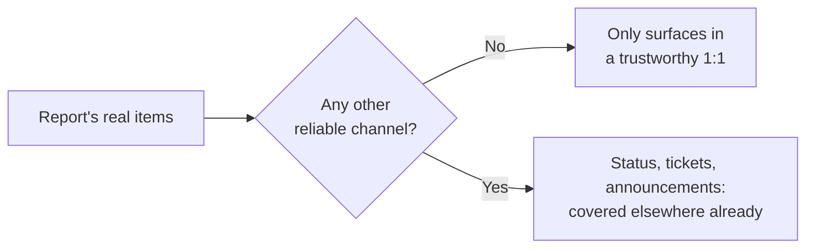
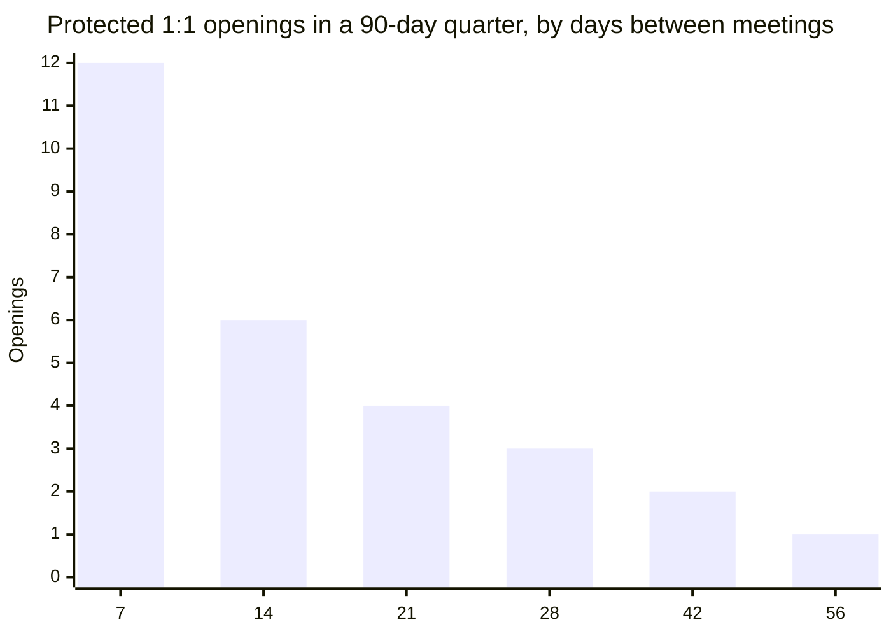

import Scenario from "../../../components/Scenario.astro";
import LevelIntro from "../../../components/LevelIntro.astro";
import PracticeCheck from "../../../components/PracticeCheck.astro";

export const unit = {
  track: "people-management",
  unitSlug: "one-on-one",
};

<Scenario label="The problem">
  <Fragment slot="facts">
    

      

        0 of 3
        real concerns raised
      

      

        

      

    

    
On the report's mind today

    

      
💭 Unsure where their role is heading

      
😬 A teammate's review comments feel harsh

      
😐 Answering "fine" in a flatter tone than usual

    

    
On the manager's list

    

      
📅 Friday deadline check-in

      
🎫 Stale ticket statuses

      
🗓️ Sprint planning moving to Tuesdays

    

  </Fragment>

A manager opens their weekly 1:1 with a direct report:

> "Hey, how's the migration project going? Are we still on track for Friday? ... Oh, and can you clean up those stale ticket statuses. Also, sprint planning's moving to Tuesdays. Cool — anything on your end?"

> "Nope, think that's it."

**Before reading on: this report has three real things on their mind today — where their role is heading, a teammate's review comments feeling harsher than warranted, and a flatter tone than usual. How many of those three make it into the conversation above?**

</Scenario>

Zero. Not because nothing real happened, and not because the report had nothing to say, but because nothing in the structure of that conversation made space for it.

<LevelIntro
  items={[
    "What a 1:1 covers that no other channel does",
    "Why the manager-led default squeezes the report out",
    "Why consistency decides whether the meeting gets used",
  ]}
/>

## What did the meeting cover, and what did it skip?

| What got covered                      | What never got said                                |
| ------------------------------------- | -------------------------------------------------- |
| Friday deadline (manager asked)       | Where the role is heading (report never got asked) |
| Ticket statuses (manager flagged)     | Review-comment friction (report never got asked)   |
| Sprint day change (manager announced) | The flat tone (nobody noticed or named it)         |

Every item on the left already has another home: a standup, a tracker, a team announcement. Every item on the right has none. That asymmetry is the whole point of a 1:1.

- **A 1:1's distinctive value** is what surfaces nowhere else: how someone is really doing, a blocker they have not escalated, feedback they are sitting on, how they see their own growth.
- **The default failure mode is the manager doing most of the talking.** Their own updates and asks fill the time, which inverts the purpose: it is the report's time, and the manager already has team meetings and written updates for pushing information downward.

<PracticeCheck
  track={unit.track}
  unitSlug={unit.unitSlug}
  topicId="unique-value"
/>

## What does a structure that works look like?

- **Start with the report's mind, not the manager's agenda.** Wins, blockers, how they are actually doing, anything they want to raise, and only then the manager's own topics.
- **Listen for what is not said.** "Everything's fine" in a flat tone is information; gently naming it ("you seem a bit off today") is part of the skill, not overstepping.
- **Ask a coaching question before supplying an answer.** "What have you considered?" is slower today and builds the report's own judgment for next time.

## Why does consistency matter as much as content?

A 1:1 that is repeatedly rescheduled signals, intended or not, that it is low priority, and a report will not save something real for a slot that might vanish. Cadence also sets how many protected openings exist at all. In a 90-day quarter, using one meeting per interval:

The numbers are floor(90 / days between meetings), the same formula as this unit's interactive demo. Each skipped meeting removes one of the few moments a concern could surface.

<PracticeCheck
  track={unit.track}
  unitSlug={unit.unitSlug}
  topicId="consistency-trust"
/>
