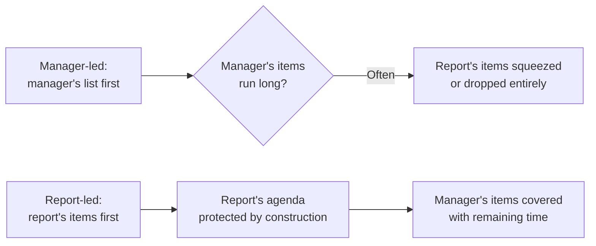
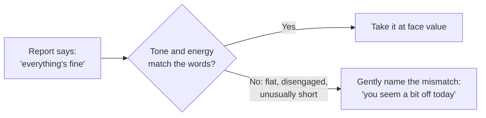

import Scenario from "../../../components/Scenario.astro";
import LevelIntro from "../../../components/LevelIntro.astro";
import Checkpoint from "../../../components/Checkpoint.astro";
import PracticeCheck from "../../../components/PracticeCheck.astro";

export const unit = {
  track: "people-management",
  unitSlug: "one-on-one",
};

<Scenario label="The tension">
  <Fragment slot="facts">
    

      

        25 / 30
        minutes on the manager's list
      

      

        

      

    

    

      
⏱️ 5 minutes left for "anything on your end?"

      
🎲 Whatever surfaces in that window gets rushed or dropped

    

  </Fragment>

A well-meaning manager runs a tight 30-minute 1:1: 25 minutes on their own list (project status, a few asks, a scheduling note), then, with five minutes left, "anything on your end?"

**If something real surfaces in that last five minutes, a hesitant concern the report has been sitting on for weeks, what usually happens to it?**

</Scenario>

Usually it gets a rushed, surface-level response, or a "let's pick this up next time" that quietly never happens. Not because the manager does not care, but because a five-minute leftover window was never built to hold something that took weeks to work up to saying.

<LevelIntro
  items={[
    "Manager-led vs. report-led agenda order",
    "Reading the gap between words and tone",
    "Coaching questions vs. supplying the answer",
  ]}
/>

## Is the five-minute squeeze bad luck, or structural?

It is structural. The manager already has other channels (team meetings, async updates, direct messages) for their own items, while the report's items (how they are actually doing, what they hesitate to escalate, thoughts on their own growth) often have no other reliable outlet. Putting the report's time first keeps the 1:1 from reverting to whichever agenda is more comfortable to lead with, which in practice is the manager's.

| What a 1:1 can cover                                         | Where else it already lives                      |
| ------------------------------------------------------------ | ------------------------------------------------ |
| Project status, ticket assignments, deadlines, announcements | Standup, tracker, team meeting, written updates  |
| How the person is doing, beyond "fine"                       | Nowhere reliable                                 |
| A blocker they have not escalated, and why not               | Nowhere reliable                                 |
| Feedback they are sitting on, about the manager or the team  | Nowhere reliable                                 |
| Where they want to grow                                      | Usually a review months away, if anywhere at all |

<Checkpoint question="A manager says: 'I always ask what's on their mind eventually. I just cover my own list first, then get to theirs.' Does that satisfy the structural point, since the report's items do get asked about either way?">

No. The point is not whether the question eventually gets asked, but whether real time and attention remain when it does. Covering the manager's list first means the report's items inherit whatever is left, which is exactly the five-minute squeeze from the opening. The fix is not adding the question; it is changing which list goes first, because that decides whether the report gets protected time or leftover time.

</Checkpoint>

<PracticeCheck
  track={unit.track}
  unitSlug={unit.unitSlug}
  topicId="report-first-agenda"
/>

## A report says "everything's fine." Does that settle it?

The words and the delivery are two separate signals. This is not mind-reading: it is noticing a real, observable mismatch between what is said and how it is said.

A mismatch earns a gentle, low-pressure check rather than being ignored or met with assumed disaster. The report keeps full control over how much to share; the manager's job is making the door visibly open, not forcing it.

<Checkpoint question="A report answers 'how are things?' with a short, matter-of-fact 'fine, busy week', with the same energy they usually bring, just terse phrasing. Does the mismatch principle call for a check-in here too?">

No. The principle concerns a gap between words and delivery, and there is none here: terse-but-matched is simply this report's normal register. Treating every short answer as a red flag misapplies the idea and makes the report feel monitored for tone rather than heard. The check-in is warranted when the delivery contradicts the words, not whenever the words are brief.

</Checkpoint>

<PracticeCheck
  track={unit.track}
  unitSlug={unit.unitSlug}
  topicId="listening-mismatch"
/>

## A report says they are stuck. Does helping mean answering fast?

Take a report who says: "I'm stuck on how to handle this API's inconsistent rate limiting."

| Response style | What the manager says                                                                    | Short-term effect   | Next similar problem                       |
| -------------- | ---------------------------------------------------------------------------------------- | ------------------- | ------------------------------------------ |
| Answer-first   | "Just add exponential backoff with jitter, here's the pattern."                          | Fast, maybe correct | Comes straight back to the manager         |
| Coaching-first | "What have you already tried, and what makes you think those approaches aren't working?" | Slower this time    | The report has a way to start on their own |

The answer-first response may even be correct, but the report never had to develop an approach, so the next problem returns to the manager. The coaching-first response costs time now and builds the report's own problem-solving for later. It is the same trade-off `people-management/ic-excellence-management` describes (letting someone struggle productively vs. solving it for them), applied to the setting where it happens most often.

Coaching is a tool for problems, not for every question. A report who asks what the team's policy on something is has a factual gap, and a direct answer respects their time.

<PracticeCheck
  track={unit.track}
  unitSlug={unit.unitSlug}
  topicId="coaching-vs-answer"
/>
