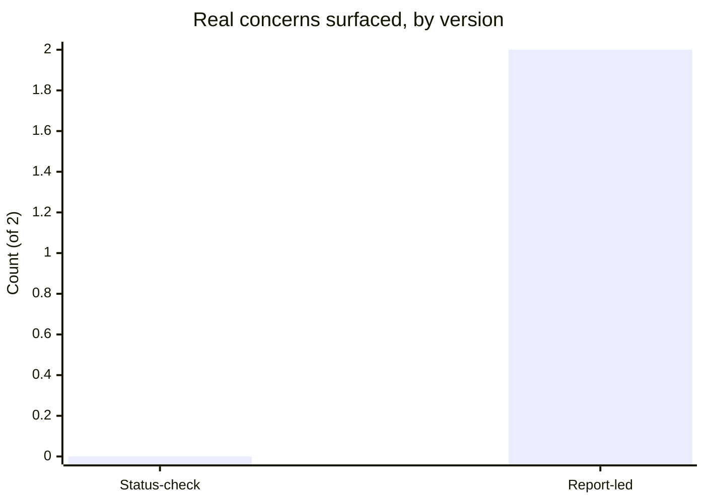

import Scenario from "../../../components/Scenario.astro";
import LevelIntro from "../../../components/LevelIntro.astro";
import Checkpoint from "../../../components/Checkpoint.astro";
import PracticeCheck from "../../../components/PracticeCheck.astro";

export const unit = {
  track: "people-management",
  unitSlug: "one-on-one",
};

<Scenario label="The scenario">
  <Fragment slot="facts">
    

      

        0 of 2 → 2 of 2
        real concerns raised, by version
      

      

        

      

    

    
The report is carrying

    

      
💭 Unclear sense of where their role is heading

      
😬 A teammate's review comments feel harsher than warranted, unescalated

    

    
Structure being compared

    

      
📋 Version 1: manager's list first, "anything on your end?" last

      
🙋 Version 2: report's items first, six months later

    

  </Fragment>

A report has been quietly struggling with an unclear sense of where their role is heading, and has a real, unescalated concern about a teammate's code review comments feeling harsh. Two 1:1 structures handle the exact same underlying situation.

**Same report, same two concerns, same manager, six months apart: the only thing that changes is agenda order. Does that alone predict how much surfaces?**

</Scenario>

<LevelIntro
  items={[
    "Two agenda orders, side by side",
    "What changes when the structure flips",
    "Failure modes that undo the fix",
  ]}
/>

## The status-check version

> **Manager:** "Hey, how's the migration project going? Are we still on track for the Friday deadline?"
>
> **Report:** "Yeah, should be fine. Almost done with the data layer piece."
>
> **Manager:** "Great. Oh, and I wanted to flag: can you update the ticket statuses, a few are stale. Also, heads up, we're moving sprint planning to Tuesdays starting next week."
>
> **Report:** "Sure, got it."
>
> **Manager:** "Cool, anything on your end?"
>
> **Report:** "Nope, I think that's it."

A closing "anything on your end" after the manager's own list is not a real invitation. It reads, correctly, as "wrapping up," not "I have protected time for whatever is on your mind." The report's concerns never surface, not because they were not real, but because nothing in the structure made space for them.

## The report-led version, six months later

> **Manager:** "Before we get into anything from my side, what's on your mind this week? Doesn't have to be work-related."
>
> **Report:** "Actually, yeah. I'm not totally sure where my role is heading. I feel like I'm doing similar work to a year ago and I'm not sure if that's fine for now or something I should worry about."
>
> **Manager:** "That's a real thing to raise, thanks for saying it directly. What would 'heading somewhere' look like to you: more scope, a different kind of work, something else?"
>
> **Report:** "Probably more ownership over a whole area, not just executing tickets someone else scoped."
>
> **Manager:** "Okay, let's think through what that could look like concretely, maybe starting with an upcoming project. Anything else on your mind before I go into my list?"
>
> **Report:** "One more thing, a little awkward: some of a teammate's recent review comments have felt harsher than the issues warrant. I haven't said anything to them directly."
>
> **Manager:** "I appreciate you telling me. Do you want me to just be aware of it for now, or would it help to think through how you might raise it with them first?"

Both concerns surface because the structure asked first, with real room, before any manager item competed for the time. The manager's coaching questions ("what would that look like", "do you want me aware, or to think through raising it yourself") kept ownership of both situations with the report.

## What actually differs, side by side?

**Both conversations are polite and both managers seem attentive. What measurable thing is different?**

| &nbsp;                      | Status-check version                           | Report-led version                                |
| --------------------------- | ---------------------------------------------- | ------------------------------------------------- |
| **First question asked**    | "How's the migration going?" (manager's topic) | "What's on your mind this week?" (report's topic) |
| **Report's real concerns**  | 0 of 2 raised                                  | 2 of 2 raised                                     |
| **"Anything on your end?"** | Closing formality, after the list is done      | Not needed: the report's turn came first          |
| **Manager's own items**     | Fully covered                                  | Still fully covered, just afterward               |

Agenda order is the single change that flips the outcome from 0 to 2 here. That does not prove it is the only thing that matters; the failure modes below cover what else has to hold.

<Checkpoint question="The manager's own items get fully covered in both versions. If nothing was lost by reordering, what was actually gained by putting the report's agenda first?">

Nothing on the manager's list changed in outcome. What changed is which items got unhurried attention and which got whatever time was left over. In the status-check version the report's concerns got the leftover slot and surfaced zero of two; in the report-led version they got the protected slot and surfaced both. Reordering cost the manager's list nothing and gained two concerns that would otherwise have gone unraised, so it is a free structural change, not a trade-off over whose items matter more.

</Checkpoint>

## Is it trust or structure that changed?

The report is the same person with the same concerns in both versions, so their willingness to speak up did not change. What changed is whose agenda came first and whether "anything on your end" was a genuine opening or a closing formality. The six months are not mainly about gradually built trust: applying the structure from the very first report-led 1:1 would very plausibly have surfaced both concerns right away in this relationship.

<Checkpoint question="The comparison suggests structure alone would 'very plausibly' have surfaced both concerns immediately. Does that mean trust does not matter to whether a report opens up?">

No. Trust still matters generally. What the comparison isolates is that structure was sufficient for this relationship, which already had six months of working rapport; reordering removed a structural obstacle unrelated to trust. It does not claim structure suffices everywhere, and the failure modes below cover cases (a newer report, a manager who disengages once the agenda is reordered) where structure alone stops being enough.

</Checkpoint>

## What undoes the fix?

| Failure                                                         | What it looks like                                                                                                    | The fix                                                                  |
| --------------------------------------------------------------- | --------------------------------------------------------------------------------------------------------------------- | ------------------------------------------------------------------------ |
| Adopting the structure, not the mindset                         | Manager reorders the agenda but visibly disengages once the report's items feel "resolved enough"; the report notices | Stay present through the report's items, not just by agenda order        |
| Over-applying coaching questions                                | Report asks what the team's policy on X is (a factual gap) and gets a coaching question back                          | Match the tool to the question: factual gaps need direct answers         |
| Letting the meeting become inconsistent once it feels routine   | Rescheduling or shortening 1:1s when no urgent item seems pending                                                     | Treat the recurring slot as the point, not just that week's contents     |
| Assuming one good 1:1 fixes an established status-check pattern | Report still gives guarded, minimal answers after a single reordered meeting                                          | Earned trust takes repetition, even when the structural fix is immediate |

**Before moving on: if the manager in the report-led version had visibly checked the time once the career-direction topic felt wrapped up, would the review-tone concern likely have surfaced at all?** Probably not. Agenda order does not do the work if attentiveness is not genuine throughout, not just at the opening question.

<PracticeCheck
  track={unit.track}
  unitSlug={unit.unitSlug}
  topicId="structure-failure-modes"
/>

## Beyond this example

The report-led 1:1 above is one case, not the whole territory. A few questions to test whether the structural point transferred, not just the dialogue:

- What would change if the report's concern were something the manager could not fix or influence at all, such as a personal circumstance affecting availability? Does "protecting their agenda time" mean something different when there is nothing to coach toward?
- What if the report were newer, with less established trust than the report here? Would you expect the first report-led 1:1 to surface something this substantial, or does the "trust builds gradually" point predict a slower opening?
- If a report keeps using their protected time only for status updates even when genuinely invited to raise anything, what does that suggest is still missing, given that structure alone was supposed to be sufficient?
