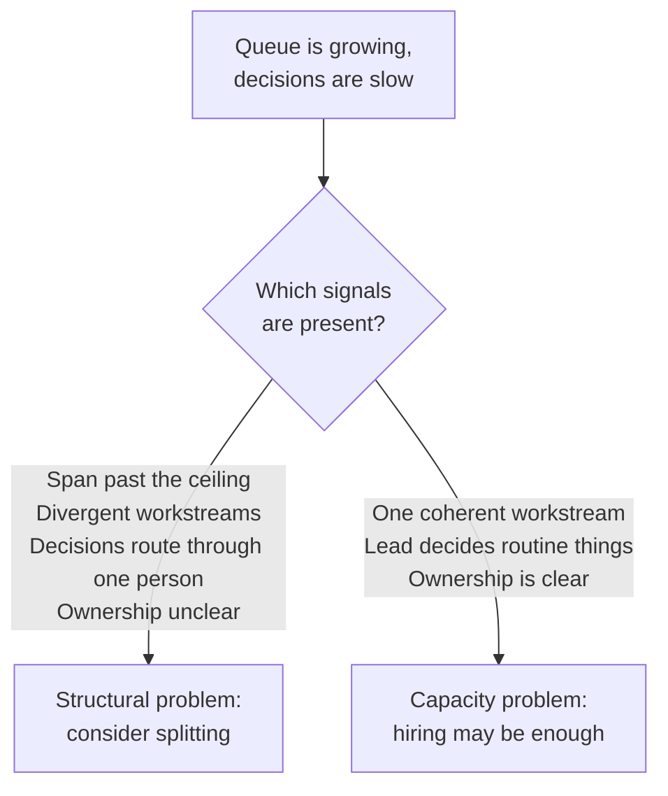

import Scenario from "../../../components/Scenario.astro";
import LevelIntro from "../../../components/LevelIntro.astro";
import PracticeCheck from "../../../components/PracticeCheck.astro";

export const unit = { track: "people-management", unitSlug: "org-design" };

<Scenario label="One team, eleven reports, and a decision queue that keeps growing">
  <Fragment slot="facts">
    

      

        

          <strong>1:1 minutes per report</strong> (180 min/week budget)
          16 of 36 min
        

        

          

        

      

      
👥 <strong>Direct reports</strong> — 11, up from 5 a year ago

      
🧩 <strong>Divergent workstreams</strong> — payments and search, both blocked on the same reviewer

      
🐌 <strong>Decision latency</strong> — a day, a year ago; a week, now

    

  </Fragment>

Priya has managed the same team for a year. It started at 5 engineers
and now stands at 11 — no reorg, just steady hiring against a growing
roadmap. Her weekly 1:1 budget hasn't changed: 3 hours, split across
however many reports she has. A year ago that was 36 minutes per
person. Now it's 16. Every payments feature and every search feature
still gets reviewed by her personally, so both workstreams wait in the
same queue behind whichever came first. A decision that used to take a
day now takes a week — not because anyone got slower, but because
everything still routes through one person. **Priya could hire two
more engineers this quarter. Would that fix the problem, or make it
worse?**

</Scenario>

Hiring feels like the obvious lever, because the roadmap really does need
more hands. But the queue is not a shortage of hands. It is a shortage of
places where decisions can be made. This unit is about telling those two
problems apart.

<LevelIntro
  items={[
    "Span of control and its ceiling",
    "Signals that say split, not just hire",
    "Team shapes and the Conway link",
  ]}
/>

## What is actually being stretched as the team grows?

**If Priya works longer hours, does the 16-minute 1:1 go back to 36?** No. The pool is fixed, so only the count of people dividing it matters.

| Direct reports | Minutes per report (180 ÷ reports) |
| -------------- | ---------------------------------- |
| 5              | 36                                 |
| 8              | 22.5                               |
| 11             | about 16                           |
| 20             | 9                                  |

- **Span of control** is the number of people who report directly to one
  manager. Past a rough ceiling, the quality of 1:1s, context on each person's
  work, and decision speed all degrade. Commonly quoted ceilings for
  hands-on technical management sit around 6 to 8, but that is a rule of
  thumb, not a law.
- Hiring into an over-stretched span does not fix the structure. It gives
  the same bottleneck more people to queue behind.

<PracticeCheck
  track={unit.track}
  unitSlug={unit.unitSlug}
  topicId="span-of-control"
/>

## How do you know a team should split rather than just hire?

**Is headcount the whole test?** No. It is the easiest signal to see, but not the only one.

- **Communication overhead** grows faster than headcount: the number of
  possible pairs inside a team of n people is $$n(n-1)/2$$. Doubling a team
  more than doubles its coordination paths.
- **Splitting a team** means dividing it into two or more teams, each with
  its own lead and a clear ownership boundary.

<PracticeCheck
  track={unit.track}
  unitSlug={unit.unitSlug}
  topicId="split-signals"
/>

## What shapes can the resulting teams take?

**Once you split, does it matter where the line falls?** Yes. The line decides what becomes easy and what stays hard.

| Team topology        | Grouped by                        | Typical trade-off                                         |
| -------------------- | --------------------------------- | --------------------------------------------------------- |
| Functional           | Discipline (all backend together) | Deep skill mentoring, but features need handoffs          |
| Cross-functional pod | Outcome or product area           | End-to-end ownership, but thinner bench per discipline    |
| Platform             | A capability other teams consume  | Leverage for others, but its customers are internal teams |

- **Conway's Law**: organizations design systems that mirror their own
  communication structure, so the org chart and the software tend to
  converge whether or not anyone plans it.

<PracticeCheck
  track={unit.track}
  unitSlug={unit.unitSlug}
  topicId="team-shapes"
/>

## What does L3 add?

L2 works out the signals and the shape trade-offs. L3 follows Priya's team
from 5 to 20 people over 18 months: choosing the split line, picking leads,
running the transition, and facing the same ceiling a second time inside one
of the new pods.
