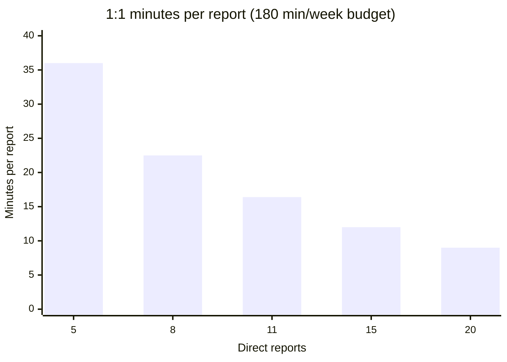
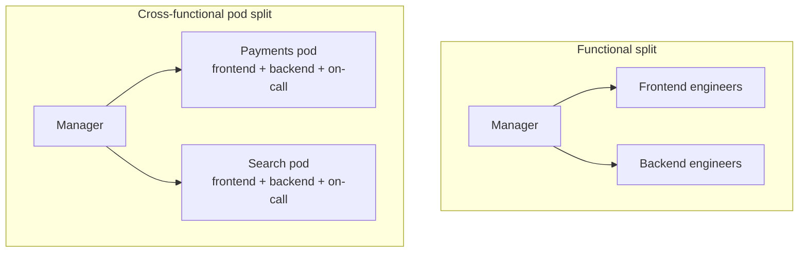
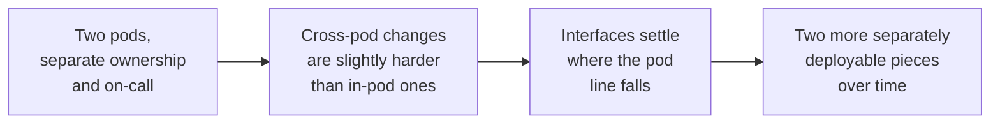

import LevelIntro from "../../../components/LevelIntro.astro";
import Checkpoint from "../../../components/Checkpoint.astro";
import PracticeCheck from "../../../components/PracticeCheck.astro";

export const unit = { track: "people-management", unitSlug: "org-design" };

L1 showed the symptom: Priya's 1:1 time per report fell from 36 minutes to
16 as her team grew from 5 to 11, and decisions that took a day now take a
week. L2 works out why that happens mechanically, which signals justify a
split rather than more hiring, and how the shape of the split changes the
software the teams build.

<LevelIntro
  items={[
    "Why the span ceiling is arithmetic",
    "Coordination links and decision routing",
    "Team shapes and Conway's Law",
  ]}
/>

## Why does span of control have a real ceiling?

**Priya did not get worse at her job, so why did every report's 1:1 time shrink?** Her weekly 1:1 budget is fixed at 180 minutes, and a fixed pool divides across however many people share it.

At 5 reports there is room for a stuck problem, a career question, and
slack. At 11 there is barely room for a status check. Nothing about Priya
changed; the division did. The ceiling shows up as a quieter symptom too:
when 1:1s are too short to coach, decisions quietly pile up on the manager
instead.

**Does anyone above 6 to 8 reports fail?** Not automatically. Roles that need little day-to-day coaching can sustain a wider span. The figure is a rule of thumb for hands-on technical management, where 1:1s, review, and unblocking all compete for the same hours.

<Checkpoint question="Priya freezes hiring at 11 reports and changes nothing else. Does the underlying problem go away?">

No. Freezing stops the ratio from getting worse, but 16 minutes stays 16
minutes and every decision still routes through her. The fix has to change
the structure, meaning who reports to whom and who decides what, not just
the growth rate.

</Checkpoint>

## Which signals say split, beyond the headcount number?

**Would a strict rule such as "split at 8 reports" always be right?** No. A team can be in real trouble below the number, or fine above it.

| Signal                          | What it looks like in practice                                                                 |
| ------------------------------- | ---------------------------------------------------------------------------------------------- |
| Span ceiling breached           | 1:1 time and review turnaround degrade although the manager is not slacking                    |
| Genuinely divergent workstreams | Two areas have different stakeholders, roadmaps, and failure modes but share one reviewer      |
| Decision bottleneck             | Nearly every non-trivial decision routes through one person, whoever is closest to the problem |
| Diffuse or absent ownership     | After an incident nobody can say with confidence, "this is mine to fix"                        |
| Onboarding drag                 | New hires ramp slowly because one manager cannot hand off that much surface area of context    |

Coordination cost also grows faster than headcount. The number of possible
pairs among n people is $$n(n-1)/2$$:

| Team size | Possible pairs |
| --------- | -------------- |
| 5         | 10             |
| 10        | 45             |
| 11        | 55             |
| 20        | 190            |

Two pods of 10 hold 45 + 45 = 90 pairs inside them, against 190 for one
team of 20. Pairs are a proxy, since not everyone talks to everyone, but the
direction is the point: size makes coordination expensive faster than it
makes capacity.

## Functional teams, cross-functional pods, and platform

**Once a team decides to split, does the line matter?** Yes. It decides what gets easier and what stays hard.

|          | Functional (by discipline)                                | Cross-functional pod (by outcome)                    |
| -------- | --------------------------------------------------------- | ---------------------------------------------------- |
| Strength | Deep skill mentoring; consistent standards within a craft | End-to-end ownership; fast decisions inside the pod  |
| Weakness | Shipping one feature needs handoffs across teams          | Thinner bench per discipline; standards can drift    |
| Best fit | Small teams, or work with heavy discipline-specific depth | Clearly separable product areas or customer outcomes |

A **platform team** is a third option: it provides a capability, such as an
internal deploy pipeline, that other teams consume. Its customers are other
engineers, so its success is measured by how much faster they move.

<PracticeCheck
  track={unit.track}
  unitSlug={unit.unitSlug}
  topicId="team-shapes"
/>

## Conway's Law: the org chart becomes the architecture

**Does splitting Priya's team change only who reports to whom?** It changes the software too, whether anyone intends it or not. Systems end up structured like the communication structure of the organizations that build them.

<Checkpoint question="Priya splits into a payments pod and a search pod, but both keep editing one tightly coupled shared module every day. Has the split delivered its benefit?">

Only partly. The chart shows two teams, but the code still forces them to
negotiate every change to the shared module, so the coordination cost the
split was meant to remove has only been relabeled. Conway's Law cuts both
ways: the org split and the system boundary need to move together.

</Checkpoint>

<PracticeCheck
  track={unit.track}
  unitSlug={unit.unitSlug}
  topicId="conways-law"
/>

## The generalizable lesson

Span, divergent workstreams, and decision bottlenecks apply to any
people-facing structure: a sales team, a support team, or a design team hit
the same arithmetic once one manager's fixed attention stretches across too
many people or too many different problems. L3 shows how to act on these
signals, using Priya's team as it keeps growing past this point.
