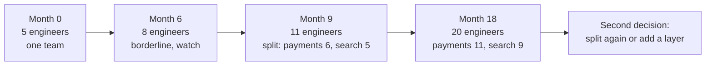

import Scenario from "../../../components/Scenario.astro";
import LevelIntro from "../../../components/LevelIntro.astro";
import Checkpoint from "../../../components/Checkpoint.astro";
import PracticeCheck from "../../../components/PracticeCheck.astro";

export const unit = { track: "people-management", unitSlug: "org-design" };

<Scenario label="The same team, 18 months later, hitting the same ceiling twice">
  <Fragment slot="facts">
    

      
📅 <strong>Month 0</strong> — 5 engineers, 1 manager, one functional team

      
📅 <strong>Month 9</strong> — 11 engineers, span breached, split into 2 pods

      
📅 <strong>Month 18</strong> — 20 engineers; the payments pod alone is back at 11

    

  </Fragment>

**Before reading further, predict: at month 18 the payments pod's lead has 11 direct reports, the exact number that forced Priya's own split nine months earlier. Does the same fix apply a second time, or does something change now that a layer of management already sits in between?**

</Scenario>

Keep the prediction in mind. The story below is one worked case, chosen so
the arithmetic repeats; the choices around it are where the real judgment is.

<LevelIntro
  items={[
    "Choosing a split line by domain",
    "Transition mechanics that make it stick",
    "Why one split is rarely the last",
  ]}
/>

## Month 0 to 6: one team, functional, and still fine

At 5 engineers Priya runs one functional team: everyone reports to her,
work goes to whoever has capacity, and review rotates informally. 1:1s run
36 minutes, decisions close the same day, and shared context substitutes
for formal ownership. By month 6 headcount is 8, so 1:1s are 22.5 minutes.

**Is there already a signal to split at month 6?** Span is borderline and ownership is still mostly clear; the divergent-workstreams signal is present but weak. This is a legitimate "not yet", provided it is actively watched.

## Month 9: the ceiling breaks and the decision gets made

At month 9 the team is 11, so 180 ÷ 11 gives about 16 minutes per report.
Payments and search are now different workstreams with different
stakeholders and failure modes, yet every non-trivial call still goes to
Priya. Three of the five signals are present: span ceiling, divergent
workstreams, and decision bottleneck. She decides to split.

<Checkpoint question="Could Priya instead have appointed an assistant manager who takes some 1:1s but reports combined status back to her, leaving the team otherwise unchanged?">

That relieves the 1:1 symptom but not the cause. Ownership of payments
versus search was never separated, so decisions still route through Priya,
one layer removed. The fix has to give someone real decision authority over
a bounded piece of work, not just redistribute meeting time.

</Checkpoint>

## Choosing the split line: domain, not headcount

**Priya could split 11 into 5 and 6 arbitrarily to balance numbers. Would that work as well as splitting along payments and search?** No. Coordination cost tracks who must talk to whom to get a decision made, not how evenly the roster divides.

| Split approach                  | What happens afterward                                                                             |
| ------------------------------- | -------------------------------------------------------------------------------------------------- |
| Even headcount (arbitrary 5/6)  | Both pods still mix payments and search work, so decisions cross a pod boundary as often as before |
| Domain line (payments / search) | Each pod owns a coherent area end to end, so most decisions stay inside one pod                    |

She splits by domain: a payments pod of 6 and a search pod of 5.

## Picking leads

Each pod needs a lead with real decision authority, not just a bigger title.
Priya weighs each internal candidate on two criteria: depth in that domain,
and evidence that others already route decisions to them. Both leads she
picks were already the informal point of contact, so the split formalizes an
existing pattern rather than inventing authority. She considered an outside
hire for the search lead but judged that someone needing months of context
could not make confident calls from day one.

## Transition mechanics: what has to happen

A split announced in a meeting and a split that works are different things.
Priya runs the handoff over four weeks:

1. A written ownership doc per pod naming its services, on-call rotation,
   and stakeholder relationships, signed off by both new leads before the
   split takes effect.
2. A short monthly check-in with Priya for each engineer during the first
   month, alongside the new lead's weekly 1:1, so the handoff is not a hard
   cutoff.
3. New pod-level on-call rotations starting two weeks before the combined
   rotation ends, so an incident in the gap has two people who know what is
   happening.
4. The code-ownership file updated the same day as the announcement, so
   review routing and incident paging match the new boundary immediately.

<Checkpoint question="Priya delays the code-ownership update until things settle a few weeks later. What is the concrete risk in the meantime?">

Review requests and incident pages keep routing by the old ownership,
likely straight back to Priya or whoever last touched the code, regardless
of pod. That recreates the original bottleneck informally: the chart says
split while the tooling says one team, and the tooling decides who is paged
at 2am.

</Checkpoint>

<PracticeCheck
  track={unit.track}
  unitSlug={unit.unitSlug}
  topicId="split-boundary"
/>

## Month 18: the payments pod hits the same ceiling

Payments grows faster than search: fraud and regional payment methods pull
in five more engineers (6 to 11), while search gains four (5 to 9). At month 18 the payments lead sits exactly where Priya was at month 9, with the same 16-minute arithmetic. The difference is that a management layer now sits between that lead and Priya, who manages leads rather than individual engineers.

The diagnosis repeats; the fix has a new option. Either split payments again along a further domain line, such as core payments and fraud and risk, or keep one pod and add a second layer of leadership under its lead. Which is right depends on whether payments has a real, separable sub-domain boundary, or is one coherent domain that simply grew large.

**Extend it: suppose both pods depend on a shared risk-scoring module that neither owns and both change weekly. Does the month 9 domain split still hold up cleanly, or does the shared dependency bring back the coordination cost? Does your answer change if the module is small and rarely touched, versus large and touched by both pods every week? And what would change if the news were different, for example payments shrinking instead of growing?** This unit followed one case, not the whole territory: your own team's pressures, existing leaders, and codebase will move the right answer.

## Trade-offs and failure modes

| Failure mode                                                      | What it gets wrong                                                                                   |
| ----------------------------------------------------------------- | ---------------------------------------------------------------------------------------------------- |
| Splitting purely by headcount, ignoring domain                    | Both teams still cross-coordinate on the same decisions; the split reduces nothing                   |
| Splitting before real signals appear, on anticipated growth alone | Fragments a team that still benefits from shared context; each pod is too thin to be self-sufficient |
| Announcing a split without a lead who has real authority          | Decisions still bottleneck on the original manager; the chart changed, the routing did not           |
| Leaving the codebase unchanged after an org split                 | Conway's Law works against you; the coordination cost returns through shared code                    |
| Treating one split as permanent                                   | A pod that keeps growing hits the same ceiling again; org design is a recurring decision             |

<PracticeCheck
  track={unit.track}
  unitSlug={unit.unitSlug}
  topicId="recurring-splits"
/>
