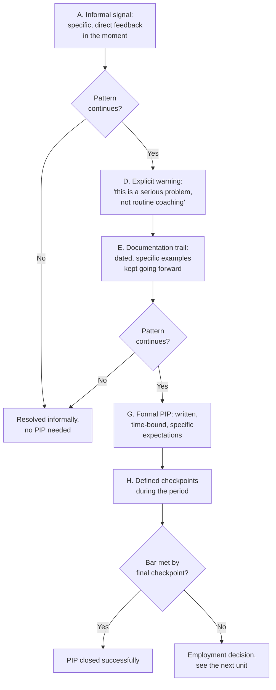

import LevelIntro from "../../../components/LevelIntro.astro";
import Checkpoint from "../../../components/Checkpoint.astro";
import PracticeCheck from "../../../components/PracticeCheck.astro";

export const unit = {
  track: "people-management",
  unitSlug: "performance-improvement-plans",
};

L1 named the no-surprises principle and the documentation trail as the two things
a fair PIP depends on, without showing how they fit together in order. L2 works
through the full sequence, from the first informal signal to the final
checkpoint, and exactly where the Scenario's manager fell off it.

<LevelIntro
  items={[
    "The full sequence from signal to final checkpoint",
    "Why documentation has to predate the formal PIP",
    "What makes a PIP goal specific enough to be fair",
  ]}
/>

## What has to happen before a PIP?

**The manager genuinely believed the problem was real and even mentioned it once.
So why is "nobody told me" a fair complaint, and what should have happened
instead?** A gentle "let's try to hit deadlines more consistently" is what a
manager says as routine coaching. It does not say "this could cost you your job."
The report is describing an honest gap between what was said and what was meant.

The Scenario's manager did step A and skipped step D: the mention was never
framed as "this is serious," so the report filed it under routine coaching.
Everything downstream depends on D having happened and having been
_understood_, not merely said.

<Checkpoint question="A manager gave a vague heads-up in a 1:1 (step A) and the pattern has continued. Is the manager now ready to start the documentation trail, or is something else missing first?">

Something is still missing: the explicit warning. The sequence does not move from
an informal signal straight to documentation. The report has to hear, in plain
terms, that this has crossed from coaching into a serious problem that puts
their role at risk. Starting the trail first just produces a well-dated record of
a process the report was never told was underway, which fails the no-surprises
principle as surely as having no record. The manager goes back, delivers the
warning, and builds the trail forward from there.

</Checkpoint>

<PracticeCheck track={unit.track} unitSlug={unit.unitSlug} topicId="sequence" />

## Why does documentation start before the PIP, not with it?

**If the manager begins writing things down the day the PIP is decided, what is
still missing?** Context. A PIP resting on two weeks of evidence gathered right
as it starts reads as sudden or retaliatory, even when the pattern is months old.
A trail that starts at the explicit warning and runs for weeks before the plan
makes the PIP look like the next step in an established pattern.

| What is documented                                               | Why it matters at PIP time                                          |
| ---------------------------------------------------------------- | ------------------------------------------------------------------- |
| Dated, specific examples ("missed the Mar 3 deadline by 4 days") | Turns "performance felt like it was slipping" into a factual record |
| The explicit-warning conversation itself                         | Shows the no-surprises principle was met, not just intended         |
| Any context the report raised                                    | Shows the process considered the report's side too                  |

<PracticeCheck
  track={unit.track}
  unitSlug={unit.unitSlug}
  topicId="doc-trail"
/>

## What makes a PIP goal fair to evaluate?

**At the final checkpoint, what separates a clear verdict from a second round of
the Scenario's argument?** Goals stated so concretely that meeting them is a
factual question. A vague goal moves the disagreement from the present to the
checkpoint and makes it the same size.

| Vague goal (avoid)                 | Specific, observable goal (use instead)                                                                    |
| ---------------------------------- | ---------------------------------------------------------------------------------------------------------- |
| "Be more thorough in code review"  | "Leave at least one substantive comment on 90% of assigned PRs, checked weekly"                            |
| "Communicate better with the team" | "Post a written status update in the team channel every Friday for 6 consecutive weeks"                    |
| "Improve overall performance"      | "Ship the two agreed features by their stated dates, with no more than one missed intermediate checkpoint" |

<Checkpoint question="A PIP states the goal 'communicate better with the team.' At the final checkpoint the manager says it was not met and the report disagrees. Whose problem is that disagreement, given what specificity is supposed to prevent?">

It is the plan's problem, and the manager owns it. A goal like "communicate better"
was never stated as a checkable condition, so there is no shared fact for either
side to point to. The checkpoint becomes a second round of the same subjective
judgment that made the Scenario unfair. Specificity moves the question from "do we
agree this got better" to "was the update posted every Friday for six weeks,"
which has one answer no matter who asks. A vague goal also leaves the manager
without a defensible position if the outcome is ever challenged.

</Checkpoint>

<PracticeCheck
  track={unit.track}
  unitSlug={unit.unitSlug}
  topicId="specific-expectations"
/>

## Failure modes at this level

- **Treating a vague mention as if it satisfied the no-surprises principle.**
  Satisfying it requires the report to have understood the stakes, not just to
  have heard words that could be read that way in hindsight.
- **Starting the documentation trail only when the PIP begins.** This is what
  makes a justified PIP look sudden or retaliatory.
- **Writing goals the manager can move.** A vague goal is unfair to the report
  and leaves the manager with no clean answer at the final checkpoint.
