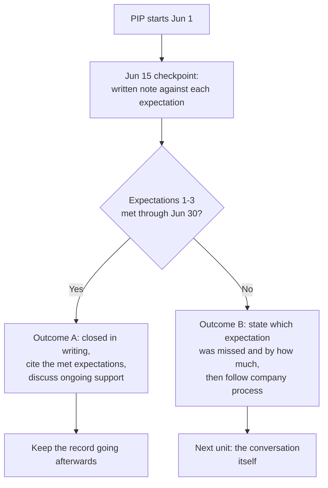
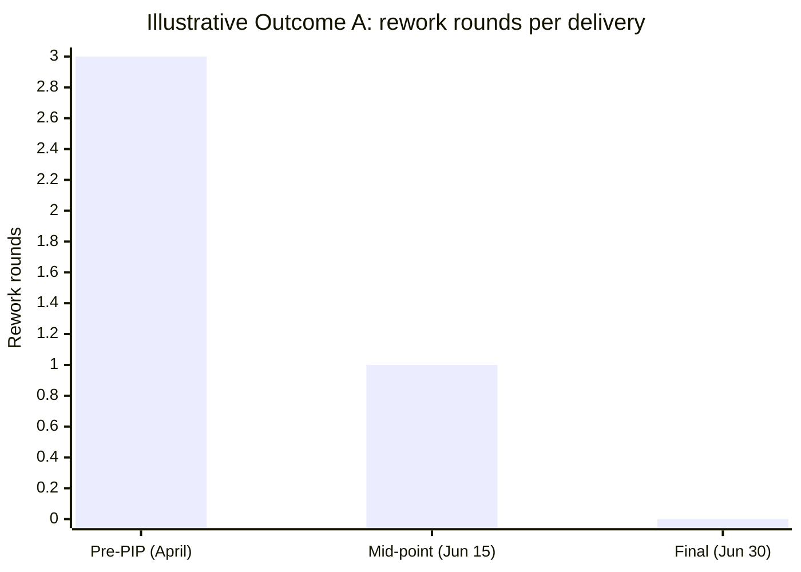

import Scenario from "../../../components/Scenario.astro";
import LevelIntro from "../../../components/LevelIntro.astro";
import Checkpoint from "../../../components/Checkpoint.astro";
import PracticeCheck from "../../../components/PracticeCheck.astro";

export const unit = {
  track: "people-management",
  unitSlug: "performance-improvement-plans",
};

<Scenario label="The scenario">
  <Fragment slot="facts">
    

      
⚠️ <strong>Mar 7</strong> and <strong>May 20</strong> — releases missed by 4 and 6 days

      
🔁 <strong>Apr 29</strong> — dashboard delivered, QA found it needed a full rework

      
🗣️ <strong>May 22</strong> — the explicit warning, finally given

      
📄 <strong>Jun 1 to Jun 30</strong> — a 30-day plan, checkpoint on Jun 15

    

  </Fragment>

Same manager and report as L1 and L2, with dates attached. The explicit-warning
step was skipped, the pattern ran two quarters, and the report says nobody
told them. L3 repairs the missing step, builds the documentation trail, writes
the PIP, and follows both outcomes at the final checkpoint. All names, dates and
numbers are fictional.

**Before reading on, predict: which single piece of the record would the report
challenge first, and would they be right to?**

</Scenario>

<LevelIntro
  items={[
    "The repair conversation and a two-sided record",
    "A written PIP with specific, checkable expectations",
    "Both outcomes at the final checkpoint, and a real dispute",
  ]}
/>

## Repairing the missing step

**The manager skipped the explicit warning. Is it too late to run a fair
process?** No, but the manager must go back and do it properly before a PIP can
start. A dedicated conversation, not a 1:1 aside, says plainly:

> "I want to talk directly about something I should have raised more clearly
> before now. Over the last two quarters, deadlines were missed on the March and
> May releases, and the April dashboard project needed a full rework after
> delivery. I haven't been clear enough that this is a serious problem, not
> routine feedback, and I need to be clear now: if this pattern continues, it
> puts your role here at risk. I want to help you turn it around, and the next
> step is a formal, written plan with specific goals and checkpoints."

**Why before any document exists?** The written PIP should formalize something
already understood, not deliver the news. Confirming out loud that the report
understands the stakes is what finally satisfies the no-surprises principle.

## The record, made two-sided

After the conversation the manager starts a dated record and backfills only what
can be honestly reconstructed:

| Date   | Example                                                                |
| ------ | ---------------------------------------------------------------------- |
| Jan 14 | March release date discussed; report agreed to the timeline            |
| Mar 7  | Release missed by 4 days; report cited unclear requirements            |
| Apr 2  | Requirements clarified in writing before work started (manager's step) |
| Apr 29 | Dashboard delivered; QA found it needed a full rework                  |
| May 20 | Second release missed by 6 days                                        |
| May 22 | Direct conversation above; explicit warning given                      |

**Does the report's Mar 7 explanation matter?** Yes, and the record keeps it
rather than hiding it. The Apr 2 clarification removes that explanation for the
later misses. A trail listing only failures, with none of the manager's own
corrective steps, shows the failures but not that the process was fair.

<Checkpoint question="The record includes the manager's own Apr 2 corrective step, not only the report's misses. Why does that make the eventual PIP more defensible?">

A one-sided record reads as building a case rather than genuinely trying to
help. By recording Apr 2, the trail answers the Mar 7 explanation directly: it
shows the excuse was taken seriously and addressed, so a similar miss after that
date can no longer be blamed on the same cause. That turns the record from a
list of grievances into evidence that the process treated both sides fairly,
which is what keeps the PIP that follows from looking retaliatory.

</Checkpoint>

<PracticeCheck
  track={unit.track}
  unitSlug={unit.unitSlug}
  topicId="two-sided-record"
/>

## The written plan

> **Performance Improvement Plan, [Report], effective June 1, 30-day period**
>
> **Areas of concern:** Missed release deadlines (March, May) and delivered
> work requiring full rework (April), continuing after requirements clarity was
> addressed on April 2.
>
> **Expectations for this period:**
>
> 1. Ship the June 15 release on or before its stated date.
> 2. No delivered work item requires more than one round of QA rework before
>    acceptance.
> 3. Flag any at-risk timeline at least 3 business days before the deadline, in
>    writing, rather than at the deadline itself.
>
> **Checkpoints:** Weekly 1:1 status review; a formal mid-point check-in on
> June 15; a final review on June 30.
>
> **Support provided:** Manager will pre-review requirements documents before
> work starts; pairing available on request.
>
> **Outcome:** Meeting all three expectations through June 30 closes this PIP
> successfully. Not meeting them may lead to further action, up to the end of
> employment, in line with company policy.

**Do the three expectations pass L2's specificity test?** Yes. Each has a
factual yes/no answer at the checkpoint (did the release ship on time, how many
rework rounds, was the risk flagged 3 business days out or not). Notice also the
plan lists the _support_ the manager commits to; a plan with demands and no
support reads as a paper trail, not a chance to improve.

## Two outcomes at the final checkpoint

**What does June 30 look like in each direction?** Both start the same way:
the manager writes down what happened, at each checkpoint, in the same plain
terms as the plan.

An illustrative Outcome A trajectory (assumed numbers, not data) would see rework
rounds fall across the period:

**Outcome A:** the June 15 release ships on its date, the mid-point item needs one
round of QA feedback (within the stated limit), and a second delivery by June 30
needs none. The manager closes the PIP in writing, citing the met expectations.

**Outcome B:** the June 15 release is not ready on its date, no advance flag was
filed, and it ships 3 days later. The checkpoint note records this plainly,
citing expectations 1 and 3 and confirming the timeline has not changed. If the pattern has not turned around by
June 30, the manager follows the company's process for what comes next, with HR
involved. Because the expectations were checkable, the manager is reporting a
fact, not defending an opinion. (The interactive demo on this page shows why
expectation 1 has no partial credit: any lateness fails it.)

<Checkpoint question="In Outcome B the manager's note says 'the release was 3 days late and no risk was flagged.' Why is that stronger than 'the report is still not taking this seriously'?">

The first sentence states two facts the report can verify or contest on their own
terms: a date and an absent flag. The second states a judgment about attitude
that neither side can check, which reopens the exact subjective argument the
plan exists to avoid. When the expectations are written as observable events, the
checkpoint note can be a plain record of what happened. That is both fairer to
the report, who knows precisely where they stand, and safer for the manager.

</Checkpoint>

<PracticeCheck
  track={unit.track}
  unitSlug={unit.unitSlug}
  topicId="checkpoint-outcomes"
/>

## Extend it: a genuine factual dispute

**What if the report insists requirements were unclear even after April 2?** The
trail's value is that it is dated and specific enough to check: did the April 2
clarification cover the May release's requirements, or only April's? If the
report is right, the fair move is to correct the record and adjust the PIP's
expectations. A trail used to steamroll a real correction stops being a fairness
tool and becomes a weapon, which defeats the reason for keeping one.

**What would change if the report were in their first weeks at the company, or
had years of strong history before this slump, or the news were worse (a safety
or conduct issue rather than missed dates)?** Think about it before moving on:
tenure changes how much benefit of the doubt "unclear requirements" deserves,
and company or local rules (probation periods, required notice, whether a PIP is
even the right tool) may override this sequence entirely. The Scenario's manager
and report are one case, not the whole territory. Always involve HR and check
local rules before acting.

## Failure modes at this level

- **Writing PIP expectations never mentioned before.** If "communicate better"
  appears in the PIP but was never in the trail, it breaks the no-surprises
  principle inside an otherwise well-run process.
- **Treating the mid-point checkpoint as informal.** The Jun 15 note is what
  makes either outcome defensible later.
- **Going to zero documentation after a successful close.** A pattern that
  returns three months later forces a restart from step A instead of building on
  what is already known.
