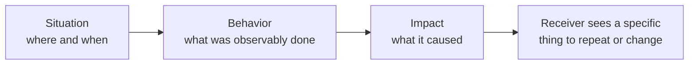

import Scenario from "../../../components/Scenario.astro";
import LevelIntro from "../../../components/LevelIntro.astro";
import PracticeCheck from "../../../components/PracticeCheck.astro";

export const unit = {
  track: "people-management",
  unitSlug: "sbi-framework",
};

<Scenario label="Feedback that didn't land">
  <Fragment slot="facts">
    

      

        Said the next day
        87% of the specifics still retrievable (modeled)
      

      

        

      

      

        Said three weeks later
        5% still retrievable (modeled)
      

      

        

      

    

    

      
🗣️ <strong>What was said</strong>: "You need to be more proactive"

      
📅 <strong>When</strong>: three weeks after the incident, in a quarterly review

      
😕 <strong>Result</strong>: nothing changed; the report had nothing to do differently

    

  </Fragment>

A manager tells a report, in a quarterly review, "you need to be more
proactive." The report nods, says they will work on it, and three months
later nothing has changed. The manager is a little annoyed; the report is a
little confused about what was even being asked.

**The feedback was heard. Why didn't it change anything?**

</Scenario>

The bars in the callout come from this unit's interactive demo. They are a
teaching model, not a measurement of real people: the point is the shape,
specifics fade fast.

<LevelIntro
  items={[
    "Trait labels versus observable behavior",
    "The three parts of Situation-Behavior-Impact",
    "Why delivery speed matters",
  ]}
/>

## Why does "be more proactive" give the report nothing to do?

**What would the report actually do on Monday morning after hearing it?**
There is no answer, and that is the problem.

- A **trait** is a conclusion about a person ("not proactive enough"). It sums
  up many events into a label and throws the events away.
- A **behavior** is something a camera could have recorded ("joined standup 15
  minutes late and gave no blocker update").
- The report can change a behavior. A trait is not something you can
  decide to do differently at 9am.

| Trait-based ("be more proactive")       | SBI instead                                               |
| --------------------------------------- | --------------------------------------------------------- |
| A judgment about who someone is         | A description of one event: where, what, and what it cost |
| Nothing concrete to act on              | A specific action the receiver can repeat or change       |
| Reads as a character critique           | Reads as an observation about a moment, not an identity   |
| Cannot be checked, only accepted or not | Can be checked: either it happened that way or it did not |

<PracticeCheck
  track={unit.track}
  unitSlug={unit.unitSlug}
  topicId="trait-vs-behavior"
/>

## What are the three parts of SBI?

**If a trait is the wrong ingredient, what is the right recipe?**

- **SBI (Situation-Behavior-Impact)** is a three-part feedback structure.
- **Situation:** the specific moment ("in yesterday's 9:15 standup").
- **Behavior:** the observable action in it ("you gave a status update but
  did not mention the delayed API").
- **Impact:** the concrete effect ("we planned the week around an endpoint
  that was not ready").
- It leaves out two things on purpose: **trait labels** and **guesses about
  motive** ("you don't care"). Neither can be observed, and both invite an
  argument about the person instead of a look at the event.

<PracticeCheck
  track={unit.track}
  unitSlug={unit.unitSlug}
  topicId="sbi-parts"
/>

## What this unit covers

- **L2:** why the structure works, how delivery timing interacts with it, and
  why praise needs the same structure as correction.
- **L3:** one incident written three ways, then what changes when the problem is
  a repeated pattern or the audience is bigger than one person.
