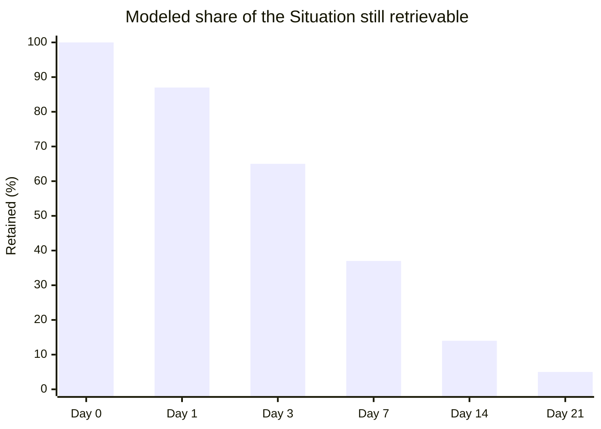
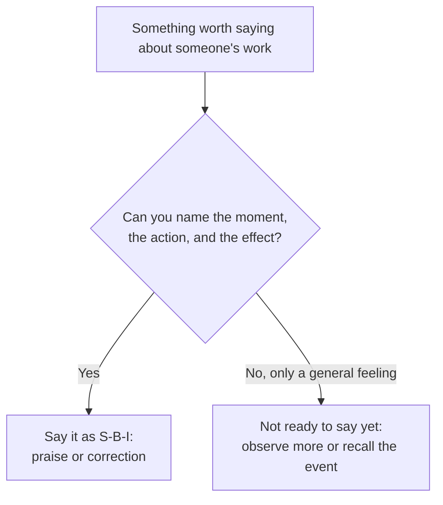

import LevelIntro from "../../../components/LevelIntro.astro";
import Checkpoint from "../../../components/Checkpoint.astro";
import PracticeCheck from "../../../components/PracticeCheck.astro";

export const unit = {
  track: "people-management",
  unitSlug: "sbi-framework",
};

L1 showed a trait label landing with no effect and introduced the three parts
of SBI. L2 works out what happens to those parts as days pass, and why the
same structure that fixes a problem is also what makes praise worth hearing.

<LevelIntro
  items={[
    "How specifics decay with delay",
    "Why timing and content are separate choices",
    "Praise with the same three parts",
  ]}
/>

## What does a few days of waiting do to the Situation?

**A manager has a clean SBI message ready but decides to save it for the
quarterly review. What is lost on the way?** The "S" goes first. It is the
most single-instance detail (an exact meeting, an exact sentence), so it is
what blurs when neither person took notes. The unit's interactive demo models
this as an exponential fade with a seven-day time constant. It is an
illustration, not a measurement, but the rounded values below are exactly what
the demo shows:

By day 21 the manager is left with "you're often late," which is the trait
statement SBI was meant to replace. The fix is not a better memory, it is a
shorter gap.

<Checkpoint question="A manager delivers SBI feedback three weeks late, from memory, with no notes. Which letter is most likely to have turned back into a vague trait statement, and why that one?">

The Situation. It is the most specific, single-instance detail, an exact moment
and an exact exchange, so it is the first thing to blur. Once the manager can no
longer name the moment, they reach for "this happens a lot," which is
pattern-level trait language. Behavior and Impact can often survive in rough
form; the Situation is what anchors them to something checkable.

</Checkpoint>

<PracticeCheck
  track={unit.track}
  unitSlug={unit.unitSlug}
  topicId="timing-decay"
/>

## Is fast enough? Timing versus content

**If SBI is delivered next day, is it automatically good? And if feedback is
fast but vague, is that at least half right?** Timing and content are two
independent dials, and the grid shows why both matter.

|                        | Specific (S-B-I)                    | Vague (trait)                                       |
| ---------------------- | ----------------------------------- | --------------------------------------------------- |
| **Fast (next day)**    | Best case: fresh and checkable      | Vagueness delivered sooner, still nothing to act on |
| **Slow (weeks later)** | Specifics have faded, quality drops | Worst case: stale and vague                         |

Speed protects the Situation; structure supplies the Behavior and Impact.
Neither rescues the other. A fast trait label ("you've been quiet lately") can
even do harm: the receiver tries to fix the wrong thing, such as talking more
in general, because the real gap was never named.

<Checkpoint question="Feedback arrives the same day, but it is 'be more of a team player.' What has timing fixed, and what is still broken?">

Timing has preserved nothing in particular, because there was no specific
Situation to preserve. What is still broken is everything content-related: no
observable Behavior, no Impact, nothing the receiver can repeat or change. Fast
delivery of a vague message just makes the vagueness arrive sooner.

</Checkpoint>

<PracticeCheck
  track={unit.track}
  unitSlug={unit.unitSlug}
  topicId="timing-vs-content"
/>

## Does praise need the structure too?

**"You did great work this sprint" feels kind. Why isn't it good feedback?**
Because it is a trait-style verdict with a positive sign. The receiver cannot
tell which specific thing to keep doing, so the compliment is pleasant and
changes nothing.

| Version                                                                                                                                                   | What the person learns                          |
| --------------------------------------------------------------------------------------------------------------------------------------------------------- | ----------------------------------------------- |
| "Great job on the release."                                                                                                                               | That the manager is pleased. Not what to repeat |
| "In Thursday's release call (S), you listed the three rollback steps before anyone asked (B), so when the deploy stalled we reverted in ten minutes (I)." | The exact habit to keep, and why it mattered    |

The ten minutes in the example is an invented detail for illustration. The
point is structural: the same three parts that make a correction usable make
praise reinforce a repeatable behavior instead of a mood. As a bonus, specific
praise is hard to fake, which makes it believable.

<PracticeCheck
  track={unit.track}
  unitSlug={unit.unitSlug}
  topicId="praise-sbi"
/>

## Where the idea goes next

The underlying move, replacing a conclusion with the evidence that produced it
plus its effect, is not specific to feedback conversations. L3 pushes it into
harder cases: a problem that has happened three times, and a message whose
audience or stakes differ from the original one-on-one.
