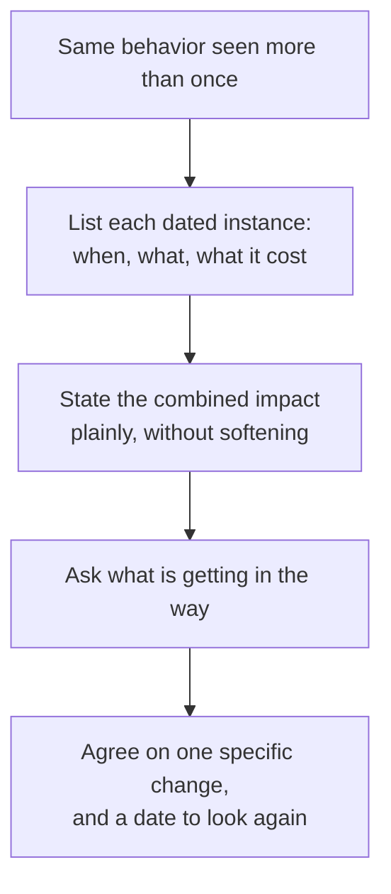

import Scenario from "../../../components/Scenario.astro";
import LevelIntro from "../../../components/LevelIntro.astro";
import Checkpoint from "../../../components/Checkpoint.astro";
import PracticeCheck from "../../../components/PracticeCheck.astro";

export const unit = {
  track: "people-management",
  unitSlug: "sbi-framework",
};

<Scenario label="The incident in full">
  <Fragment slot="facts">
    

      
👤 <strong>Who</strong>: Priya, a backend engineer on a team of six

      
🔔 <strong>What</strong>: told her manager privately that the payments API would slip a week, then left it out of standup, for the third time

      
💥 <strong>Impact</strong>: the team planned around the wrong date and lost two days of work, found at a mid-sprint check-in

    

    

      

        Lost to replanning
        2 of 10 working days in the sprint (assumed 2-week sprint)
      

      

        

      

    

  </Fragment>

Priya's manager has to talk to her about it. Before reading the three versions
below, make a prediction: **when managers give quick, in-the-moment feedback,
which of Situation, Behavior or Impact do they skip most often, and why might
that one be the easiest to leave out?**

</Scenario>

<LevelIntro
  items={[
    "The same incident written three ways",
    'A repeated pattern without the word "always"',
    "Smaller impact and bigger audiences",
  ]}
/>

## The same incident, three versions

**Which of these would you want to receive, and which would change what you
do on Monday?**

**Version 1: a trait, saved for the quarterly review.**

> "Priya, one thing for this quarter: I think you could be more proactive about
> surfacing blockers. I've noticed it a few times."

No moment either person can point to, no picture of what "proactive" looks
like in a standup, and it arrives weeks removed from the events it is about.
Priya cannot tell whether it concerns last week or last quarter.

**Version 2: fast, still a trait.**

> "Hey Priya, got a sec? You've been a bit quiet in standup lately. Try to
> speak up more."

The timing is better (same week) but the content still names a trait. Priya
may reasonably start narrating unrelated updates, because the real gap, one
known blocker not said out loud, was never named.

**Version 3: SBI, next day.**

> "Priya, can I share something from yesterday's standup? **(S)** When it was
> your turn you gave a status update but did not mention that the payments
> team said their endpoint will be a week late, which you'd told me about on
> Tuesday. **(B)** Because it never reached the team's shared picture, we
> planned this week assuming it would be ready, and we only caught it at
> Wednesday's check-in, which cost about two days of replanning. **(I)** Going
> forward, could anything you've flagged to me directly also be said out loud
> in standup, even if it feels redundant?"

| Element          | Version 1         | Version 2         | Version 3                         |
| ---------------- | ----------------- | ----------------- | --------------------------------- |
| Situation named? | No                | No                | Yes: yesterday's standup, Tuesday |
| Behavior named?  | No ("proactive")  | Vaguely ("quiet") | Yes: one missing sentence         |
| Impact named?    | No                | No                | Yes: two days of replanning       |
| Delay            | About three weeks | Same week         | Next day                          |
| Next step clear? | No                | No                | Yes, a single request             |

<Checkpoint question="Version 2 arrived within the same week, much sooner than Version 1. Why isn't that speed enough to make it good feedback?">

Because speed only preserves what is already specific, and Version 2 contains
no specific moment, behavior or effect. It names a trait ("quiet"), so its
freshness is wasted. Version 3 is better because it pairs fast delivery with all
three parts. Timing and structure are independent dials, and SBI needs both set
well.

</Checkpoint>

Notice what Version 3 does not do: it never says why Priya did it. She may have
assumed the manager would relay it, or that it was not her place. SBI describes
what happened and what it caused, and then asks; it does not diagnose.

<PracticeCheck
  track={unit.track}
  unitSlug={unit.unitSlug}
  topicId="three-versions"
/>

## What changes when it has happened three times?

**Priya's manager waited through two earlier standups hoping it would fix
itself. What does waiting do to the eventual conversation?** It stores up
frustration, so the message arrives as accumulated criticism instead of one
fixable data point. The answer is not to say "you always do this." It is to
name each instance as its own Situation.

> "This is the third time. Two standups ago it was the auth migration date, and
> the week before that the staging environment problem. Each time you'd told me
> directly, it didn't reach the team update, and each time we replanned
> mid-sprint."

| Pattern statement                              | Why it works or fails                                     |
| ---------------------------------------------- | --------------------------------------------------------- |
| "You always do this."                          | Cannot be checked, invites a fight over the word "always" |
| "This keeps happening, over and over."         | Same problem: no instance to point at                     |
| "Three times: the 3rd, the 10th and the 17th." | Each one is a fact the receiver can confirm or correct    |

A pattern is built from Situations, not from adjectives. If the manager can only
name one instance clearly, the honest message is about that one instance.

<Checkpoint question="A manager says 'this keeps happening, over and over,' with no dates. Is that still a pattern-level SBI conversation?">

No. It has slipped back into a trait judgment applied to a longer stretch of
time. "Keeps happening" is unverifiable in the same way "not proactive" was in
Version 1: the receiver cannot check it or point to what it refers to. A
pattern conversation stays SBI only when each instance is a nameable Situation.

</Checkpoint>

<PracticeCheck
  track={unit.track}
  unitSlug={unit.unitSlug}
  topicId="pattern-conversation"
/>

## How does the message change with smaller stakes or a bigger audience?

**Everything so far assumed a private conversation with a real, costly impact.
What if nobody had replanned anything, or what if the manager wanted to raise it
in front of the whole team?**

- **Smaller impact:** the Impact still gets said, but honestly sized: "it would
  have been slightly smoother." Inflating a minor effect to make the point land
  spends trust that real, high-impact feedback will need later.
- **Bigger audience:** a named, specific behavior is a private message. Said in
  front of peers it becomes public criticism of one person. The group version is
  general guidance ("let's say flagged blockers out loud in standup"), with the
  individual conversation held privately.

| If this changes...         | What to do with S-B-I                                                               |
| -------------------------- | ----------------------------------------------------------------------------------- |
| Impact is minor            | Keep it, describe it at its true size                                               |
| Audience is the whole team | Generalize S and B, make the ask a team norm, keep the person-specific talk private |
| The behavior was positive  | Same structure; public praise with specifics is usually fine                        |

<Checkpoint question="Why is exaggerating a small impact worse than simply leaving the Impact out?">

Leaving it out removes the "why it matters," but it does not damage anything.
Exaggerating plants a claim the receiver can later see through, and once they
do, the next impact statement, even a true and serious one, gets discounted.
The cost is not this conversation, it is every future one.

</Checkpoint>

<PracticeCheck
  track={unit.track}
  unitSlug={unit.unitSlug}
  topicId="impact-and-audience"
/>

## This is one case, not the whole territory

The worked example had a private flag that never reached a standup. Extend it
yourself before moving on:

- Priya answers, "I assumed you would mention it." What does the conversation
  become, and which of S, B or I would you keep unchanged?
- The same gap happens with a peer, not a report, and you have no authority over
  them. What stays the same in the message and what do you drop?
- The news is worse: the delayed endpoint cost a client commitment, not two
  days. How does honest sizing of the Impact change the tone of Version 3?
- The person is remote and the only channel is written chat. Which of the
  three parts is most at risk of being lost?

There are no scripted answers. The skill is noticing which of the three parts
the situation has put under pressure and rebuilding the message around it.

## Failure modes at a glance

| Failure mode                                     | What it gets wrong                                              |
| ------------------------------------------------ | --------------------------------------------------------------- |
| Naming a trait instead of a behavior             | Nothing to change, and it reads as a character judgment         |
| Saving it for a scheduled review                 | The Situation has faded; the message turns into a pattern guess |
| Letting frustration build over several instances | The message lands as a pile of criticism, not a fixable point   |
| "You always..."                                  | Unverifiable; the receiver argues about "always"                |
| Guessing at motive                               | Invites defense of intent instead of looking at the event       |
| Exaggerating the impact                          | Spends trust needed for future, real impact                     |
