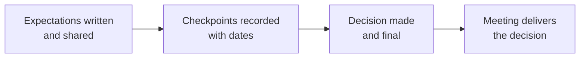

import Scenario from "../../../components/Scenario.astro";
import LevelIntro from "../../../components/LevelIntro.astro";
import PracticeCheck from "../../../components/PracticeCheck.astro";

export const unit = {
  track: "people-management",
  unitSlug: "termination-process",
};

<Scenario label="The problem">
  <Fragment slot="facts">
    

      

        10 min
        until a manager must deliver a final decision in person
      

      

        

      

    

    

      
📋 The improvement plan ended; its written expectations were not met

      
🔒 The decision is already final

      
🗣️ Fear one: say too much and contradict the record

      
🧊 Fear two: say too little and sound cold

    

  </Fragment>

Marcus manages a small delivery team. The improvement plan for one of his
engineers, Elena, ended last week without the written expectations being
met, and the decision to end her employment is final. The meeting is in
ten minutes.

Two instincts pull at him at once. One says to explain everything, to
soften it and be fair. The other, repeated by a friend, says to never
explain anything, to stay safe. He has run hundreds of 1:1s and has never
felt this unprepared.

**Is there a way to do this that is both kind and safe, or is it a straight
trade-off between the two?**

</Scenario>

The two instincts feel like opposites, but they guard against different
dangers. Over-explaining protects the person's feelings and risks
contradicting the written record. Under-explaining protects the company and
risks making a fair process feel cold. Choosing one tends to hurt the other.

<LevelIntro
  items={[
    "Why kind and safe are not a trade-off",
    "What the meeting is for, and what it is not",
    "The terms this unit uses",
  ]}
/>

## Is it really kind versus safe?

**If both instincts feel right, why does choosing one backfire?** Because each
protects only one of two things, and the same behaviour can serve both.

- **Dignity in the delivery** means the conversation itself, plus the
  practical details around it (timing, privacy, belongings, access), are
  owed to the person whatever the reason for the decision.
- Most of what makes a termination humane is also what makes it sound:
  clarity, brevity, respect, and no surprises. All of these point to a short,
  factual conversation, not a debate.
- The trade-off feels real only if the meeting is treated as the place to
  _make_ a case. It is the place to _deliver_ one.

| Instinct                 | Protects             | Typical cost                                      |
| ------------------------ | -------------------- | ------------------------------------------------- |
| Explain everything       | The person's dignity | New reasons that may not match the record         |
| Say almost nothing       | The company's safety | A cold, sudden feeling, even after a fair process |
| Short, factual, prepared | Both                 | None of the two costs above                       |

<PracticeCheck
  track={unit.track}
  unitSlug={unit.unitSlug}
  topicId="false-tradeoff"
/>

## What is the meeting actually for?

**If the manager is nervous about what to say, is the meeting where the
decision gets weighed?** No. The decision was made earlier, at the end of the
improvement plan, and the meeting only delivers it.

- **Termination meeting:** a short conversation, in person or on video, where
  an already-final decision to end employment is delivered. It is not a
  discussion about whether the decision will happen.
- **Documented cause:** the specific, dated performance record built during
  the improvement plan. It is what supports the decision if anyone ever
  challenges it.
- **At-will employment:** in some jurisdictions, the default that either side
  can end employment at any time. It shapes the obligations in this unit but
  does not remove them, and details differ by place and contract. This unit
  is general education, not legal advice.

The diagram's point is the order: the meeting is the last box, not the place
where earlier boxes get redone.

<PracticeCheck
  track={unit.track}
  unitSlug={unit.unitSlug}
  topicId="delivery-not-decision"
/>

## What the next levels cover

L2 explains the four-step shape of the meeting and why the reason stays tied
to the written record. L3 follows Marcus through the actual conversation:
what he prepares, the words he uses, and what he does when Elena says it
is not fair.
