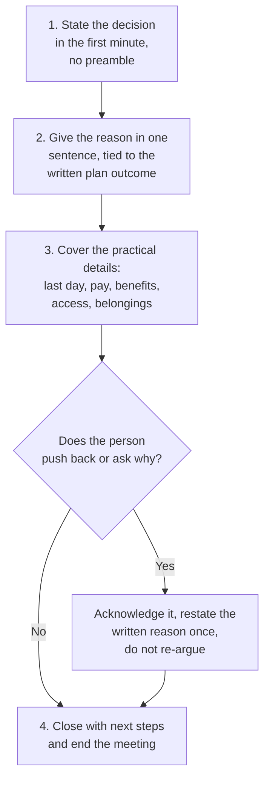

import LevelIntro from "../../../components/LevelIntro.astro";
import Checkpoint from "../../../components/Checkpoint.astro";
import PracticeCheck from "../../../components/PracticeCheck.astro";

export const unit = {
  track: "people-management",
  unitSlug: "termination-process",
};

L1 named the tension Marcus feels: the meeting must be humane and sound, and
choosing one seems to cost the other. L2 works out the structure of a
conversation that serves both.

<LevelIntro
  items={[
    "The four steps of the meeting, in order",
    "Why the decision comes before any explanation",
    "Why one reason, tied to the written record",
  ]}
/>

## What does the meeting look like, step by step?

**Marcus has ten minutes and one rule: no improvising the shape. What is the
shape?** Four steps, always in the same order.

Step 3 happens in both branches. A quiet person still needs the practical
information; silence is not permission to skip it.

<Checkpoint question="Elena listens quietly and asks nothing after hearing the reason. Can Marcus move straight to ending the meeting?">

No. The practical details (last day, pay and benefits, access, belongings)
come before the close no matter how the person reacts. Skipping them because
there was no pushback would leave Elena unable to act on what just happened,
which is its own failure of dignity even though nobody argued.

</Checkpoint>

<PracticeCheck
  track={unit.track}
  unitSlug={unit.unitSlug}
  topicId="meeting-structure"
/>

## Why does the decision come first?

**A softer start feels kinder, so why not ease in with "let's talk about how
the plan went"?** Because the person understands what is happening within a
few words, and a preamble stretches the worst part. Every sentence before the
real one is time spent bracing without knowing what for.

| Opening                                           | What the person experiences                     |
| ------------------------------------------------- | ----------------------------------------------- |
| "Let's review how the plan went..."               | Guessing the ending while waiting for it        |
| "Let's cover your laptop and last paycheck first" | Avoidance; the decision still has not been said |
| "We are ending your employment, effective today"  | The truth at once, then room to react           |

Stating it plainly is the respectful choice: it does not make the person sit
through a preamble to guess the ending.

<PracticeCheck
  track={unit.track}
  unitSlug={unit.unitSlug}
  topicId="decision-first"
/>

## Why one reason, and why that one?

**Marcus knows many true frustrations about Elena's last two quarters. Why
share only one sentence?** Because anything said in the room becomes part of
the record of why the decision was made. The record that matters is the one
already built during the plan: written expectations, dated checkpoints.

- A new reason, even a true one, that was not in that process creates a
  mismatch between what was written and what was said. That mismatch is what
  legal exposure looks like in practice.
- One sentence tied to the plan's written expectations is both enough and
  safer than a fuller account improvised under pressure.
- Marcus is not hiding anything. The fuller story was already shared with
  Elena through the plan; this is not the place to reopen it.

The demo on this page makes the effect visible. On its illustrative scale,
each reason added beyond the written record raises relative exposure by 20
points, from 0 with no new reasons to 100 with five. The numbers are a
teaching scale, not a measured legal risk. What to take from it is the
direction: the safe count is zero.

<Checkpoint question="Marcus, wanting to be kind, adds two extra reasons that were never in the written plan. Which failure mode is this, and what does it put at risk?">

This is over-explaining. It aims at dignity, since Marcus wants Elena to
understand the whole picture, but what it puts at risk is soundness. Each
reason spoken in the room becomes part of the account of why the decision was
made, and a reason that never appeared in the plan opens a gap between the
paper trail and the spoken word. If the decision is ever challenged, that gap
is what looks bad, however true the extra reasons were.

</Checkpoint>

<PracticeCheck
  track={unit.track}
  unitSlug={unit.unitSlug}
  topicId="one-reason-rule"
/>

## Failure modes at this level

- **Treating the meeting as a debate to be won.** If the person disagrees,
  the answer is "I understand this is hard, and the decision is final," not a
  longer argument that reopens what the plan already concluded.
- **Leading with logistics instead of the decision.** It delays the clarity
  the person is owed and reads as avoidance.
- **Preparing the reason but not the practical details.** The practical part
  is the easiest to prepare fully, and the worst to improvise.
