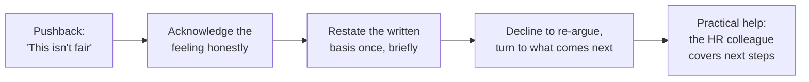

import Scenario from "../../../components/Scenario.astro";
import LevelIntro from "../../../components/LevelIntro.astro";
import Checkpoint from "../../../components/Checkpoint.astro";
import PracticeCheck from "../../../components/PracticeCheck.astro";

export const unit = {
  track: "people-management",
  unitSlug: "termination-process",
};

<Scenario label="The scenario">
  <Fragment slot="facts">
    

      
👤 <strong>Marcus</strong>, the manager, delivers the news

      
👩‍💻 <strong>Elena</strong>, the engineer, whose plan ended unmet

      
📅 Plan written in May; checkpoint on June 30; decision final

      
🧑‍💼 A colleague from HR will be in the room

    

  </Fragment>

Same people and facts as L1 and L2. Both names are fictional. Marcus has
ten minutes. The plan set written expectations, including shipping on the
stated dates and flagging risk in advance, and the June 30 checkpoint
recorded them as not met. L3 follows the real conversation, from what he
prepares to what he says when Elena objects.

**Before reading on, predict: which moment is the easiest to get wrong, and
why?**

</Scenario>

<LevelIntro
  items={[
    "What must be ready before walking in",
    "The opening lines, word for word",
    "Handling pushback without re-arguing",
  ]}
/>

## What has to be ready before walking in?

**Beyond the opening line, what does Marcus prepare in the ten minutes he
has?** Four things, all practical. None of them are good candidates for
improvisation.

| Item                        | What Marcus needs before the meeting                  |
| --------------------------- | ----------------------------------------------------- |
| Last working day            | An exact date, stated plainly                         |
| Pay and benefits            | What is owed, and when written details will follow    |
| Access and equipment        | When access ends; how and when to return equipment    |
| A second person in the room | HR or equivalent, confirmed before the meeting starts |

The first three rows are facts to state. The fourth is a safeguard: a witness
who can catch a moment when Marcus starts to over-explain and who can answer
questions (benefits specifics, legal details) that are not his to answer.

<Checkpoint question="Which of the four items exists so Marcus is not the only one responsible for how the conversation goes, rather than being information he must state?">

The second person in the room. The other three are facts Marcus must have
ready to say accurately. The second person protects the process itself: a
witness, a check against improvising under pressure, and the right source
for questions outside Marcus's role.

</Checkpoint>

<PracticeCheck
  track={unit.track}
  unitSlug={unit.unitSlug}
  topicId="preparation"
/>

## What do the first minutes sound like?

**Marcus has the facts. What exactly does he say?**

> **Marcus:** "Thanks for making time. I want to get right to it, because this
> is not going to be an easy conversation. We are ending your employment
> here, effective today."

No preamble, not even one softening sentence. Per L2, a delay would only
extend the moment Elena spends bracing.

> **Marcus:** "As we discussed at the end of the improvement plan, the
> expectations we agreed on, shipping on the stated dates and flagging risk
> in advance, were not met by the June 30 checkpoint. That is the basis for
> this decision."

That sentence is the whole explanation. It uses only what Elena already
saw in writing, so nothing in it is new or improvised.

> **Marcus:** "Today is your last working day. [HR colleague] is here and will
> walk through pay, benefits, and next steps right after this. Your system
> access ends at 6pm today, and we will arrange a time tomorrow for you to
> collect your personal items."

This is where the prepared practical items are delivered, plainly and with
specifics.

<PracticeCheck
  track={unit.track}
  unitSlug={unit.unitSlug}
  topicId="opening-lines"
/>

## What if Elena pushes back?

**Elena says: "This isn't fair. You never gave me a real chance." How does
Marcus respond live without re-arguing or caving?**

> **Marcus:** "I hear that this feels sudden and unfair, and I know it is
> hard to hear. The plan we agreed to in May set out specific written
> expectations, and the June 30 checkpoint is what this decision is based on.
> I am not going to re-argue it here, but I want to make sure you have what
> you need for what comes next."

**Why not defend the plan's fairness at length?** A longer defense turns the
meeting into a debate Marcus is trying to win. Fairness was established
during the plan; the meeting delivers its outcome. Restating the basis once,
calmly, is both respectful and safe, and it is also what keeps new reasons at
zero: the first and the second answer say the same thing in the same words.

<Checkpoint question="Elena pushes back a second time with the same complaint. What does Marcus do, and what does he avoid?">

He repeats the same acknowledgment and the same written basis, briefly, and
turns toward next steps again. He avoids matching frustration with
frustration and avoids adding any new justification to prove his point. A
second, louder defense is how a hard but clean meeting becomes adversarial,
and it is the moment most likely to produce an off-record reason.

</Checkpoint>

<PracticeCheck track={unit.track} unitSlug={unit.unitSlug} topicId="pushback" />

## Extend it: this is one case, not the whole territory

This unit follows one person, one meeting, one cause. The principles travel
farther than the script does, so test them on cases the example does not
contain.

**What changes if Marcus must deliver this news to five people on the same
day, in a layoff rather than a performance-based ending?** The structure
(decision first, one reason, practical details, no re-arguing) still holds.
The reason changes shape: it is no longer individual documented cause but a
business decision about roles. The practical part grows to include severance
terms and the order and timing of conversations, usually coordinated with HR
and legal beforehand.

Other questions to try:

- What changes if the person is remote and the meeting is on video?
- What changes if the person is a close friend of Marcus?
- What changes if the person becomes upset or leaves the room?

For each, ask which of the four steps stays fixed and which part of the
preparation gets larger. Legal rules about notice, pay, and procedure vary by
place and contract, so Marcus's HR colleague and legal advisers, not this
page, settle those specifics.

## Failure modes at this level

- **Improvising pay, benefits, or equipment details because they were not
  confirmed beforehand.** These are the most preparable parts, and winging
  them reads as disorganized in the part that should feel most solid.
- **Escalating tone to match the person's pushback.** Calm restating is the
  entire playbook.
- **Holding the meeting without a second person present.** It removes the
  witness and the safeguard against over-explaining.
