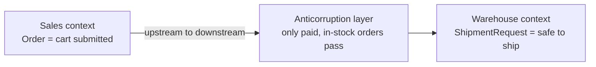

import Scenario from "../../../components/Scenario.astro";
import LevelIntro from "../../../components/LevelIntro.astro";
import PracticeCheck from "../../../components/PracticeCheck.astro";

export const unit = {
  track: "product-domain",
  unitSlug: "bounded-contexts",
};

<Scenario label="The problem">
  <Fragment slot="facts">
    

      
🍽️ <strong>Owner:</strong> "send me Friday's table" means the seating plan

      
📊 <strong>Bookkeeper:</strong> "table" means rows and columns of sales

      
💥 <strong>Result:</strong> a correct spreadsheet that answers the wrong question

    

  </Fragment>

A restaurant owner tells the bookkeeper, "Send me the table for Friday." The
bookkeeper sends a spreadsheet of Friday's sales. The owner wanted the seating
plan: which party sits where. Neither of them used the word wrongly. In a dining
room, a table is furniture with a party seated at it. In a spreadsheet, a table
is rows and columns.

**Nobody disagreed about the word, so where did the mismatch come from?** From
the place each person was standing when they said it.

</Scenario>

Software teams hit the same trap with much higher stakes. In an online store,
the Sales part of the system creates an `Order` the moment a customer submits a
cart. The Warehouse part sees that `Order` and starts packing it. Some of those
carts never get paid, and parcels go out anyway. Both teams say "order" and mean
"a customer bought something", yet the two systems do not fit together.

<LevelIntro
  items={[
    "Where one word keeps one meaning",
    "Guarantees hidden behind a shared word",
    "The map vocabulary: upstream, downstream, translation",
  ]}
/>

## Why does the same word break two systems that "agree"?

**Both teams would write the same one-sentence definition of "order". What
differs, then?** What each team may safely assume is already true whenever the
word shows up.

- A **bounded context** is the boundary around a part of a system where a word
  has one specific meaning and one set of rules. Outside the boundary, the same
  word may mean something else.
- A **guarantee** is something other parts of the system can safely assume is
  already true. It is rarely written in the definition.
- A **model** is the names, data and rules a part of the system uses to
  represent its work. A model can be correct for its own context and unsafe for
  another context to use directly.

| In the story    | Word used | What it guarantees                                  |
| --------------- | --------- | --------------------------------------------------- |
| Sales context   | `Order`   | A cart was submitted. Payment and stock: not yet.   |
| Warehouse needs | `Order`   | Payment confirmed and stock available: safe to ship |

The gap is the whole bug. Sales never promised payment, and Warehouse assumed
it.

<PracticeCheck
  track={unit.track}
  unitSlug={unit.unitSlug}
  topicId="same-word-different-meaning"
/>

## What vocabulary names the pieces?

**If the fix is not "make the teams agree on the word", what is it?** Draw where
meanings change, say who depends on whom, and translate at the border.

- A **context map** is a picture of which bounded contexts exist and how they
  depend on each other. Its job is to show where meaning changes, not only where
  a network call happens.
- **Upstream** is the context whose model changes on its own schedule.
  **Downstream** is the context that must adapt when it does. Sales is upstream
  of Warehouse here.
- An **anticorruption layer** is a deliberate translation step at the boundary,
  so one context's model does not leak into another's.

<PracticeCheck
  track={unit.track}
  unitSlug={unit.unitSlug}
  topicId="context-map-vocab"
/>

L2 shows why the translation step beats fixing either model, and compares three
ways to relate two contexts. L3 works the Sales and Warehouse bug through in
full, including what changes when the downstream team has no power to negotiate.
