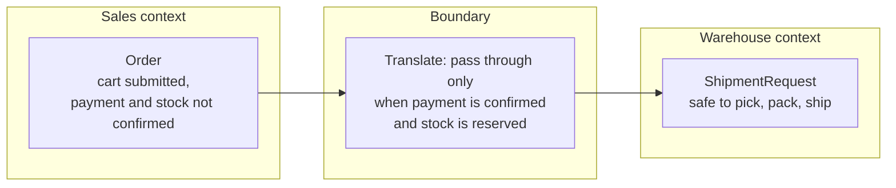

import LevelIntro from "../../../components/LevelIntro.astro";
import Checkpoint from "../../../components/Checkpoint.astro";
import PracticeCheck from "../../../components/PracticeCheck.astro";

export const unit = {
  track: "product-domain",
  unitSlug: "bounded-contexts",
};

L1 showed that "table" meant two things to the owner and the bookkeeper, and
that `Order` meant two things to Sales and Warehouse. L2 asks the next question:
once you know the meanings differ, where should the fix go, and what are the
options?

<LevelIntro
  items={[
    "Why the fix belongs at the boundary",
    "Cost of wiring contexts together directly",
    "Anticorruption layer, conformist, shared kernel",
  ]}
/>

## Why not just make Sales' `Order` mean "safe to ship"?

**It looks like the cheapest fix: one team changes one definition. What breaks?**
Sales' own work. Sales needs an `Order` that exists before payment clears: the
cart page, the "you left something behind" reminders, and stock holds all depend
on it. Forcing Sales' model to carry Warehouse's guarantee would damage the
context that is working correctly.

The better move is to let each model stay true to its own context and do the
reconciling once, at the border.

Here "context" means the place where a word has one meaning, which may be a
team, a service, or part of a service. The translation step is the
**anticorruption layer**.

<Checkpoint question="Sales and Warehouse both define 'Order' the same way in a meeting. Does that agreement make it safe to wire their systems together directly?">

No. The meeting only agreed on the sentence. What is missing is what each side
may assume is already true: Sales' `Order` exists before payment clears, and
Warehouse needs payment confirmed. The mismatch lives in those unstated
guarantees, so a conversation that only compares definitions will never find it.

</Checkpoint>

### How much does the missing layer cost?

**If Sales' `Order` changes shape, how many places must someone fix?** It
depends on how many systems read it directly. The unit's interactive demo uses a
toy model with two sliders: the number of downstream consumers wired to Sales
and the number of Sales model changes per quarter. Wired directly, each change
touches every consumer. With one translation layer, each change touches only
the layer. These are teaching numbers, not measurements.

| Downstream consumers | Sales changes per quarter | Places to fix, wired directly | Updates, with a layer |
| -------------------- | ------------------------- | ----------------------------- | --------------------- |
| 1                    | 2                         | 2                             | 2                     |
| 2 (demo default)     | 2                         | 4                             | 2                     |
| 5                    | 2                         | 10                            | 2                     |
| 10                   | 2                         | 20                            | 2                     |

With a single consumer the layer saves nothing in this count. The savings grow
with every extra system that depends on Sales' shape, which is why the layer is
a judgment call and not a rule.

<PracticeCheck
  track={unit.track}
  unitSlug={unit.unitSlug}
  topicId="acl-purpose"
/>

## What are the options for relating two contexts?

**When two contexts are related, who has to change when the other one does?**
Usually it is not symmetric. The upstream context evolves on its own schedule
and the downstream context adapts. What differs is how the downstream side
adapts.

| Pattern              | What it means                                                         | Typical fit                                                  |
| -------------------- | --------------------------------------------------------------------- | ------------------------------------------------------------ |
| Anticorruption layer | Downstream translates the upstream model, keeping its own model clean | Upstream guarantees are not safe to rely on (this unit)      |
| Conformist           | Downstream adopts the upstream model as-is, with no translation       | Downstream has little or no influence, such as a vendor API  |
| Shared kernel        | Both sides jointly own one small piece of the model                   | Two teams that can coordinate closely and change it together |

A shared kernel works while it stays small, such as one jointly protected
`PaymentConfirmed` event. It turns risky when it grows into a large object that
neither team can change without slowing the other.

<Checkpoint question="In the Sales and Warehouse relationship, which context is upstream, and who absorbs the cost of staying compatible?">

Sales is upstream. Its `Order` model changes for Sales' own reasons and owes
Warehouse no advance notice. Warehouse is downstream, so it absorbs the cost, and
it does so through its translation layer rather than by asking Sales to slow
down. The cost sits on the side with less leverage over the other's model.

</Checkpoint>

**Is a context map just an architecture diagram with new jargon?** No. A
service diagram marks where network calls cross. A context map marks where
meaning changes. One service can sit inside a single context, and one service
can quietly straddle two if a word's guarantees change partway through it.

<PracticeCheck
  track={unit.track}
  unitSlug={unit.unitSlug}
  topicId="integration-patterns"
/>

**Does every integration need a translation layer?** No. Only where the two
contexts carry different guarantees. Where both already share the same
guarantees, wiring directly is safe, and the layer is cost without benefit.
