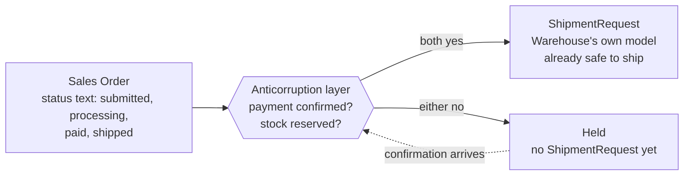

import Scenario from "../../../components/Scenario.astro";
import LevelIntro from "../../../components/LevelIntro.astro";
import Checkpoint from "../../../components/Checkpoint.astro";
import PracticeCheck from "../../../components/PracticeCheck.astro";

export const unit = {
  track: "product-domain",
  unitSlug: "bounded-contexts",
};

<Scenario label="What actually happened, and what fixed it">
  <Fragment slot="facts">
    

      
🐛 <strong>The bug:</strong> parcels shipped for orders whose payment later failed

      
🔍 <strong>Root cause:</strong> Warehouse trusted Sales' status text as a promise

      
🛠️ <strong>The fix:</strong> a layer that forwards only paid, reserved orders

    

  </Fragment>

Back in the restaurant, imagine the kitchen printer shows "Table 7 ready". The
host reads it as "a physical table is free" and seats a new party there, while
the kitchen meant "Table 7's food is ready to carry out". Nobody was careless.
A message written for one place was read as a promise in another.

**Before reading the fix, predict: what is the smallest change that would have
prevented the Warehouse bug without asking Sales to redefine `Order` for its own
purposes?**

</Scenario>

<LevelIntro
  items={[
    "The bug traced to its root cause",
    "An anticorruption layer that holds up",
    "Leverage, cost and the failure modes",
  ]}
/>

## What actually happened, and why is reading the status field not a fix?

Sales creates an `Order` record when a cart is submitted, before the payment
provider confirms the charge and before stock is checked. That is deliberate:
the cart page and the reminder emails need the record early. The Sales status
text moves through values such as `submitted`, `processing`, `paid` and
`shipped`. To make the screen feel responsive, Sales sometimes marked an order
`processing` before payment confirmation came back.

Warehouse listened for new orders and queued anything past `submitted` for
picking, reasonably assuming `processing` meant "safe to act on". When a
payment later failed, the parcel had already left.

**Wouldn't a careful mapping of every current status value fix it?** Only for
today. Sales can add a status, reorder transitions or change what `processing`
means internally, and owes Warehouse no notice, because `processing` was never a
promise made to Warehouse. A hand-mapped status list is a snapshot of someone
else's model, not a contract.

<Checkpoint question="Warehouse's team documents every current Sales status value and builds shipping logic around that exact mapping. Is the bug permanently fixed?">

No. The mapping only holds while Sales keeps its status values, their order and
their meaning exactly as they are today. Sales changes them for Sales' reasons,
so the same bug returns the first time one of them moves. The cause was never a
misread field. It was depending on a model that belongs to another context.

</Checkpoint>

<PracticeCheck
  track={unit.track}
  unitSlug={unit.unitSlug}
  topicId="status-mapping-fragility"
/>

### The fix, concretely

Warehouse added a layer between Sales' order stream and its own model. The layer
asks two yes or no questions: is the payment really confirmed, and is the stock
really reserved? Only when both answers are yes does it create Warehouse's own
`ShipmentRequest`. An order that fails either question is held, and it is
checked again when the missing confirmation arrives.

| Question                            | Before the fix                               | After the fix                                      |
| ----------------------------------- | -------------------------------------------- | -------------------------------------------------- |
| What Warehouse trusted              | Sales' status text, interpreted by guesswork | Two explicit facts checked at the boundary         |
| If Sales changes its statuses       | Shipping decisions break silently            | Nothing changes, the layer ignores status text     |
| If Sales renames the facts          | Not applicable                               | The layer fails loudly, in one place               |
| Who owns the meaning "safe to ship" | Nobody explicitly, assumed from Sales' field | Warehouse, through its own `ShipmentRequest` model |

Here "contract" does not mean a legal document. It means an explicit promise
between systems about what a piece of data can be trusted to mean.

## When is building the layer the wrong call?

**Everything above assumed Warehouse could build and maintain its own layer.
What if Sales were a marketplace platform that dictates its order format, take
it or leave it?** Then the conformist pattern becomes attractive: adopt the
upstream model largely as-is and accept that upstream changes will occasionally
break something. The judgment is about leverage and cost, not about which
pattern is more correct. A layer that costs more to build and maintain than the
breakage it prevents is not the better choice.

<Checkpoint question="A downstream team is choosing between an anticorruption layer and adopting a marketplace platform's order format as-is. What should decide it?">

Leverage and cost, not correctness. A layer is worth building when the upstream
guarantees cannot be trusted and the downstream team has enough at stake to pay
for the translation. Against a platform that will not negotiate, the layer may
cost more than the occasional breakage, which makes conformist the pragmatic
choice. The reasoning flips when the team has real influence or the upstream
guarantees truly cannot be relied on.

</Checkpoint>

| Failure mode                                                   | What it gets wrong                                           |
| -------------------------------------------------------------- | ------------------------------------------------------------ |
| Wiring one model directly into another with no translation     | Every upstream change becomes a silent risk downstream       |
| Assuming "we agree on the word" means "we agree on guarantees" | The definitions match while the hidden assumptions diverge   |
| Building a layer with no leverage or stake to justify it       | Effort goes into insulating against changes that cost little |
| Treating a context map as a service diagram                    | Misses that the boundary is where meaning changes            |
| Skipping the layer because "it is more code"                   | Swaps a one-time visible cost for a recurring silent one     |

<PracticeCheck
  track={unit.track}
  unitSlug={unit.unitSlug}
  topicId="leverage-and-cost"
/>

## Extend it: this is a case, not the whole territory

The Sales and Warehouse story is one case. Try the next ones yourself before
reading any answer.

- A third context, Returns, also consumes Sales' `Order`. Can it reuse
  Warehouse's layer, or does it need its own?
- What changes if the news were worse, and a payment fails after the parcel has
  shipped? Which context owns the next step?
- What changes if the audience were different: a two-person startup with one
  consumer of Sales' data, instead of a company with ten?

Use the L2 numbers as a starting point. With one consumer, the layer saves
nothing in the count, so the answer to the third question may well be "do not
build it yet".
