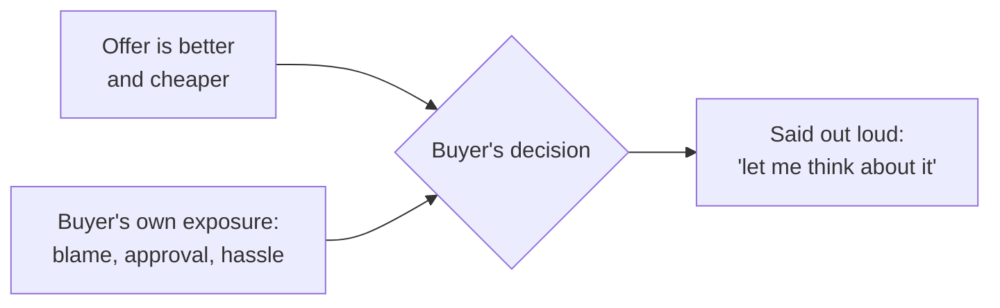

import Scenario from "../../../components/Scenario.astro";
import LevelIntro from "../../../components/LevelIntro.astro";
import PracticeCheck from "../../../components/PracticeCheck.astro";

export const unit = {
  track: "product-domain",
  unitSlug: "buyer-psychology",
};

<Scenario label="The jacket got cheaper. The answer did not change.">
  <Fragment slot="facts">
    

      
🧥 Jacket: $120 (assumed price), fits, and she needs one

      
🗣️ Stated reason: "It's too expensive"

      
🏷️ Clerk's fix: 20% off, so $96

      
🤷 Her reply: "Hmm, I'll think about it"

    

    

      

        $96 of $120
        price after the cut, still a "no"
      

      

        

      

      
96 / 120 = 80%. The price fell by a fifth and her hesitation did not move.

    

  </Fragment>

A shopper, Mara, tries on a jacket. It fits, it is the kind she was looking for,
and she says: "It's too expensive." The clerk, wanting to help, takes 20% off:
$120 becomes $96 (these prices are made up for the example). Mara looks at the
tag, looks at the jacket, and says: "Hmm, I'll think about it."

**If price really was the problem, why did fixing the price not fix the answer?**

</Scenario>

The clerk answered the sentence Mara said. Mara's hesitation was about
something she did not say, and a price cut cannot touch that.

<LevelIntro
  items={[
    "Stated versus real objections",
    "Why the real reason stays unsaid",
    "Risk and the pull of the status quo",
  ]}
/>

## What is the difference between what a buyer says and what stops them?

**What could Mara be worried about that a cheaper tag does not solve?** Perhaps
that she cannot return it if it looks wrong at home, or that her partner will
ask why she bought another coat. Nothing in "too expensive" mentions either.

- A **stated objection** is the reason a buyer gives out loud: "too expensive,"
  "not the right time," "let me think about it."
- A **real objection** is the concern that actually decides the answer. It is
  often about the buyer's own risk, reputation or permission rather than the
  product.
- Stated objections are cheap to say. They sound professional, end the
  conversation politely, and ask nothing of the buyer.

|                  | Stated objection                     | Real objection                                        |
| ---------------- | ------------------------------------ | ----------------------------------------------------- |
| How it sounds    | "It's too expensive"                 | Usually unspoken unless someone asks                  |
| What it is about | The product, on the surface          | The buyer's risk, reputation or authority             |
| Why it gets said | Costs nothing and avoids awkwardness | Feels personal, so it is not volunteered              |
| Mara's version   | "Too expensive"                      | Not yet known. A later level finds it with a question |

<PracticeCheck
  track={unit.track}
  unitSlug={unit.unitSlug}
  topicId="stated-vs-real"
/>

## Why do buyers hesitate even when the offer is better?

**Suppose the offer really is better and cheaper than what the buyer has now.
What else could make "no change" the safer-feeling answer?** Who carries the
blame if the change goes wrong.

- **Risk aversion** is reluctance to be the one responsible if a new choice goes
  badly, even when it is probably better.
- **Status quo bias** is the pull toward "what we already do," because its flaws
  are familiar and survivable, while a new option's flaws are still unknown.
- In a business sale, the same pull exists one level up: a work colleague
  recommending a new vendor puts their name on the outcome. This is what the
  sale-between-companies setting adds to Mara's jacket.

Both inputs feed the decision. Only the left one shows up in the pitch, and
only the right one explains the stall.

<PracticeCheck
  track={unit.track}
  unitSlug={unit.unitSlug}
  topicId="risk-status-quo"
/>

## A workplace version of the same gap

A vendor offers a client a monitoring tool: software that watches systems and
alerts people when something breaks. It solves the client's stated problem
("we find out when things break from customer complaints") and costs less than
their current patchwork. The client says: "This looks great, we need to think
about it." Same shape as the jacket. L2 gives a question that finds what sits
underneath, and L3 runs it as a real follow-up call.
