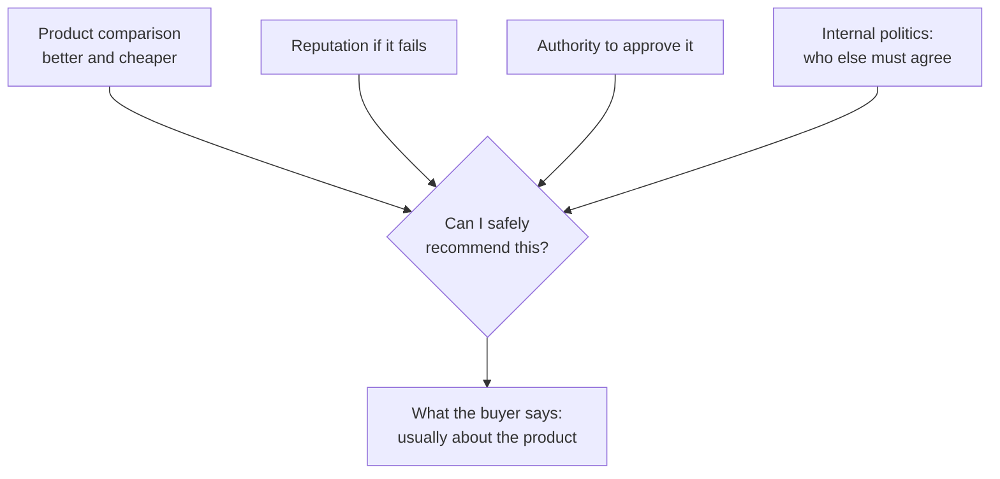

import LevelIntro from "../../../components/LevelIntro.astro";
import Checkpoint from "../../../components/Checkpoint.astro";
import PracticeCheck from "../../../components/PracticeCheck.astro";

export const unit = {
  track: "product-domain",
  unitSlug: "buyer-psychology",
};

L1 showed Mara saying no to a jacket whose price had just dropped by a fifth,
and a client stalling on a better, cheaper tool. This level builds two things:
a short list of patterns worth listening for, and one question that invites the
real concern out without accusing anyone.

<LevelIntro
  items={[
    "Stated-to-real patterns, as clues not rules",
    "Why a business buyer carries personal risk",
    "A question that looks forward, not backward",
  ]}
/>

## Is there a pattern in what people say and what they mean?

**If "I'll think about it" and "it's not the right time" both end a
conversation, are they the same objection?** Often not. Different stated lines
tend to sit on top of different worries.

| Stated objection                 | A common real objection underneath                                   |
| -------------------------------- | -------------------------------------------------------------------- |
| "I'll think about it."           | Not confident enough yet to put their own judgment behind the choice |
| "It's not the right time."       | Unsure they are allowed to approve this alone                        |
| "We're happy with what we have." | Status quo bias: the old flaws are known, the new ones are not       |
| "It's a bit expensive for us."   | No way yet to justify the cost to whoever they answer to             |

Read the table as a list of things to listen for. Sometimes "too expensive"
means exactly that: the budget is not there. A table of patterns is not a
mind-reading machine, and treating every stall as a cover story turns curiosity
into suspicion.

<Checkpoint question="A buyer says 'we're happy with what we have,' although your product is clearly better on paper. Which pattern from the table is the likeliest worry underneath?">

Status quo bias. The buyer's current setup has flaws they already know how to
live with, while the new option's flaws are unknown and therefore feel riskier
to be responsible for. "We're happy with what we have" is easier to say than
"I would rather live with a known problem than be blamed for an unknown one,"
yet the second sentence is closer to what is deciding the answer.

</Checkpoint>

## Why is a business buyer's hesitation so often personal?

**The tool is cheaper and better. Why would the person buying it still hesitate?**
Because they are judged on the outcome of the choice, not on the comparison
chart. In a business-to-business sale (one company selling to another), the
buyer often needs approval, has to explain the decision upward, and puts their
reputation on the result.

The stated objection nearly always references the product, because that is the
comfortable, professional thing to say. The weight of the decision sits on the
three boxes the pitch never mentioned.

<PracticeCheck
  track={unit.track}
  unitSlug={unit.unitSlug}
  topicId="objection-patterns"
/>

## What do you ask when you suspect the stated reason is not the whole story?

**Is "Is that really the reason?" a good question to ask?** No. It points at the
past, implies the buyer was not honest, and invites them to defend what they
already said. A better question points forward: **"What would need to be true
for this to be an easy yes?"**

| Question                      | What it asks the buyer to do    | Likely result                    |
| ----------------------------- | ------------------------------- | -------------------------------- |
| "Is that the real reason?"    | Confirm or deny a suspicion     | Defends the stated reason harder |
| "Why not?"                    | Justify a decision already made | Repeats the stated objection     |
| "What would need to be true?" | Plan what is missing for a yes  | Names the missing piece          |

Back in the shop, the clerk tries it on Mara. "What would need to be true for
this to be an easy yes?" Mara answers: "If I could bring it back within 30 days,
I would take it today." The real objection was never the $96. It was being stuck
with a coat she could not return.

<Checkpoint question="Why does 'what would need to be true for this to be an easy yes?' get a more honest answer than 'is price really the problem?'">

The price question still asks the buyer to confirm or deny a suspicion about
their own honesty, so they either admit they were holding something back or
defend the stated reason to avoid saying so. The forward question never asks
them to look at what they already said. It asks what is missing, which is a
planning question with nothing uncomfortable to defend against.

</Checkpoint>

<PracticeCheck
  track={unit.track}
  unitSlug={unit.unitSlug}
  topicId="surfacing-question"
/>

## Three ways this goes wrong

- **Assuming every stall hides something.** Sometimes the stated objection is
  the whole story, and digging for more reads as pushy.
- **Asking in a way that accuses.** Backward-looking questions risk the
  relationship for information a forward question gets for free.
- **Finding the real objection and ignoring it.** Learning that the worry is
  personal risk and answering with more features leaves the actual concern
  untouched.
