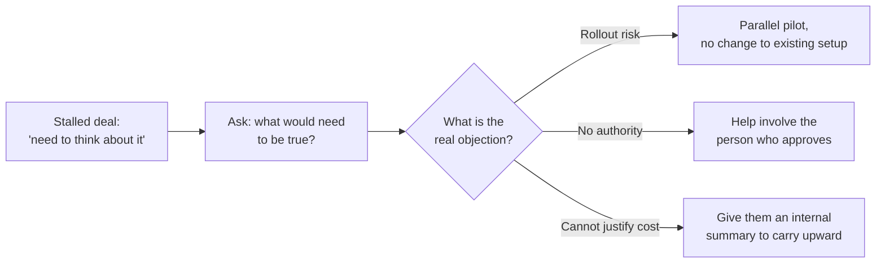

import Scenario from "../../../components/Scenario.astro";
import LevelIntro from "../../../components/LevelIntro.astro";
import Checkpoint from "../../../components/Checkpoint.astro";
import PracticeCheck from "../../../components/PracticeCheck.astro";

export const unit = {
  track: "product-domain",
  unitSlug: "buyer-psychology",
};

<Scenario label="The scenario">
  <Fragment slot="facts">
    

      
🛠️ Vendor sells a monitoring tool; client's stated problem is learning of outages from customers

      
💬 Client's line: "This looks great, we need to think about it"

      
⏳ Three weeks and two follow-up emails later: silence

      
❓ Real objection: not yet known

    

  </Fragment>

This is the monitoring-tool sale from L1, picked up three weeks after the
pitch. The tool matches the client's stated problem and costs less than their
current mix of partial tools. Nothing about the product has changed. The only
thing the vendor can still change is what they ask.

**Before reading on: which would you guess is stuck, the tool or the client's
position, and what single question would you ask to find out?**

</Scenario>

<LevelIntro
  items={[
    "The follow-up question, line by line",
    "Matching the response to the real objection",
    "Why one fix does not fit every stalled deal",
  ]}
/>

## What does the vendor ask, and what comes back?

**Why not ask "have you decided?"** That invites a yes or a stall, and the
stall is the answer already given. The vendor asks the forward question from L2.

> Vendor: "Totally understand needing time. Can I ask, what would need to be
> true for this to be an easy yes on your end?"
>
> Client: _(pause)_ "Honestly, the tool itself isn't the issue. I would be the
> one recommending we switch monitoring vendors, and if the migration causes
> any disruption in the first month, that is on me, even though the current
> setup is genuinely worse."

A migration is the move from one tool to another. The client fears the messy
middle: the old system is imperfect but everyone knows how to survive it, while
the switch itself could create blame. The stated objection said nothing about
that, and a thorough pitch could not have drawn it out, because the pitch only
ever tested the product against the problem the client had already named.

<Checkpoint question="Why could even a perfect first pitch not have found this worry?">

The pitch tests the product against the stated problem, and the worry was never
part of that problem. The client also had little reason to volunteer "I am afraid
of being blamed" in a sales meeting, where saying it feels exposing. It surfaced
only when a question invited the client to name what was missing.

</Checkpoint>

<PracticeCheck
  track={unit.track}
  unitSlug={unit.unitSlug}
  topicId="follow-up-call"
/>

## What does the vendor do now that the real objection is known?

**Does the vendor go back to features and price?** No. Those answer the stated
objection, and the real one is about rollout risk to the client personally. The
response has to remove that exposure.

> Vendor: "That is a reasonable thing to be cautious about. What if we ran a
> parallel pilot? Your current monitoring stays exactly as it is, ours runs
> alongside it for three weeks with no changes to your existing alerts, and you
> cut over only after you have seen it catch everything the old one does."

In a parallel pilot, the new tool runs beside the old one without replacing it.
To cut over is to make the new tool the one people actually depend on. The
pilot removes the month in which the client would be exposed: nothing changes
until they have verified the result themselves.

| Real objection                         | What it needs                                | What does not help                       |
| -------------------------------------- | -------------------------------------------- | ---------------------------------------- |
| Personal rollout risk                  | Reversible, low-exposure first step          | A discount or a longer feature list      |
| "My boss decides, and has not seen it" | A way to bring the approver into the process | A pilot the buyer cannot authorize alone |
| No way to justify the cost upward      | Material they can use with their own manager | Repeating the price comparison           |

<Checkpoint question="The client's worry was rollout risk. Why would a 15% discount have done nothing for it?">

A discount lowers the price, and the client had not said price was the issue.
Their exposure was the first month after the switch, and a cheaper tool that
breaks in that month is still their name on the recommendation. The response
has to remove or shrink that exposure, and the pilot does exactly that.

</Checkpoint>

## What carries over, and what is only this case?

The pattern generalizes: a stated objection about the product usually sits on
top of a concern about the buyer's own risk or authority, and a forward question
surfaces it without accusation. It applies well beyond sales, for example to
getting a manager to approve a project or a teammate to adopt a new tool.

The specifics do not generalize. The exact real objection (personal rollout
risk) and the exact fix (a zero-risk pilot) belong to this client. **This is one
worked case, not the whole territory.** Try extending it:

- **What if the answer had been** "my boss controls this budget and has not seen
  it yet"? Would the same pilot still be the right response, or does it need a
  structurally different fix?
- **What if the client answered** "nothing, we just do not need it"? Is that
  stated objection also the real one, and how would you tell?
- **What if you were the buyer** and a colleague stalled on your proposal? What
  forward question would you ask them?

In the authority case, a good response sounds different: "Would it help if we
prepared a short summary for your boss, joined a decision call, or mapped the
approval steps together?" The fix is no longer to reduce rollout risk. It is
to help the buyer bring in the person who can actually say yes.

<Checkpoint question="If the answer had been 'my boss controls this budget and has not seen it yet,' would the parallel pilot still fit?">

No. The pilot removes rollout risk, which is not the blocker in this version.
The client would still lack a route to their boss's sign-off however well the
pilot performed. The response has to match whatever the real objection turns
out to be, which here means helping bring the decision-maker into the
conversation, rather than reusing last case's fix because it worked once.

</Checkpoint>

<PracticeCheck
  track={unit.track}
  unitSlug={unit.unitSlug}
  topicId="matching-response"
/>

## Failure modes

| Failure mode                                              | What it gets wrong                                                                        |
| --------------------------------------------------------- | ----------------------------------------------------------------------------------------- |
| Answering a stall with more features or a bigger discount | Neither addresses personal risk or missing authority                                      |
| Asking "is that the real reason?"                         | Puts the buyer on the defensive and makes the real concern less likely to surface         |
| Acknowledging the concern but not answering it            | The pilot worked because it removed the exposure, not because the worry was noted         |
| Reusing one case's fix as the universal fix               | A pilot solves rollout risk and does nothing for an authority or budget-justification gap |
