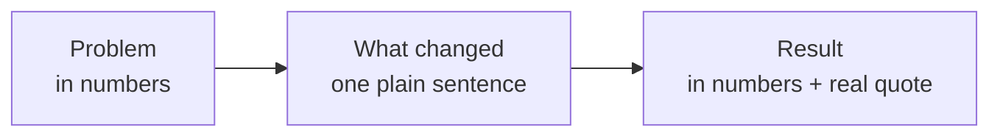

import Scenario from "../../../components/Scenario.astro";
import LevelIntro from "../../../components/LevelIntro.astro";
import PracticeCheck from "../../../components/PracticeCheck.astro";

export const unit = {
  track: "product-domain",
  unitSlug: "case-studies",
};

<Scenario label="Same week, same deal size, one habit">
  <Fragment slot="facts">
    

      
🤝 <strong>Both reps close</strong>: a $21,000/year deal, same week

      
⏱️ <strong>Omar</strong>: closes, then starts the next cold-outreach cycle

      
📝 <strong>Sana</strong>: spends 20 minutes on a one-page case study and a specific referral ask

    

    
Three months later

    

      

        
🥶 Omar: 3 cold leads, 0 closed$0 closed

        

      

      

        
🔥 Sana: 2 warm referrals, 1 closed$23,000 closed

        

      

    

  </Fragment>

Two reps close a similarly sized deal at the same company in the same week:
$21,000 a year, nothing unusual about either sale. Omar logs the deal and starts
the next prospecting cycle from a cold list, the way he starts every cycle.
Sana logs hers, then spends about twenty minutes on two things: turning the win
into a one-page case study built from the client's own numbers and words, and
asking that client for one or two introductions to people with the identical
problem.

Three months later Omar has three cold leads and nothing closed. Sana has two
warm referrals, and one of them has already closed at $23,000. All names and
dollar figures in this unit are made up for teaching.

**Same skill, same product, same deal size. What did those twenty minutes buy
Sana that Omar's identical selling ability did not?**

</Scenario>

A closed deal is usually treated as the finish line. This unit treats it as raw
material for two small moves that turn one win into leverage for the next.

<LevelIntro
  items={[
    "A closed deal as raw material",
    "The anatomy of a one-page case study",
    "The referral ask and why it compounds",
  ]}
/>

## Why is a closed deal the start of something, not the end?

**If Omar and Sana sell equally well, where did the difference come from?** Not
from the sale. It came from what each did with the sale afterwards.

- **Raw material:** a closed deal contains a real before, a real change and a
  real result. Unrecorded, that information is gone within weeks.
- **Warm lead:** a prospect who arrives having already read what happened for
  someone like them. Cold leads start from zero trust; warm ones start part of
  the way there.
- **Compounding:** each documented win makes the next sale easier, so the gain
  grows with the number of wins instead of staying flat.

| Three months after the close | Omar (closed, moved on)          | Sana (closed, documented, asked)              |
| ---------------------------- | -------------------------------- | --------------------------------------------- |
| Leads sourced                | 3 cold                           | 2 warm referrals                              |
| Where each lead started      | From zero, like every past cycle | Already half-convinced by a documented result |
| Closed revenue from them     | $0                               | $23,000 (1 of 2)                              |

<PracticeCheck
  track={unit.track}
  unitSlug={unit.unitSlug}
  topicId="win-as-raw-material"
/>

## What does a case study actually contain?

**Why would a prospect believe Sana's one page and shrug at a page of praise?**
Because her page has a fixed shape that makes each claim checkable.

- **Problem, in numbers:** what the client's situation was costing before,
  stated as the client stated it.
- **What changed:** the specific change, described plainly enough that a similar
  prospect recognizes their own setup.
- **Result, in numbers, with a real quote:** a before/after figure and a
  sentence the client actually said.

A case study missing any one of the three reads as praise, and praise is easy to
discount as politeness. A number and a quote are much harder to wave away.

<PracticeCheck
  track={unit.track}
  unitSlug={unit.unitSlug}
  topicId="case-study-anatomy"
/>

## What is a referral ask, in one line?

A direct request for an introduction to someone with the problem the client just
had solved. It works when it is asked **right after the win** and phrased as a
**narrow question the client can answer in under a minute**. L2 takes both
variables apart.

**Key terms:** case study, referral ask, warm lead, before/after, compounding,
proof point.
