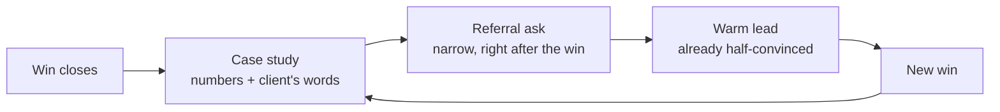

import LevelIntro from "../../../components/LevelIntro.astro";
import Checkpoint from "../../../components/Checkpoint.astro";
import PracticeCheck from "../../../components/PracticeCheck.astro";

export const unit = {
  track: "product-domain",
  unitSlug: "case-studies",
};

L1 showed the gap between documenting a win and letting it disappear. L2 asks
two sharper questions: why does one version of a case study persuade while
another is ignored, and why does one referral ask get a name while another gets
silence? Every figure is a made-up teaching number.

<LevelIntro
  items={[
    "Checkable versus unfalsifiable proof",
    "Referral timing and framing",
    "How one win loops into the next",
  ]}
/>

## What makes a case study persuasive instead of decorative?

**Two pages describe the same result. A skeptical prospect trusts one and
discounts the other. What is that prospect testing for?** Whether this is a
real thing that happened to a real person, or copy written to sound like one.

| Element     | Weak version                                          | Strong version                                                               |
| ----------- | ----------------------------------------------------- | ---------------------------------------------------------------------------- |
| Numbers     | "significantly reduced errors"                        | "cut double-booking incidents from 4 a quarter to 0"                         |
| Voice       | Unattributed marketing copy about how clients love it | A real quote from a named person and role                                    |
| Structure   | A success story with no stated starting point         | Problem in numbers, then the change, then the result in numbers              |
| Credibility | "A logistics company"                                 | Named client and role, specific enough that a similar prospect recognizes it |

A vague version is not dishonest. It is **unfalsifiable**, and a skeptical
reader treats a claim they cannot check as marketing by default. A specific
number attached to a named person is easy to check and hard to invent.

<Checkpoint question="Why does 'cut double-booking incidents from 4 a quarter to 0' persuade more than 'significantly reduced errors' when both describe the same result?">

The specific number can be checked and the vague phrase cannot. "Significantly
reduced errors" could describe almost any outcome, including a disappointing one
in confident language, so a skeptic has no way to tell and discounts it. "From 4
a quarter to 0" is a concrete fact tied to a person, and that kind of detail is
exactly what a prospect screens for when reading a case study at all.

</Checkpoint>

<PracticeCheck
  track={unit.track}
  unitSlug={unit.unitSlug}
  topicId="checkable-proof"
/>

## What makes a referral ask get a real answer?

**Two reps ask satisfied clients for introductions. One gets a name in a minute,
the other gets nothing. The clients liked both reps equally. What differed?**
The ask itself, on two variables.

| Variable | Works                                                             | Fails                                                               |
| -------- | ----------------------------------------------------------------- | ------------------------------------------------------------------- |
| Timing   | Right after the win, while the pain and the relief are both fresh | Folded into a renewal call months later                             |
| Framing  | "Does anyone come to mind with this exact problem?"               | "Let me know if you hear of anyone"                                 |
| Burden   | The client answers from memory in under a minute                  | The client must research and remember the request on their own time |

Open-ended asks fail not because the client does not want to help, but because
they hand the client a research task with no trigger to remember it.

<Checkpoint question="A rep closes a deal like Marcus's but asks for a referral only at the renewal call four months later. What is lost even if the client says yes?">

The specificity behind the yes. Right after the win the client can name a
precise, vivid problem and picture a colleague who has the same one. Four months
on, the details have blurred into general satisfaction, so the answer becomes
vague goodwill: generic, delayed or forgotten, because the moment that made the
match obvious has passed.

</Checkpoint>

<PracticeCheck
  track={unit.track}
  unitSlug={unit.unitSlug}
  topicId="referral-ask-mechanics"
/>

## How much can the habit add over a year?

**Does a 20-minute habit really change a pipeline, or only a single quarter?**
It repeats, and each repetition has a yield. Using the assumptions in this
unit's slider demo (all made up): one case study a quarter, 1.5 qualified
referrals from each, a 45% close rate on referred leads, a $20,000 average deal.

| Step                          | Calculation     | Result per quarter |
| ----------------------------- | --------------- | ------------------ |
| Referrals from one case study | 1 x 1.5         | 1.5                |
| Wins from them                | 1.5 x 45%       | 0.675              |
| Revenue from those wins       | 0.675 x $20,000 | $13,500            |
| Over 4 quarters               | 4 x $13,500     | **$54,000**        |

A rep who skips both steps, like Omar, generates none of that. This level's slider
demo lets you drag any input to zero and watch the contribution vanish.
Each documented win also feeds later sales directly: an overcome objection for
the next objection conversation, a real dollar figure for the next ROI pitch,
and a client's own words for the next discovery call.
