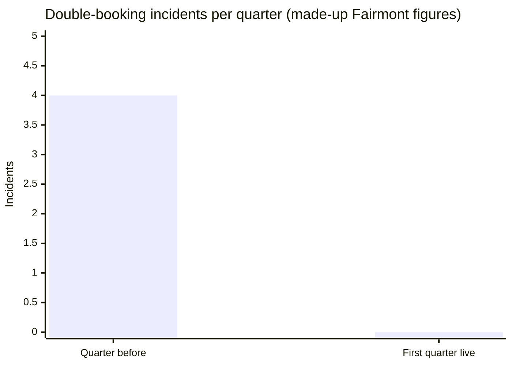
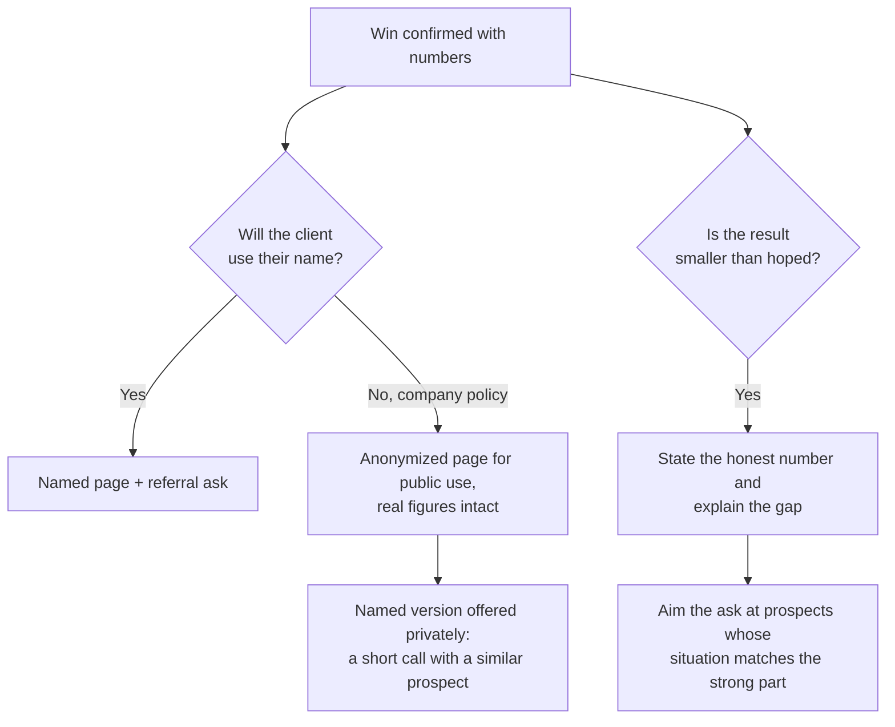

import Scenario from "../../../components/Scenario.astro";
import LevelIntro from "../../../components/LevelIntro.astro";
import Checkpoint from "../../../components/Checkpoint.astro";
import PracticeCheck from "../../../components/PracticeCheck.astro";

export const unit = {
  track: "product-domain",
  unitSlug: "case-studies",
};

<Scenario label="The scenario">
  <Fragment slot="facts">
    

      
🚚 Fairmont Logistics: $19,800/year, locked for two years (made-up)

      
🤝 Marcus agreed to a reference call if the tool performs after one quarter

      
📉 Before: 4 double-bookings a quarter at about $2,100 each

      
📅 Now: three months live, time for the follow-up

    

  </Fragment>

Dana closed Fairmont Logistics in the `objection-handling` unit on the promise of
a reference call if the tool performed. Three months have passed. This level runs
the follow-up in full: confirm the result, write the page, make the ask, and
then bend the plan twice when the win does not arrive in the ideal shape. Every
name and number is made up.

**Before reading on: which do you think Dana does first, writing the case study
or asking for the referral?**

</Scenario>

<LevelIntro
  items={[
    "Verifying the number, then writing the page",
    "The referral conversation and a failed contrast",
    "Awkward wins: private clients and modest results",
  ]}
/>

## Why does Dana check the number with Marcus before writing anything?

**If she already knows the tool works, why not draft the page from memory?**
Because a case study is only as strong as its least checkable sentence, and
memory rounds everything off.

Dana asks how the quarter went. Marcus says: zero double-bookings, down from
four. She asks what that is worth in the terms he used originally, and he gives
the same ballpark as before, about $2,100 an incident in overtime and rush
coverage.

| Quantity                        | Calculation | Value   |
| ------------------------------- | ----------- | ------- |
| Incidents avoided this quarter  | 4 - 0       | 4       |
| Avoided cost this quarter       | 4 x $2,100  | $8,400  |
| Annualized if the pattern holds | 4 x $8,400  | $33,600 |

The page then follows L2's shape, in prose: the problem (three dispatchers
editing one spreadsheet, four double-bookings, about $8,400 a quarter), the
change (a tool that locks a truck once it is assigned), and the result (zero
incidents, $8,400 avoided, "on pace for roughly $33,600 a year if the pattern
holds"), closing with Marcus's own sentence: "Once it was impossible to
double-book a truck, that whole category of cost just went away." There are no
adjectives doing the persuading, and every figure came from Marcus half a minute
earlier.

<Checkpoint question="Why does the page keep Marcus's slightly informal sentence instead of a polished paraphrase?">

A polished paraphrase such as "streamlined our dispatch process" could have been
written by anyone, so a skeptic cannot tell whether a client said it. Marcus's
phrasing is recognizably what an operations manager says about his own
workflow, which makes it hard to fabricate and easy to believe. That
believability is the whole reason to include a quote.

</Checkpoint>

<PracticeCheck
  track={unit.track}
  unitSlug={unit.unitSlug}
  topicId="verify-then-write"
/>

## How does the referral conversation run, and what does a failed one look like?

**Marcus has just confirmed the numbers. What is the best next sentence?** The
ask, in the same conversation, while the win is the thing on his mind.

Dana asks permission to publish the write-up, and Marcus agrees ("it is all
true, might as well say it"). She then asks, with an easy way out, whether he
knows one or two other operations leads running dispatch from a shared
spreadsheet with several editors, since that is the setup where the tool saves
the most. A name surfaces almost at once, because the question gave him something
precise to match against. Dana then lowers the effort further by offering to
mention his name or have him forward the contact, and he chooses to forward it.

Theo closed a similar win the same quarter and let it slide. His page, posted
three weeks after the close, says clients love how much time they save, with no
number, name or quote. His referral ask is a postscript on a routine check-in a
month later: "if you know anyone who might be interested, feel free to send them
our way." Silence followed.

| Element          | Dana                                         | Theo                                  |
| ---------------- | -------------------------------------------- | ------------------------------------- |
| Case study       | Real numbers, named client, attributed quote | Vague praise, no name, no number      |
| Referral timing  | Same call as the result confirmation         | A month later, inside a routine email |
| Referral framing | "One or two ops leads with this exact setup" | "If you know anyone"                  |
| Outcome          | A specific name, forwarded during the call   | Silence                               |

<Checkpoint question="Theo's client was genuinely satisfied and the result was as solid as Dana's. Why did his ask still fail?">

A good result does not make the ask for you. Theo's version made the client
remember the win unprompted, think of a qualifying person unprompted and then
take the initiative to reach out. Most satisfied clients will not do that, not
because they do not care but because nothing made the match between a solved
problem and a person who has it obvious. Dana's ask made that match in the same
breath as confirming the win.

</Checkpoint>

<PracticeCheck
  track={unit.track}
  unitSlug={unit.unitSlug}
  topicId="referral-conversation"
/>

## What if the client will not go public, or the result is modest?

**Plans meet awkward wins. What survives, and what must change?**

**Private client.** Suppose Marcus says he can do a reference call but cannot put
his name and Fairmont's on a public page because of vendor-endorsement policy.
The numbers and quote do not vanish; they move to narrower uses. Dana writes an
anonymized public version ("a logistics fleet running three-dispatcher
shared-spreadsheet scheduling") with every figure intact, and keeps the named
version for private introductions. Persuasion needs a real person a prospect can
talk to, not a public logo.

**Modest result.** Suppose two of four incidents were eliminated, a genuine 50%
reduction worth 2 x $2,100 = $4,200 a quarter. The honest page says so and
explains the remainder, for example that the other two trace to a training gap
the team is closing. A modest number a prospect can verify beats an inflated one
that does not hold, the same lesson as `value-based-selling` where a promised
figure that is not delivered costs more trust than a smaller honest one would
have cost in a first impression.

<Checkpoint question="With the modest result, why aim the referral ask at a narrower group of prospects?">

Because the strong part of the result only applies to some situations. Asking for
anyone with the general problem pulls in prospects whose setup does not match
what actually worked, who then judge the tool against a result it never claimed
for them. Aiming at the matching situation keeps the ask honest and the
resulting conversations more likely to end in a win.

</Checkpoint>

<PracticeCheck
  track={unit.track}
  unitSlug={unit.unitSlug}
  topicId="awkward-wins"
/>

## What this worked example does not cover

The Fairmont follow-up is a case, not the whole territory. **What would change
if Marcus's win were a deadline hit that would otherwise have been missed, not a
cost avoided?** The three-part shape (a before, a specific change, a result in
the client's own terms) still holds, but the number worth leading with might be
a date, a contract renewed or a client kept, not a dollar figure. Ask the same of
other twists: a client who changed jobs before the quarter ended, a result that
took a year to show, or a win that depended on the client's own effort. In each,
find the client's own real measure of the win and build the page and the ask
around that.
