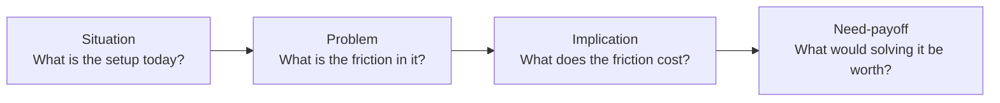
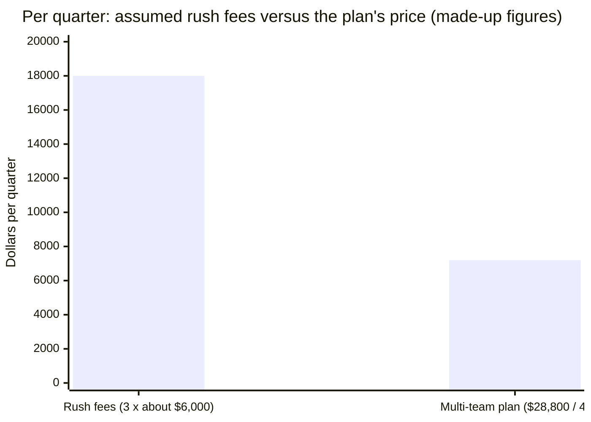

import LevelIntro from "../../../components/LevelIntro.astro";
import Checkpoint from "../../../components/Checkpoint.astro";
import PracticeCheck from "../../../components/PracticeCheck.astro";

export const unit = {
  track: "product-domain",
  unitSlug: "discovery",
};

L1 showed that Bex and Adri differed in one thing: whether the call was
built around asking or around telling. L2 turns that into a repeatable
order. As in L1, the names and figures are made up for teaching.

<LevelIntro
  items={[
    "What each of the four steps is for",
    "Why implication is the step most calls skip",
    "Who should say why solving it matters",
  ]}
/>

## What does each step of the flow do?

**Bex asked four questions and Priya moved from "pricing for 8 people"
to "leadership would sign off on a bigger plan". Was that luck, or did
each question have a distinct job?** Each had one.

| Step        | Bex's question in the call                                     | What it reveals                            |
| ----------- | -------------------------------------------------------------- | ------------------------------------------ |
| Situation   | "Walk me through how work moves through your team"             | Three teams are involved, not one          |
| Problem     | "How does the handoff happen, and does it always work?"        | Things get missed and sit for a day or two |
| Implication | "When that happens, does it show up in cost or with a client?" | Rush fees and a missed client launch       |
| Need-payoff | "If that stopped, what would it be worth to you?"              | A bigger, multi-team plan is justified     |

Each step builds on the one before and does not try to do the next
step's job. The situation step is easy to over-invest in because it
feels like small talk: keep it to just enough context to ask a sharp
problem question.

<Checkpoint question="A rep spends twenty minutes on the situation step, covering every tool and process Priya's team uses, and then pitches. What went wrong, even though every question was open?">

Open questions are not enough on their own: the rep never asked what
goes wrong in that setup, so no problem was named and no cost was
attached. The situation step only exists to make the problem question
sharp. A long tour of the current setup leaves the prospect's urgency
exactly where it started, and the pitch that follows has to invent a
reason to care.

</Checkpoint>

<PracticeCheck
  track={unit.track}
  unitSlug={unit.unitSlug}
  topicId="four-step-flow"
/>

## Why is implication the step most calls skip?

**"Things get missed sometimes" sounds minor. What turns it into a deal
worth six times the original ask?** Putting a cost on it, which is the
implication step.

Priya's problem answer was mild: handoffs sometimes slip. Her
implication answer was not: three rush fees this quarter, the last one
about $6,000, and one missed client launch. Suppose, as an assumption for
this example only, that the other two fees were similar. Then the quarter
cost about $18,000 in rush fees alone.

Once that figure is on the table, a plan priced at $7,200 per quarter
stops looking like an expense and starts looking like a smaller number
than the problem already costs. Without the implication step, the price
has no anchor: the prospect compares it to nothing, and the seller
compares it to nothing too.

<Checkpoint question="A rep asks the situation question, then the problem question, then jumps to the pitch. What step is missing, and what does the missing step cost the rep?">

Implication is missing. Naming a problem without its cost leaves the
prospect's sense of urgency mild, so the pitch has to manufacture
urgency from the seller's side, which is much harder than reusing
urgency the prospect has already stated. It also leaves the price
without an anchor, so neither side can judge whether it is reasonable.

</Checkpoint>

<PracticeCheck
  track={unit.track}
  unitSlug={unit.unitSlug}
  topicId="implication-cost"
/>

## Who should say why solving it matters?

**After the cost is on the table, the seller could say "so you can see
why this matters". Why does Bex ask instead?** Because a reason the
prospect says out loud is theirs, while a reason the seller asserts is
only an argument.

| Who states the payoff | What it sounds like                                           | What the prospect does with it                 |
| --------------------- | ------------------------------------------------------------- | ---------------------------------------------- |
| The seller            | "This will save you a lot of money"                           | Weighs it as a sales claim, discounts it       |
| The prospect          | "Avoiding one more missed launch is worth more than the tool" | Carries it into their own internal discussions |

A need-payoff answer in the prospect's own words is also the raw number
that `product-domain/value-based-selling` later turns into a formal
case. Discovery's job is to surface it, not to polish it.

<PracticeCheck
  track={unit.track}
  unitSlug={unit.unitSlug}
  topicId="need-payoff-owner"
/>

## Pitch-first against discovery-first

| Stage in the call                  | Pitch-first (Adri)                       | Discovery-first (Bex)                           |
| ---------------------------------- | ---------------------------------------- | ----------------------------------------------- |
| If the ask is the real problem     | Works, at the size originally asked      | Works, and confirms it                          |
| If the ask is not the real problem | Answers the wrong question, then silence | Real problem surfaces before the pitch is built |
| Ceiling on deal size               | Whatever was first requested             | The real problem's scope and cost               |

Neither rep was lazy or dishonest. The difference was the shape of the
conversation, and that shape can be learned. L3 walks a full call.
