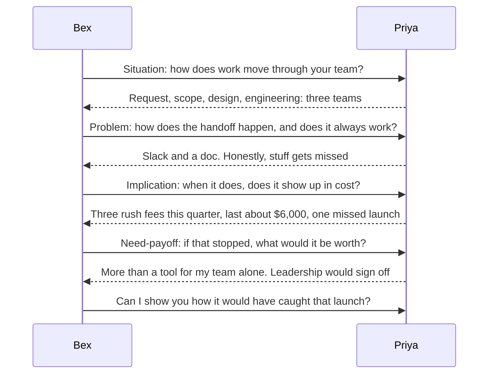
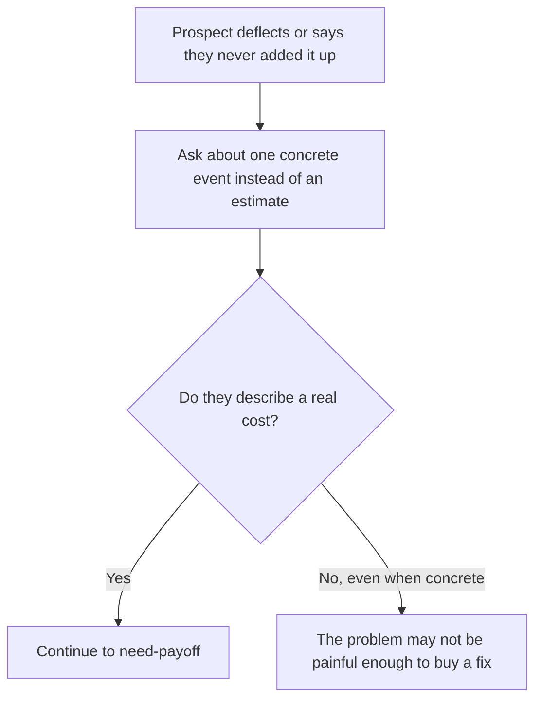

import Scenario from "../../../components/Scenario.astro";
import LevelIntro from "../../../components/LevelIntro.astro";
import Checkpoint from "../../../components/Checkpoint.astro";
import PracticeCheck from "../../../components/PracticeCheck.astro";

export const unit = {
  track: "product-domain",
  unitSlug: "discovery",
};

<Scenario label="The scenario">
  <Fragment slot="facts">
    

      
📩 Stated ask: pricing for an 8-person team, $4,800 a year

      
🔁 Real shape: 3 teams hand work off, handoffs fail

      
💸 Cost surfaced: 3 rush fees this quarter, last about $6,000

      
📦 Outcome: 24 seats, $28,800 a year, 6 times the ask

    

  </Fragment>

Same Bex and Priya as L1 and L2 (a made-up pair). This level plays out
the call question by question, then asks what changes when the prospect
is evasive or when three people are on the line.

Before reading the transcript, decide what you expect: Priya says she
wants a tool for eight people. **Which of her first four answers do
you think changes the size of the deal the most?**

</Scenario>

L2 gave the four-step order as a diagram and a table. L3 shows it
under real conditions, including the two ways a call stops being clean.

<LevelIntro
  items={[
    "The full call, turn by turn",
    "Evasive prospects and the follow-up that helps",
    "Several stakeholders with conflicting answers",
  ]}
/>

## What does the call look like, turn by turn?

**If every answer Priya gave was one the rep could not have predicted,
how does Bex know what to ask next?** By treating each answer as the
raw material for the next question, not as a box to tick.

| Answer                          | Who produced it | What Bex now knows that the first message never said |
| ------------------------------- | --------------- | ---------------------------------------------------- |
| "Three teams, not one"          | Priya           | The 8-seat framing is too small                      |
| "Stuff gets missed"             | Priya           | The pain is at the handoffs                          |
| "Rush fees and a missed launch" | Priya           | The cost is real and recurring                       |
| "Worth more than the tool"      | Priya           | The buyer has already argued for a bigger deal       |

Every row says Priya. Bex never told her the problem, its cost or its
value. The questions were open, so the answers were hers, and an
answer someone produced themselves is one they will defend later.

<Checkpoint question="Bex's pitch is one sentence plus a request to demo, while Adri's was fifteen minutes. Why can the short pitch work here?">

Because it does not have to do the job a long pitch usually does. It
does not need to prove a problem exists, that it matters, or roughly
what it is worth: Priya already said all three. The pitch only needs
to point at the one capability that matches the one cost she named.
A long pitch is often a symptom of not knowing what the prospect needs,
so everything gets shown in case one thing lands.

</Checkpoint>

## What if the prospect will not give a cost?

**Suppose Priya had answered the implication question with "it is
fine, we manage". Is the call over?** No, but repeating the same
question is the wrong response.

A concrete memory ("You mentioned a missed launch. What happened with
the client afterwards?") is easier to answer honestly than "estimate the
cost in dollars", which asks for arithmetic on the spot. If the prospect
still will not engage after a concrete follow-up, that is a finding:
no rephrasing will create urgency that is not there.

<PracticeCheck
  track={unit.track}
  unitSlug={unit.unitSlug}
  topicId="messy-calls"
/>

## What if three people are on the call?

**Priya, her engineering lead and a finance director all answer the
same open question. Their answers disagree. Should the rep steer back
to what they agree on?** No. Smoothing the disagreement gives a calmer
call and a shallower one.

| Stakeholder      | What they care about                       | How they answered the cost question |
| ---------------- | ------------------------------------------ | ----------------------------------- |
| Priya            | Missed handoffs between teams              | Specific and direct                 |
| Engineering lead | Being pulled in with no warning            | Vague and uncomfortable             |
| Finance director | The rush fees themselves, not the workflow | Sharp and specific                  |

No single row is the real problem; the three together are. A pitch
built only on the finance director's number risks losing the
engineering lead, whose team has to use the tool for the deal to
work. That conflict is the starting point for
`product-domain/translating-capability-into-their-vocabulary-cfo`.

<Checkpoint question="The finance director gives a precise cost; the engineering lead gives a vague, uncomfortable one. What should the rep do in the moment?">

Name the gap gently and ask about it, for example "it sounds like this
shows up differently for each of you, is that fair?" A vague answer
beside a precise one often means the cost is felt somewhere the
engineering lead cannot fully see, or that naming it feels like blaming
their team. Taking the precise number as the whole picture would build
a pitch on one voice.

</Checkpoint>

## Beyond this one call

Priya's call is a case, not the whole territory. It had a clean answer
at every step; most calls do not. Use these to push it further:

- What would the four steps look like if the prospect insists nothing is wrong?
- What changes if the real cost is reputational and cannot be put in dollars?
- What if the person on the call is not the person who decides?

For each, name which step becomes harder, and which question you would
ask next instead of the one you planned.
