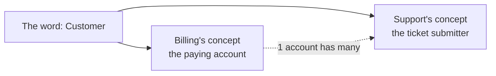

import Scenario from "../../../components/Scenario.astro";
import LevelIntro from "../../../components/LevelIntro.astro";
import PracticeCheck from "../../../components/PracticeCheck.astro";

export const unit = {
  track: "product-domain",
  unitSlug: "domain-driven-design-basics",
};

<Scenario label="One word, two keys">
  <Fragment slot="facts">
    

      
🗣️ Ana says: "grab the keys"

      
🏠 Ana means: the house keys

      
🚗 Ben hears: the car keys

      
🚪 Result: both at the front door, door still unlocked

    

  </Fragment>

Ana and Ben are leaving for a weekend trip. Ana calls from the hallway, "Grab
the keys!" Ben picks up the car keys and walks out. Ana meant the house keys.
They stand at the front door with a car they can drive and a house they
cannot lock.

**Nobody lied and nobody was careless. So what exactly went wrong?**

</Scenario>

One word was doing the work of two. Each person had a clear meaning in mind
and assumed the other had the same one, so nothing flagged the gap until it
cost something. Software teams do exactly this with business words, and then
the code makes the mismatch permanent.

<LevelIntro
  items={[
    "One word hiding two concepts",
    "Ubiquitous language",
    "What the mismatch costs a business",
  ]}
/>

## What happens when two teams share a word but not a meaning?

**An executive asks "How many customers do we have?" Billing answers 1,200.
Support answers 4,800. Who is wrong?** Neither. All numbers in this unit are
made-up teaching figures.

- Billing's **Customer** is the paying account: one per company.
- Support's **Customer** is whoever opens a ticket: often several people at the
  same company.
- The system has one table called `customers`, built early by whichever team
  touched it first. Every other team's code inherited that team's meaning
  without anyone deciding it should.

  

    

      💳 Billing: paying accounts
      1,200
    

    

      

    

  

  

    

      🎫 Support: ticket submitters
      4,800
    

    

      

    

  

  

    4,800 / 1,200 = 4 submitters per paying account on average
  

<PracticeCheck
  track={unit.track}
  unitSlug={unit.unitSlug}
  topicId="same-word-two-concepts"
/>

## What does it mean to keep one precise language?

**If the mismatch comes from words drifting apart, what keeps them together?**
**Ubiquitous language** is the practice of keeping the words used in business
conversation and the words used in the code identical and precise.

- A **domain** is the real part of the business the software represents:
  invoices, tickets, subscriptions, discounts, and the words people use to do
  their work.
- A **domain expert** understands that part of the business, even if they never
  write code: support, billing, sales, operations.
- When an expert says "grace period", the code has a `GracePeriod`, not a
  `state2` that only its author can decode.

|                                     | One shared, undefined "Customer"                             | Two explicit, scoped concepts                                                |
| ----------------------------------- | ------------------------------------------------------------ | ---------------------------------------------------------------------------- |
| Executive asks "how many customers" | Ambiguous: depends who answers                               | Clear: "1,200 paying accounts" or "4,800 support contacts", named explicitly |
| New engineer joins Billing          | Has to reverse-engineer which meaning the code actually uses | Reads the model, sees `BillingAccount`                                       |
| A report merges both teams' data    | Silently double-counts or undercounts                        | Each concept has its own field, explicitly related                           |

<PracticeCheck
  track={unit.track}
  unitSlug={unit.unitSlug}
  topicId="ubiquitous-language"
/>

The practical skill of this unit is noticing when a shared word is hiding two
different concepts, and giving each one an explicit, correctly scoped name
instead of forcing one definition to serve every team. L2 shows how.
