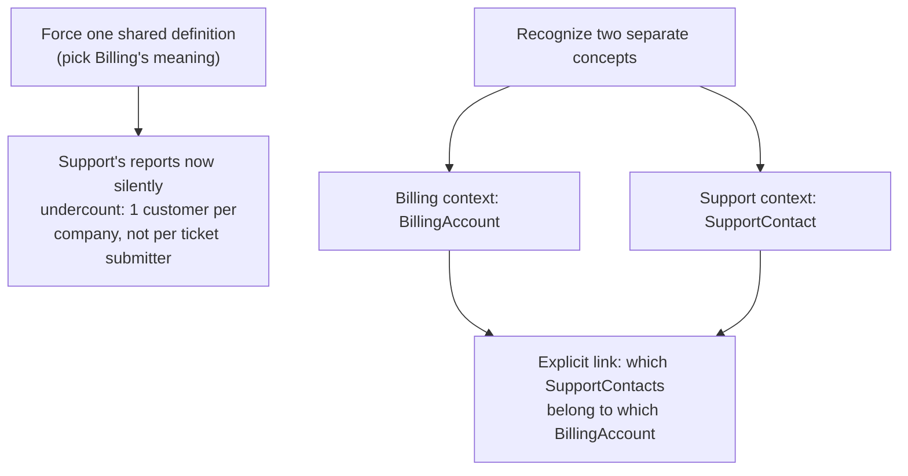
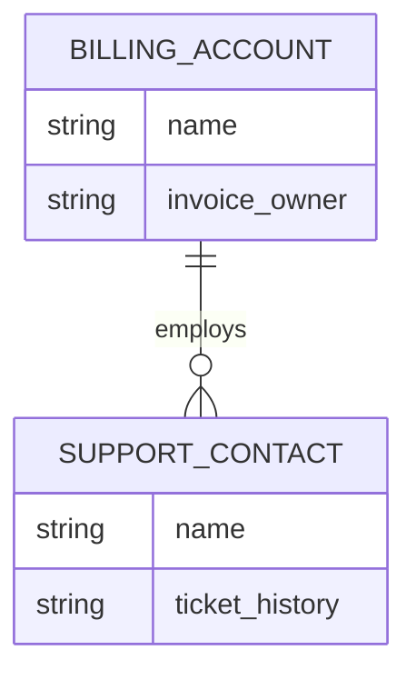
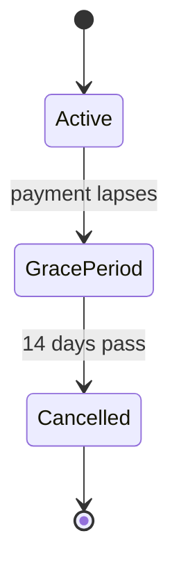

import LevelIntro from "../../../components/LevelIntro.astro";
import Checkpoint from "../../../components/Checkpoint.astro";
import PracticeCheck from "../../../components/PracticeCheck.astro";

export const unit = {
  track: "product-domain",
  unitSlug: "domain-driven-design-basics",
};

L1 showed that Ana and Ben, and Billing and Support, were each right about
their own meaning. L2 asks what a fix has to contain so it holds up in a real
system, not only in a conversation.

<LevelIntro
  items={[
    "Bounded contexts and the link at their edge",
    "What splitting costs, and when it pays",
    "Modeling a rule instead of a loose field",
  ]}
/>

## Why can't there just be one correct definition of "Customer"?

**If Billing and Support disagree, isn't the fix to pick the more correct
definition and make everyone use it?**

Forcing one definition does not resolve the disagreement. It makes one team's
model silently wrong for the other team's questions. Support needs to count
individual submitters; collapsing them into one customer per paying account
deletes information Support actually uses.

## Bounded contexts: where a term's meaning holds

**If both definitions are legitimate, how do they live in one system without
colliding?** A **bounded context** is an explicit boundary, usually following
how the business is organized (a team, a subsystem, a process), inside which a
term has one precise, agreed meaning. Outside it, the same word may mean
something else, and that is expected.

| Context | What "Customer" is called here | Meaning                                     |
| ------- | ------------------------------ | ------------------------------------------- |
| Billing | `BillingAccount`               | The account that owns and pays invoices     |
| Support | `SupportContact`               | The person who opened the ticket            |
| Between | An explicit relationship       | Each contact belongs to exactly one account |

The critical piece is not the new names. It is the **explicit relationship at
the boundary**. Without it the contexts silently disagree and no report can
reconcile them. With it, a report can say "4,800 support contacts across 1,200
billing accounts" instead of two contradictory customer counts.

<Checkpoint question="A new team, Onboarding, also tracks 'Customer', meaning whoever signed the initial contract. Should it just adopt Billing's BillingAccount since Billing already solved this?">

Not automatically. The question is whether "whoever signed the initial
contract" is the same concept as "the account that owns invoices", or a third
one that overlaps with both. In many companies the signer and the payer are the
same entity, and Onboarding can reuse `BillingAccount`. If a parent company
signs while a subsidiary's account pays, that is a real third concept, and
forcing it into `BillingAccount` recreates the original problem one level up.
The boundary has to be drawn where the meaning actually diverges, not assumed
from which team spoke first.

</Checkpoint>

**Does splitting always cost less than forcing one definition?** No. In the
unit's interactive demo, a simplified model counts pairs of teams that would
need their definitions reconciled, n x (n - 1) / 2, against roughly one
maintained boundary per team, n.

| Teams | Pairs to reconcile | Boundaries to maintain |
| ----- | ------------------ | ---------------------- |
| 2     | 1                  | 2                      |
| 3     | 3                  | 3                      |
| 4     | 6                  | 4                      |
| 10    | 45                 | 10                     |

At two teams, splitting is actually the more expensive option. The two lines
meet at three teams and diverge after that, which is why the "just talk to each
other" approach works early and fails later. This is an illustrative model, not
an estimate for any real organization.

<PracticeCheck
  track={unit.track}
  unitSlug={unit.unitSlug}
  topicId="bounded-context"
/>

## Modeling rules, not just fields

**Does "modeling the domain" just mean picking better names for database
columns?** No. It means capturing the rules the business runs by as concepts
the code enforces, not only data it stores.

| Just storing data                         | Modeling the domain                                                              |
| ----------------------------------------- | -------------------------------------------------------------------------------- |
| A `status` column that accepts any string | A `SubscriptionStatus` that moves only active, grace period, cancelled, in order |
| A `discount_percent` field with no bounds | A `Discount` that enforces "never above 40% without manager approval"            |
| A `customer_type` flag                    | Separate `BillingAccount` and `SupportContact` concepts with their own behavior  |

Each right-hand constraint is a rule an expert would say out loud: "a
subscription can't jump from active to cancelled without the grace period." A
model that does not enforce it lets other code violate a rule the business
depends on.

<Checkpoint question="A teammate says the status rule belongs in the UI, as a dropdown that only shows legal next options, not in the domain model. What is the risk of leaving it only there?">

The UI is one path into the system, not the only one. A background job doing a
batch cancellation, an internal admin tool, an API called directly by another
service, or a future integration can all set the status without touching the
dropdown, so each of them can silently break the rule. Putting the rule in the
domain model gives every caller, present or future, the same guarantee. The
dropdown is a helpful reflection of the rule for humans; the model is what
enforces it.

</Checkpoint>

<PracticeCheck
  track={unit.track}
  unitSlug={unit.unitSlug}
  topicId="rules-not-fields"
/>

**Is the takeaway "always split every ambiguous word"?** No. Splitting adds
concepts to maintain and a relationship to keep in sync. The skill is noticing
when a shared word masks two concepts with different rules and different
questions asked of them, and drawing a boundary only where the meanings have
truly diverged. That is how the code stops fighting the business.
