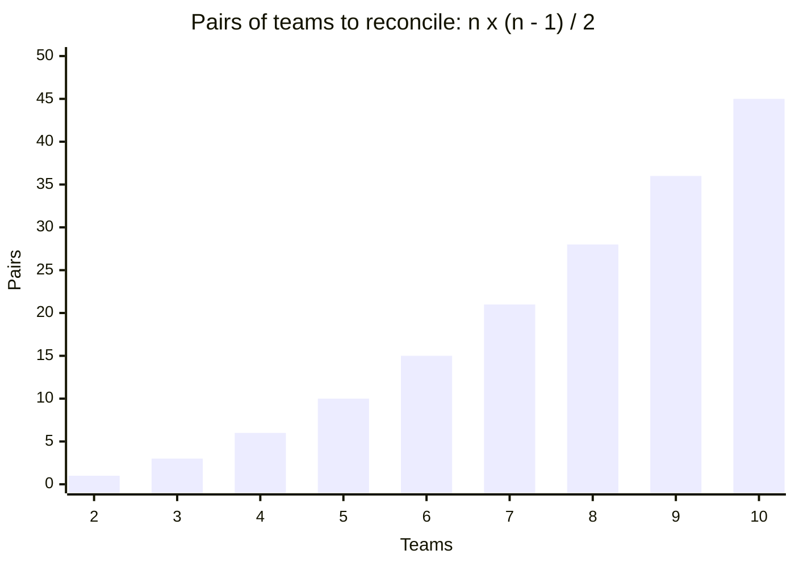

import Scenario from "../../../components/Scenario.astro";
import LevelIntro from "../../../components/LevelIntro.astro";
import Checkpoint from "../../../components/Checkpoint.astro";
import PracticeCheck from "../../../components/PracticeCheck.astro";

export const unit = {
  track: "product-domain",
  unitSlug: "domain-driven-design-basics",
};

<Scenario label="The reconciliation meeting">
  <Fragment slot="facts">
    

      
👩‍💼 <strong>Dana</strong>: Billing lead, counts paying accounts

      
🧑‍💼 <strong>Marcus</strong>: Support lead, counts ticket submitters

      
🧑‍💻 <strong>Priya</strong>: engineer, called in after two conflicting reports reached an executive

      
🔢 Made-up figures: 1,200 accounts, 4,800 contacts

    

  </Fragment>

The two conflicting customer counts from L1 have reached an executive. Priya
puts Dana and Marcus in a room.

**Before reading the conversation: is the goal of this meeting to decide whose
definition of "Customer" is correct?**

</Scenario>

<LevelIntro
  items={[
    "How a short conversation dissolves the collision",
    "When a team's own definition is still fuzzy",
    "Why informal fixes fail past a handful of teams",
  ]}
/>

## The conversation

> **Priya:** "Before we talk about the report numbers: Dana, when you say
> 'Customer', what are you actually counting?"
>
> **Dana:** "The account that pays the invoice. One per company, usually."
>
> **Priya:** "And Marcus, when Support says 'Customer'?"
>
> **Marcus:** "Whoever opened the ticket. Could be five different people at the
> same company in a given month."
>
> **Priya:** "So these are both real, both correct for what each of you needs.
> They're just not the same thing. What if we stop calling both 'Customer' and
> name them separately: a **Billing Account** and a **Support Contact**?"
>
> **Dana:** "That works for us, but how does the executive dashboard combine
> them without going back to being confusing?"
>
> **Priya:** "Every Support Contact links to exactly one Billing Account. That
> relationship already exists, people just weren't naming it. The dashboard says
> '1,200 Billing Accounts, 4,800 Support Contacts' and both are correct and
> labeled."

The disagreement vanished once it was named correctly. Dana and Marcus were
never wrong about their own numbers.

| Before                                                                  | After                                                                     |
| ----------------------------------------------------------------------- | ------------------------------------------------------------------------- |
| One `customers` table; meaning silently depended on who queried it      | `BillingAccount` and `SupportContact`, each with an explicit definition   |
| "How many customers" had no single correct answer                       | "How many billing accounts" and "how many support contacts" both have one |
| The relationship between the two existed in practice but wasn't named   | Explicit: each Support Contact belongs to exactly one Billing Account     |
| New team members had to ask around to learn which meaning applied where | The name itself tells you; no tribal knowledge required                   |

<Checkpoint question="Priya's fix worked because Dana and Marcus each already had a clear, if unstated, definition. What would have gone wrong if one of them was still genuinely unsure what their own team meant?">

The meeting only translated between two clear concepts; it did not invent one.
If Dana herself was unsure whether "Customer" meant the paying account, the
primary contact on the account, or something that varied case by case, naming it
`BillingAccount` on the spot would paper a vague concept over with a
confident-sounding label. The five-minute version presupposes that each team
already knows its own domain, and only supplies the missing step of comparing
notes across teams.

</Checkpoint>

## What if a team's own definition is genuinely fuzzy?

**The meeting assumed each lead had a clear definition. What if one of them
does not?** This is a different problem from a collision of two clear
definitions: no precise definition exists yet at all.

| Symptom                                           | Diagnosis              | What helps                                   |
| ------------------------------------------------- | ---------------------- | -------------------------------------------- |
| Each team answers at once, and the answers differ | Collision              | Name two concepts, define the link           |
| One team gives a different answer each time       | Fuzzy internal concept | Work with experts until the meaning is exact |

The fix is not a naming exercise. It is sitting with the domain experts and
asking about edge cases directly: "if someone opens a ticket but never pays
anything, are they a Support Contact? A prospective Billing Account? Neither,
until they convert?" An **edge case** is a rare or boundary case that forces a
rule to become clear, because a vague definition often breaks when tested on
unusual examples. Ubiquitous language can only be kept precise once it exists.

<PracticeCheck
  track={unit.track}
  unitSlug={unit.unitSlug}
  topicId="fuzzy-definition"
/>

## What changes at the scale of ten teams, not two?

**With two teams, one conversation and one relationship were enough. What
happens once Sales, Marketing, Finance and six other teams all use overlapping
terms slightly differently?**

A **pair** means two teams compared together. With four teams you have A-B,
A-C, A-D, B-C, B-D and C-D: six pairs already. The number of pairs grows much
faster than the number of teams.

At ten teams there are 45 pairs, not 10. Ad-hoc meetings stop scaling, and
organizations typically keep an explicit **context map**: a standing record of
which contexts exist, what each owns, and how terms translate at every boundary
that matters. It can be as simple as a table.

| Context | What this term means here | Connected context | How the term translates              |
| ------- | ------------------------- | ----------------- | ------------------------------------ |
| Billing | Customer = paying account | Support           | One account has many contacts        |
| Support | Customer = ticket author  | Billing           | Each contact has exactly one account |

<Checkpoint question="A ten-team organization adopts a context map but updates it only when someone remembers. Six months later two entries no longer match what teams mean. Is the organization better off than with no map?">

Better off, but only if the staleness gets caught. A written, stale map still
gives people something concrete to check and correct, which pure tribal
knowledge does not. But the map's value is that people trust it instead of
asking around. Two entries that have quietly drifted now mislead everyone who
reads them, which can be worse than admitting there is no map and forcing a
conversation each time. The document has to be kept current, just as the
original reconciliation worked only because Dana's and Marcus's definitions were
accurate in the moment.

</Checkpoint>

<PracticeCheck
  track={unit.track}
  unitSlug={unit.unitSlug}
  topicId="scale-context-map"
/>

## Failure modes

| Failure mode                                                                      | What it gets wrong                                                        |
| --------------------------------------------------------------------------------- | ------------------------------------------------------------------------- |
| Picking one team's definition as "correct" and forcing everyone onto it           | Deletes information the other team's model needs                          |
| Splitting every ambiguous-sounding word into separate concepts by default         | Adds boundaries and relationships to maintain where none were needed      |
| Naming two concepts but never defining the relationship between them              | Recreates the original confusion with two names instead of one            |
| Assuming a fuzzy internal definition just needs a better name                     | A name cannot fix a concept nobody has pinned down                        |
| Relying on informal conversations once the organization has many bounded contexts | Does not scale past a handful of contexts; needs a maintained context map |

## Extend it: what changes in a different case?

**This is one worked case, not the whole territory.** It had two teams, one
clear overlap and a relationship that already existed. Try changing the facts.

- **What if the news were worse?** Suppose the executive had already made a
  decision using the wrong count. Which part of the fix is still the same, and
  what extra work is there?
- **What if the audience were different?** Imagine explaining the fix to Sales
  instead of engineers. Which of the two words would you lead with, and why?
- **What if the relationship were not one-to-many?** If a contact could belong
  to two accounts, which statements in this unit would stop being true?

None of these has one clean answer. The point is the habit: before trusting a
number or a table, ask what each word in it is counting, and who agrees.
