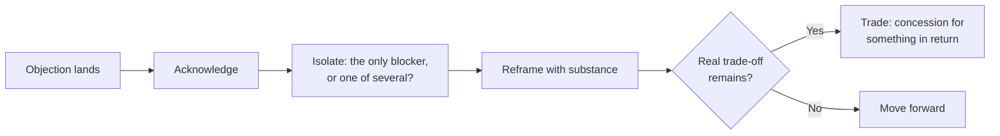

import Scenario from "../../../components/Scenario.astro";
import LevelIntro from "../../../components/LevelIntro.astro";
import PracticeCheck from "../../../components/PracticeCheck.astro";

export const unit = {
  track: "product-domain",
  unitSlug: "objection-handling",
};

<Scenario label="Same objection, two reps, opposite outcomes">
  <Fragment slot="facts">
    

      
🗣️ <strong>Buyer says</strong> — "we already have something that works"

      
⚔️ <strong>Rep A</strong> — argues the incumbent is worse, feature by feature

      
❌ <strong>Result</strong> — buyer gets defensive, call ends with "we'll keep you in mind"

    

    
Same words, different reply

    

      
🤝 <strong>Rep B</strong> — agrees it is a fair point, then asks what still costs time

      
🔍 <strong>Surfaces</strong> — a real recurring problem the buyer had not mentioned

      
✅ <strong>Result</strong> — the call ends with a next step

    

  </Fragment>

Two reps at the same company get an identical inbound lead within an hour
of each other: an operations manager who says, almost as a reflex,
"honestly, we already have something that works. I don't think we need to
switch."

Rep A takes it as a challenge and spends ten minutes on why the product
beats the incumbent on paper. The buyer gets quieter and politely ends the
call. Rep B, hearing the same line, says: "That's fair. A system nobody has
to relearn is worth a lot. Is there anything about it that still costs you
time, even if it basically works?" Thirty seconds later the buyer is
describing a recurring problem they had not mentioned before.

**Same objection, same product, same talk time. What did Rep B do in the
first ten seconds that changed everything after it?**

</Scenario>

An **objection** is a reason a buyer gives for not moving forward right now:
"too expensive," "we already have something," "not the right time." This
unit is about what to say, live, in the moment one lands, and about what to
do when the conversation turns into a real negotiation.

<LevelIntro
  items={[
    "Why arguing back makes an objection harder",
    "The stated reason versus the real blocker",
    "Trading instead of giving away, in a negotiation",
  ]}
/>

## Is an objection a wall, or a request?

**If the buyer said no, why would the best reply be a question?** Because an
objection is rarely a verdict. It is the buyer's first, compressed answer,
and it carries information about what they are worried about.

- A rep who treats it as a **wall** (Rep A) pushes against it, and people
  defend a decision harder when it is attacked.
- A rep who treats it as a **request for more information** (Rep B) opens it
  up. The buyer starts supplying the real reasons instead of guarding the
  stated one.
- Treating objections as information is also the honest framing: the goal is
  to find out what is true for this buyer, not to find a line that wins the
  exchange.

<PracticeCheck
  track={unit.track}
  unitSlug={unit.unitSlug}
  topicId="objection-as-information"
/>

## Does "too expensive" always mean the price is too high?

**Two buyers both say "it's too expensive." One has a hard budget line, the
other has not yet seen enough value. Would the same reply fit both?** No, and
that is the second idea in this unit: the stated objection and the real
blocker underneath it are often different things, and the only way to tell
is to ask.

|                       | "We already have something that works"                            | "It's too expensive"                                                           |
| --------------------- | ----------------------------------------------------------------- | ------------------------------------------------------------------------------ |
| What it sounds like   | A closed door on the whole conversation                           | A closed door on the price                                                     |
| Often really about    | The familiar system's flaws feel survivable (**status quo bias**) | A real budget ceiling, or a value case that has not landed. Not the same thing |
| Reflex that backfires | Argue the incumbent is worse                                      | Discount immediately, no questions                                             |
| Move that works       | Acknowledge it, then ask what still costs time or money           | Ask which of the two it is before replying                                     |

<PracticeCheck
  track={unit.track}
  unitSlug={unit.unitSlug}
  topicId="stated-vs-real"
/>

## Where does negotiation start, and what must you get back?

**A buyer has a genuine budget limit and asks for a lower price. Is a
discount the only move?** No. A **concession** is something you give up; the
habit that keeps a deal healthy is to give it only in exchange for something
back (a longer term, a reference, faster payment). A one-way discount tells
the buyer the original price was never real.

- **Anchoring:** the first number said pulls the rest of the conversation
  toward it. A counter-offer with reasoning resets it; haggling down from the
  buyer's number does not.
- **Walking away** from a deal that would cost more than it is worth is a
  legitimate outcome, not a failure.

| Term               | Simple meaning                                           |
| ------------------ | -------------------------------------------------------- |
| Objection          | A stated reason for not moving forward right now         |
| Status quo bias    | Preferring what is in place because its flaws are known  |
| Acknowledge        | Validate the objection as reasonable before responding   |
| Isolate            | Check whether it is the only blocker or one of several   |
| Reframe            | Respond to the real concern with substance, not a script |
| Concession trading | Give something up only in exchange for something back    |

<PracticeCheck
  track={unit.track}
  unitSlug={unit.unitSlug}
  topicId="concession-for-return"
/>
