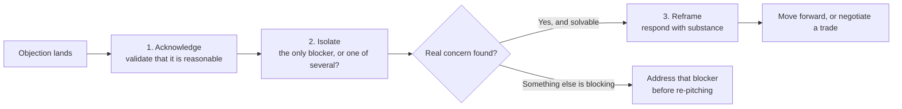

import LevelIntro from "../../../components/LevelIntro.astro";
import Checkpoint from "../../../components/Checkpoint.astro";
import PracticeCheck from "../../../components/PracticeCheck.astro";

export const unit = {
  track: "product-domain",
  unitSlug: "objection-handling",
};

L1 showed that arguing back makes an objection harder and agreeing-then-asking
opens it up. L2 turns that into a repeatable three-step model, shows what
weak and strong replies sound like side by side, and covers the negotiation
basics for when a real trade-off is on the table.

<LevelIntro
  items={[
    "The acknowledge, isolate, reframe model",
    "Weak versus strong replies, objection by objection",
    "Anchoring, counter-offers, and walking away",
  ]}
/>

## What should happen in the ten seconds after an objection lands?

**Most reps do one of two things: argue at once, or cave at once. What do both
skip?** A step that has to come first.

- **Acknowledge** earns the buyer's trust before you ask anything. Arguing at
  once signals "I heard a wall, not a person."
- **Isolate** is the step both bad reactions skip. It is a genuine question
  about whether solving this one thing would change the decision, asked to
  learn the answer, not to trap the buyer into a yes. If the answer is
  "no, something else is in the way," that is useful and you say so.
- **Reframe** happens only once you know what you are responding to. For a
  price objection it usually means connecting the price to a number the buyer
  already tracks, not offering a discount.

<Checkpoint question="A buyer says 'it's too expensive' and the rep immediately offers 10% off. Which steps were skipped, and what is the risk?">

Both acknowledge and isolate were skipped. The risk is more than lost margin:
an instant discount treats "too expensive" as a literal budget fact without
checking. If the real issue is that the value case has not landed, the lower
price fixes nothing, and the same buyer comes back unconvinced at a smaller
number. Isolating first, by asking whether the number is outside budget or the
value is unclear, tells you which fix is the right one.

</Checkpoint>

<PracticeCheck
  track={unit.track}
  unitSlug={unit.unitSlug}
  topicId="acknowledge-isolate-reframe"
/>

## What do weak and strong replies actually sound like?

**The model is easy to state and easy to skip under pressure. What does the
gap look like in real sentences?**

| Objection                              | Weak reply (argues or caves)                   | Strong reply (acknowledge, isolate, reframe)                                                                                 |
| -------------------------------------- | ---------------------------------------------- | ---------------------------------------------------------------------------------------------------------------------------- |
| "It's too expensive"                   | "I can knock 10% off if that helps"            | "Fair to raise. Is the number outside budget, or have we not shown enough value yet to justify it?"                          |
| "We already have something that works" | "Here's why we're better on every feature"     | "Makes sense, switching has real costs. Does anything about the current setup still cost you time, even if it mostly works?" |
| "We need to think about it"            | "No problem, just following up" (then silence) | "Of course. What specifically do you want to think through, so I can make sure you have what you need?"                      |
| "It's not the right time"              | "When would be better?" (then waits)           | "Understood. Is timing the only thing in the way, or would something else need to be true even at a better time?"            |

The strong column never argues the buyer out of their position. It validates
the position and then asks a specific question that either surfaces the real
concern or confirms the stated one was the real one.

<Checkpoint question="In the 'not the right time' row, why does the strong reply ask whether timing is the only thing in the way instead of asking when would be better?">

"When would be better" accepts the stated reason at face value and turns the
conversation into scheduling. If timing really is the only issue, nothing is
lost. But if timing is covering for something else (no approved budget, a
stakeholder who has not bought in, doubt about whether the product solves the
problem), following up "later" only postpones finding that out, and the deal
can drift across several better times that never arrive. Asking whether timing
is the only blocker brings the real one to the surface while there is still a
live conversation.

</Checkpoint>

<PracticeCheck
  track={unit.track}
  unitSlug={unit.unitSlug}
  topicId="weak-vs-strong-replies"
/>

## What happens once a real trade-off is on the table?

**The reframe worked and the buyer still wants better terms. Is that a failure
of the model?** No. A genuine ask is a legitimate part of a deal, and basic
negotiation mechanics take over from here.

| Mechanic            | What it means                                                                              | What goes wrong without it                                                       |
| ------------------- | ------------------------------------------------------------------------------------------ | -------------------------------------------------------------------------------- |
| Trade, don't give   | A concession is paid for with something back: longer term, reference, faster payment       | A one-way discount teaches the buyer your price was never real                   |
| Anchor with reasons | The first number pulls the conversation. Answer with a number plus the reasoning behind it | Haggling down from the buyer's number lets them set the frame                    |
| Know your walk-away | Decide before the call what deal is not worth doing                                        | A concession so large the deal stops being worth doing, or that sets a precedent |

None of this needs pressure or tricks. Each mechanic works because the trade
is explicit and both sides can see what they are getting.

<PracticeCheck
  track={unit.track}
  unitSlug={unit.unitSlug}
  topicId="anchoring-and-walking-away"
/>

L3 follows one deal through both objections in sequence, with a real
concession trade, an untrained rep's version of the same moments for contrast,
and what changes when the objection is a smokescreen or the budget is
genuinely frozen.
