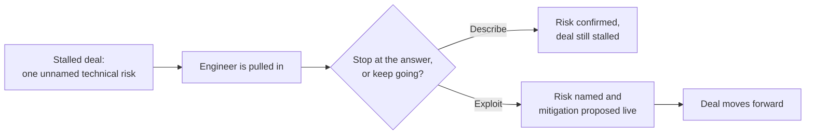

import Scenario from "../../../components/Scenario.astro";
import LevelIntro from "../../../components/LevelIntro.astro";
import PracticeCheck from "../../../components/PracticeCheck.astro";

export const unit = {
  track: "product-domain",
  unitSlug: "presales-engineering",
};

<Scenario label="Six weeks stalled, one call to unstick it">
  <Fragment slot="facts">
    

      
Cutover lock on the order table

      

        Naive lock-copy-release
        35–40 min
      

      

        

      

      

        Shadow-write cutover
        under 2 min
      

      

        

      

    

    

      
🧊 <strong>Weeks 1–6:</strong> stalled on one unanswered risk

      
💬 Account exec's answer: "built for enterprise scale"

      
🔓 <strong>Week 6, one call:</strong> the engineer names the mechanism, and the tone shifts

    

  </Fragment>

Vantable, a medium-sized analytics vendor, has spent six weeks trying to close a
strategic partnership with Harborline, a much larger logistics platform that
wants Vantable's analytics embedded in its fulfillment dashboard. The deal is
worth more in positioning than in the contract amount. It has stalled on one
question. Harborline's VP of Engineering, Renata Cho, keeps asking some version
of "what happens to our order data during the cutover?" and Vantable's account
executive keeps answering with confidence and no specifics: "our platform is
built for enterprise scale."

Renata does not doubt that the product works. A table lock on Harborline's live
order database would freeze fulfillment for every warehouse, and nobody in the
room can tell her whether that is the plan. In week six, Dara Kessler, an
engineer who has worked on Vantable's migration tooling, joins the call for the
first time. She does not reassure anyone. She names the mechanism that would
cause the lock, estimates how long it would last at Harborline's write volume,
and proposes a way to cut it to under two minutes, before anyone asks.

**Renata's tone changes inside that single call. What did Dara do that six weeks
of confident reassurance from a skilled salesperson could not?**

</Scenario>

The product never changed between week one and week six. The only thing that
changed was who answered, and how specific the answer was.

<LevelIntro
  items={[
    "Why an engineer's answer is trusted differently",
    "Describing a risk versus acting on it",
    "What a VP or CTO is really weighing",
  ]}
/>

## Why did the same question land so differently?

**If both answers were sincere, what made one of them believable?** Not warmth
or polish. The two answers differ in what the listener can check.

- **Presales engineering** here means a technical person using real engineering
  depth, in the room, to move a deal forward. It is not "an engineer who answers
  questions on sales calls."
- **Technical credibility** is the audience's belief that you would be caught if
  you were wrong. It comes from specificity they can test, not from confidence.
- The scenario numbers (35–40 minutes, 2.5 million orders a day at peak) are
  assumed for this unit's story, not measurements of any real system.

|                     | Account executive's answer       | Engineer's answer                             |
| ------------------- | -------------------------------- | --------------------------------------------- |
| Names a mechanism   | No: "built for enterprise scale" | Yes: a write lock held during the copy        |
| Gives a number      | No                               | Yes: roughly 35–40 minutes at this volume     |
| Offers a fix        | No: "migration is smooth"        | Yes: a shadow-write cutover under two minutes |
| Can Renata test it? | No: nothing to cross-examine     | Yes: she can probe every step                 |

<PracticeCheck
  track={unit.track}
  unitSlug={unit.unitSlug}
  topicId="trust-structure"
/>

## Is answering accurately enough?

**Suppose Dara had said only "yes, about forty minutes of locking" and stopped.
True, complete, and what happens to the deal?** It stays stalled, because the
fear that held it up for six weeks has just been confirmed.

- **Describing** answers the question that was asked, accurately, and stops.
- **Exploiting the opportunity** means seeing that this risk is the real blocker,
  arriving with a mitigation ready, and proposing it in the room.
- The product is the same in both. What differs is whether the biggest open risk
  gets resolved by someone the other side trusts.

<PracticeCheck
  track={unit.track}
  unitSlug={unit.unitSlug}
  topicId="describe-vs-exploit"
/>

## How does this differ from the earlier selling units?

`value-based-selling`, `discovery`, `objection-handling`, and
`translating-capability-into-their-vocabulary-cfo` cover how to sell well in
general: framing value, asking questions, handling pushback, speaking the
buyer's language. This unit is the moment those tools are not enough alone,
because Renata is not evaluating a pitch. She is deciding whether a technical
peer can be trusted with a risk that could sink her own operation.

**Key terms:** presales engineering, technical credibility, describing vs.
exploiting, risk surfacing, deal-shaping, strategic fit.
