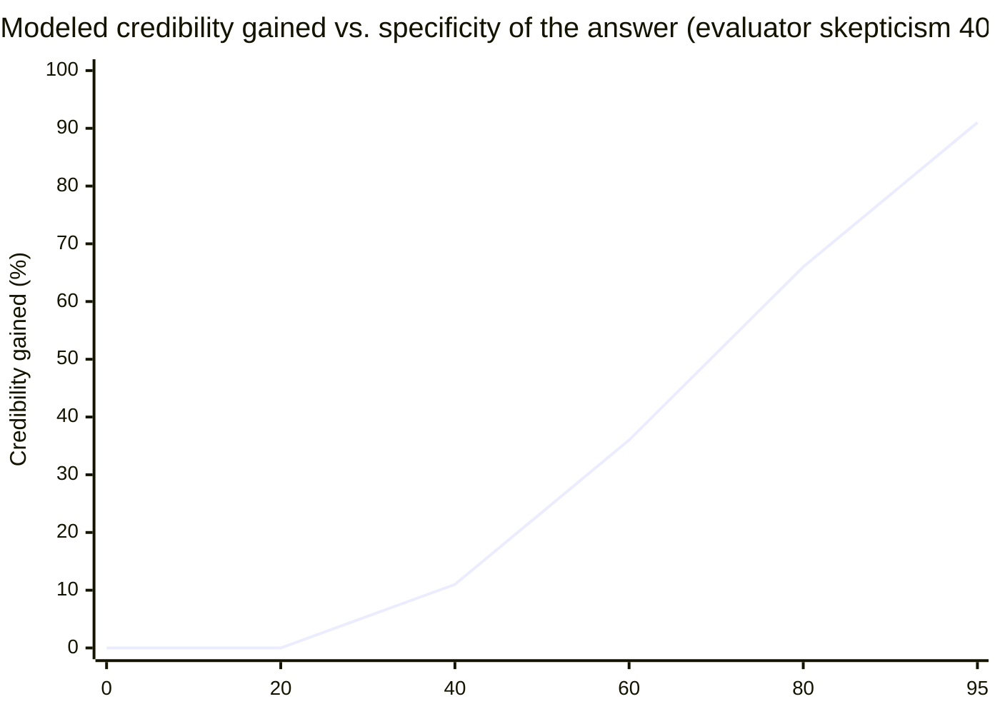
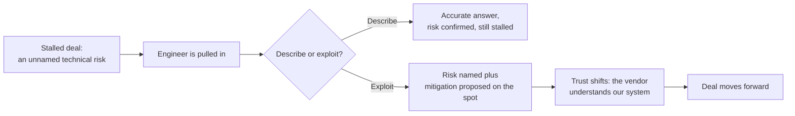

import LevelIntro from "../../../components/LevelIntro.astro";
import Checkpoint from "../../../components/Checkpoint.astro";
import PracticeCheck from "../../../components/PracticeCheck.astro";

export const unit = {
  track: "product-domain",
  unitSlug: "presales-engineering",
};

L1 showed one question answered two ways: reassurance that left the deal
stalled for six weeks, and a specific mechanism-plus-fix that moved it inside a
single call. L2 works out why that gap is structural, and what the executive in
the room is actually weighing while she listens.

<LevelIntro
  items={[
    "Incentive, and answers that can be checked",
    "Describing versus exploiting, in the room",
    "Risk, integration cost, and strategic fit",
  ]}
/>

## Why can't a salesperson's reassurance do what Dara did?

**Renata cannot verify a claim about her own infrastructure in real time. So
what is she checking instead?** The speaker. She runs a trust check on who is
answering before she weighs what they say.

|                                | Account executive                                    | Presales engineer                                         |
| ------------------------------ | ---------------------------------------------------- | --------------------------------------------------------- |
| Incentive in the room          | Close the deal; paid on it                           | Get the technical answer right; no commission on the sale |
| Cost of a wrong answer to them | None immediate; the risk lands on the customer later | Their credibility on this call and the next ones          |
| What the audience can verify   | Confidence and tone, not substance                   | Whether the mechanism holds up under a follow-up          |
| Default read from a skeptic    | "Incentivized to say yes"                            | "Has to be right, or gets caught being wrong"             |

The account executive may be entirely sincere. His incentive to say yes is
visible, though, and Renata cannot separate his optimism from diligence. Dara's
answer is **falsifiable**: it makes claims that would visibly break under a
follow-up question if they were wrong. That is why a specific answer earns
trust that a persuasive one cannot, and it has nothing to do with engineers
being more honest.

<Checkpoint question="Jordan, the account executive, is an excellent salesperson, and Dara is no better a speaker. So why did Renata trust Dara's answer on the same question?">

It is an incentive-structure gap that Renata can see from her seat, not a
communication-skill gap. Jordan's compensation depends on the deal happening,
and Renata cannot separate his confidence from that. Dara's answer can be
tested immediately: Renata can ask about the shadow-write mechanism and see
whether it survives, the way she would cross-examine one of her own engineers.
The trust comes from the answer being the kind of claim that would visibly fail
if it were wrong, and a persuasive pitch never exposes itself to that risk.

</Checkpoint>

## How specific does the answer have to be?

**Is there a point where "more detailed" starts to matter, or does credibility
build gradually?** The interactive demo on this unit models it as a threshold
shape. The chart uses its modeled numbers for an evaluator who starts at 40%
skepticism. It is a teaching model, not a measurement of any real buyer.

A vague reassurance (specificity 20) earns roughly nothing. An answer with a
named mechanism, a real number, and a proposed fix (specificity 95) earns most
of the evaluator's trust. The middle of the curve is where half-specific answers
live: "it might lock the table for a while" feels like effort and buys little.

<PracticeCheck
  track={unit.track}
  unitSlug={unit.unitSlug}
  topicId="falsifiable-specificity"
/>

## Describing a capability versus acting on an opening

**Passing the trust check gets an engineer to "accurate." What gets the deal
moving?** Whether the engineer stops at the question asked, or uses what they
can see that the other side cannot.

|                       | Describing                                                                              | Exploiting the opening                                                                                |
| --------------------- | --------------------------------------------------------------------------------------- | ----------------------------------------------------------------------------------------------------- |
| Posture               | Reactive: answers what was asked                                                        | Proactive: raises what the other side had not yet asked                                               |
| Dara's cutover answer | "About 40 minutes of write-locking at your volume." True, complete, and leaves it there | Same fact, plus "here is a shadow-write approach that gets it under two minutes; I can sketch it now" |
| What it requires      | Knowing the answer                                                                      | Seeing the risk would become the dealbreaker, and having a real mitigation ready                      |
| Effect on the deal    | Confirms the fear, often stalls it further                                              | Turns the biggest open risk into evidence the vendor understands the customer's system                |

<Checkpoint question="If Dara had said 'a migration at your volume would lock the table for about 40 minutes' and stopped, with nothing false in it, would the deal have unstalled?">

No, it would have done the opposite. An accurate answer that stops at naming
the problem confirms Renata's fear instead of relieving it. Describing the risk
correctly earns Dara the trust check, but trust alone does not move a deal while
the blocker sits unresolved. The unstalling step was the second half: a concrete
mitigation proposed on the spot that turned a 40-minute lock into a two-minute
one. The accurate description made Renata believe Dara, and the mitigation gave
her a reason to say yes.

</Checkpoint>

## What is the executive audience actually optimizing for?

**Renata's team has already vetted the feature list. So what is she in this
call to decide?** Three things a feature list does not answer, the same shift
`translating-capability-into-their-vocabulary-cfo` describes for a financial
audience.

| What she weighs  | The question behind it                            | What a feature-demo engineer says | What the engineer in the room says             |
| ---------------- | ------------------------------------------------- | --------------------------------- | ---------------------------------------------- |
| Risk             | What could break, and how badly?                  | API response times                | The write lock, and how long it would last     |
| Integration cost | What does this take from my team, not just yours? | Setup is quick                    | The steps Harborline's engineers would run     |
| Strategic fit    | Does this make our own roadmap easier or harder?  | Dashboard features                | How the integration sits in Harborline's plans |

A CTO above her cares even less about features and more about strategic fit and
risk exposure at scale. An engineer who arrives ready to demo fields questions
nobody in the room is asking. This is why the engineer's credibility, and not
the spec sheet, is the selling instrument at this level.

<PracticeCheck
  track={unit.track}
  unitSlug={unit.unitSlug}
  topicId="executive-priorities"
/>
