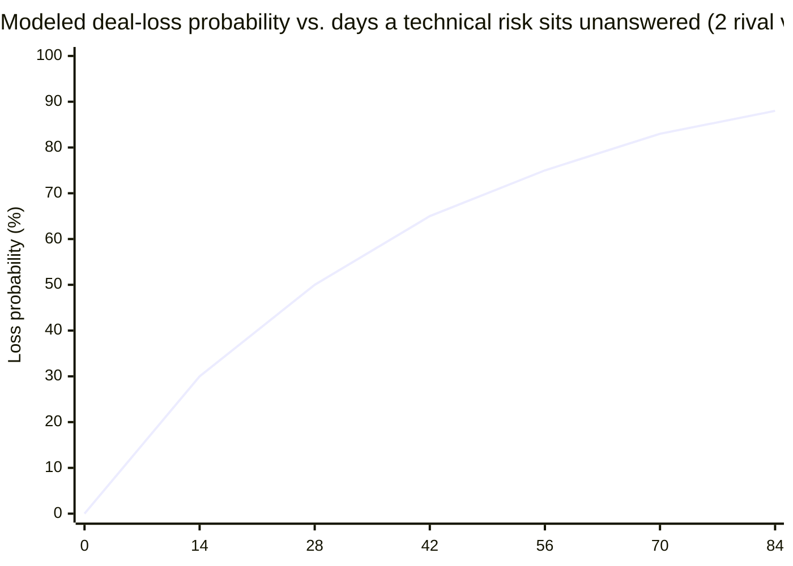

import Scenario from "../../../components/Scenario.astro";
import LevelIntro from "../../../components/LevelIntro.astro";
import Checkpoint from "../../../components/Checkpoint.astro";
import PracticeCheck from "../../../components/PracticeCheck.astro";

export const unit = {
  track: "product-domain",
  unitSlug: "presales-engineering",
};

<Scenario label="The follow-up question that sinks a rehearsed answer">
  <Fragment slot="facts">
    

      
👩‍💼 <strong>Renata Cho:</strong> Harborline VP of Engineering, the skeptic

      
🛠️ <strong>Owen Vasquez:</strong> engineer on Renata's team, asks the sharp follow-up

      
🏛️ <strong>Elena Marsh:</strong> CTO, joins fifteen minutes in

      
🤝 <strong>Jordan and Dara:</strong> Vantable's account exec and engineer

    

    

      
Assumed scenario numbers

      
2.5 million orders a day at peak. Naive lock: 35–40 min. Shadow-write cutover: under 2 min, plus about 5–8 ms of write latency during migration only.

    

  </Fragment>

Dara has just proposed a shadow-write migration for Harborline's order table, and
it sounds good. Then Renata asks one sharp question: if a write succeeds to the
old table and fails to the new one during the dual-write window, the two systems
now disagree. Dara's first design has no good answer to that.

**She can defend the first version, quietly promise to fix it later, or answer
the flaw in front of the people who would own the consequences. Which of these
builds the trust the deal needs?**

</Scenario>

This level follows the full call. Everything here is a single worked case, and
the last two sections push on what changes when the details are different.

<LevelIntro
  items={[
    "Naming the risk, then surviving the follow-up",
    "Turning a good call into a checkable commitment",
    "When no mitigation exists, or the room is hostile",
  ]}
/>

## The setup: what is at stake

Vantable is an analytics vendor; Harborline runs fulfillment logistics for
several large retailers. The deal is a strategic partnership: Harborline wants
Vantable's analytics embedded in its operations dashboard and co-marketed to its
retail customers. For Vantable it is a logo that changes how every future
prospect sizes them up. For Harborline it is a bet on a much smaller vendor
becoming load-bearing in its own product. (Company sizes and order volumes are
assumed for this story.)

Five people are on the week-six call: Jordan (Vantable account executive), Dara
Kessler (Vantable engineer, first call with Harborline), Renata Cho (Harborline
VP of Engineering), Owen Vasquez (an engineer on Renata's team), and, joining
fifteen minutes in, Elena Marsh, Harborline's CTO. Her presence is itself a
signal that the deal has her attention.

The cost of the stall is the reason the call matters. The demo on this unit
models the chance of losing a competitive deal as a risk sits unanswered. Using
its modeled numbers with two competing vendors, the stall at day 42 already
carries a 65% loss chance, and the curve keeps climbing.

This is a teaching model, not data from real deals. The point is the direction:
waiting for "someone to eventually answer it" is not a neutral default.

## The risk surfaces

**Renata:** I want to understand what happens to our order-history table during
onboarding. We are at 2.5 million orders a day at peak, and that table gets no
maintenance window. Ever.

**Jordan:** Totally understand. Our platform is built for enterprise-scale
customers, and migration is a smooth, well-tested part of onboarding.

**Renata:** I have heard that answer from three vendors this year. I need the
mechanism, not the assurance.

**Dara:** Can I take that one directly? Your order table is under continuous
write load. A naive migration locks the table, copies the data, and releases the
lock, so the lock lasts for the full copy. At your volume, from the row counts
Owen sent last week, that is around 35 to 40 minutes. Every write queues or fails
in that window, which for a 24/7 fulfillment operation means orders stop moving.
That is a legitimate concern, and I would not want it either at your scale.

Renata's first visible shift comes here, before any fix is offered. Dara named
the exact number and the mechanism unprompted. Owen leans in: "That matches what
I expected. So what is the plan?"

<Checkpoint question="Dara confirmed the 35–40 minute lock and named its cause before proposing any fix. Why start there rather than jumping to the mitigation?">

Naming the mechanism first earns the right to be heard on the fix. A mitigation
offered cold gives Renata and Owen no way to tell whether Dara understands the
failure mode or is pattern-matching to a generic answer, which is exactly why
Jordan's reassurance landed as empty. Confirming the specific number and cause is
the describing half of the pair from L2, and it is the groundwork that makes the
exploiting half believable. Skip it and the mitigation, however good, sounds like
another vendor promise.

</Checkpoint>

## The mitigation, and the complication

**Dara:** A shadow-write migration avoids the long lock. We stand up the new
schema beside the old one, dual-write every new order to both, backfill history in
the background with no lock, run a final reconciliation pass, and cut over. The
cutover, when reads switch to the new table, is under two minutes.

**Renata:** And during the dual-write window, what if a write succeeds to the old
table and fails to the new one? You now have two systems that can disagree.

This is a real, sharp follow-up that exposes a cost in Dara's first answer. A
live pitch with no room for this kind of moment is showing a rehearsed script,
not technical depth.

**Dara:** That is a fair catch. If we only retry the second write a few times and
give up, you get silent drift between the tables, and reconciliation would find it
after the fact. For a fulfillment system, an order disagreement discovered a day
later is not acceptable.

**Owen:** That is the part that worries me. A stale dashboard is fine. An order
silently missing from the new system during peak is not.

**Dara:** Agreed. The fix is to make the dual-write synchronous and fail the whole
request if either write fails. It costs a small amount of added write latency
during the migration window, roughly 5 to 8 milliseconds per order on my estimate,
and that is a real trade-off. In return the tables cannot disagree, because a write
that does not succeed on both never counts as succeeded. I would rather propose
this version and be upfront about the latency than offer the cheaper one and let
you find the drift three weeks into a live migration.

**Renata:** That is the answer I was hoping someone would give me. Most vendors
either do not know that failure mode exists, or know and do not bring it up unless
I catch it.

| First version                    | After Owen's and Renata's follow-up                  |
| -------------------------------- | ---------------------------------------------------- |
| Retry the second write, then log | Synchronous dual-write, fail the request on mismatch |
| Risk: silent drift, found later  | Risk: none of that kind; tables cannot disagree      |
| Cost: none stated                | Cost stated: about 5–8 ms per order, migration only  |

The larger shift is not that the plan is perfect. Dara reasoned through the actual
trade-off live, in front of the people who would own the consequences, instead of
defending her first draft.

<PracticeCheck
  track={unit.track}
  unitSlug={unit.unitSlug}
  topicId="tradeoff-and-revision"
/>

## The resolution, and what Dara sends afterward

**Elena:** Renata, where did we land?

**Renata:** Better than I expected. Dara found the same risk I was worried about
before I had to name it precisely, and the mitigation holds up under pressure. She
did not dodge the follow-up. She revised the plan in front of us.

**Elena:** What is the concrete next step, not the general vibe?

**Dara:** A scoped validation. We run the shadow-write migration against a copy of
a recent week of your order data, not production, so there is no risk to live
traffic, and your team gets read access to watch the reconciliation run. We can
schedule it within ten business days. It gives you evidence instead of another
assurance from me.

**Elena:** That is something I can bring to my board. Let's schedule it.

The deal does not close on this call, because strategic partnerships rarely do.
It moves from stalled to scheduled, with a falsifiable commitment attached
instead of a vague "we will follow up."

Within a day, Dara sends a one-page written summary that Renata and Elena can
forward internally without translation.

---

**Harborline Integration: Cutover Risk and Mitigation Summary**

**The risk.** A standard lock-copy-release migration on the order-history table
would hold a write lock for roughly 35–40 minutes at current volume, halting order
writes, which is unacceptable for a 24/7 fulfillment operation.

**The mitigation.** A shadow-write migration: synchronous dual-write to both
schemas (failing the request on any mismatch rather than logging), a lock-free
background backfill, reconciliation, then a read cutover in under two minutes.
Trade-off: roughly 5–8 ms of added write latency per order during the migration
window only, ending when cutover completes.

**Validation plan.** A scoped dry run on a copied week of real order data, with
Harborline engineering given read access to the reconciliation output. No
production risk. Target: scheduled within 10 business days.

**Owner.** Dara Kessler (Vantable) and Owen Vasquez (Harborline) jointly, with
Renata Cho as accountable reviewer.

---

|                  | Before this call              | After this call                                 |
| ---------------- | ----------------------------- | ----------------------------------------------- |
| Stated risk      | Vague ("migration is smooth") | Named mechanism, quantified (35–40 min lock)    |
| Mitigation       | None offered                  | Shadow-write, with its own cost stated plainly  |
| Evidence         | A vendor's word               | A scheduled dry run Harborline can watch        |
| Renata's posture | Skeptical, blocking           | Engaged, solving the problem alongside Vantable |

<Checkpoint question="The one-pager states the mitigation's latency cost right next to the fix. Why put a real cost in a document meant to move the deal forward?">

Leaving the cost out would repeat the mistake that stalled the deal for six
weeks: a claim that sounds clean until someone at Harborline finds the gap
themselves, and then every other claim in the document is discounted with it.
Stating the cost shows Renata and Owen that Vantable already found the trade-off
and weighed it. A one-pager that lists only benefits reads as marketing, while one
that pairs a real, bounded cost with a real benefit reads as a document one
engineer would write for another, and that is the credibility the whole unit has
been building.

</Checkpoint>

<PracticeCheck
  track={unit.track}
  unitSlug={unit.unitSlug}
  topicId="concrete-commitment"
/>

## What if the risk had no good mitigation?

**Suppose the honest answer had been different. What does exploiting the opening
mean when there is nothing real to propose?**

Say something structural in Harborline's schema meant Vantable genuinely could not
get the cutover under fifteen minutes without a maintenance window. Exploiting the
opening then does not mean inventing a mitigation. It means being the person who
says so plainly, before Harborline's team finds out independently, and moving the
conversation to what is possible:

1. A lower-risk path, such as migrating a less critical dataset first to prove the
   pattern.
2. A narrower initial scope that avoids the problem table until a real fix ships.
3. An honest statement that this integration is not ready yet, with a date for when
   it could be.

An engineer's credibility rests as much on saying "that one has no good answer yet"
as on solving the risks that do. A mitigation offered where none exists is the
fastest way to turn this unit's whole argument into the next stalled deal, and a
worse one, because this time it is Dara's word that broke and not Jordan's.

<PracticeCheck
  track={unit.track}
  unitSlug={unit.unitSlug}
  topicId="honest-no-fix"
/>

## What if Owen had been hostile instead of curious?

Everything above assumed a sharp but collaborative counterpart: Owen's drift
question was a real gap, asked in good faith. Suppose instead the evaluator is
skeptical on principle and looking for a reason to recommend against the vendor.
The mechanics of naming the risk and proposing a mitigation stay the same, and the
tone changes. Every claim needs a specific, checkable commitment behind it, like
the observable dry run Dara offered, because a hostile evaluator treats confident
reasoning without evidence as the unfalsifiable kind of claim an executive
audience discounts by default. Against a skeptical room the instinct to propose
something verifiable instead of merely persuasive matters more, not less.

## Your turn: stretch the case

The Harborline call is one case, not the whole territory. Hold the structure and
change one thing, then ask which move comes under pressure:

- The CTO is on the call from minute one and has no patience for mechanism detail.
  Which part of Dara's answer moves into the one-pager, and which stays in the room?
- Jordan, the account executive, interrupts Dara partway through her explanation to restate the
  "enterprise scale" line. What does Dara do, and what does that cost her?
- The dry run finds a real problem. What does Dara send, and when?
- Harborline's own engineers, not Vantable, would have to change something to make
  the plan work. How does that change the integration-cost conversation?
