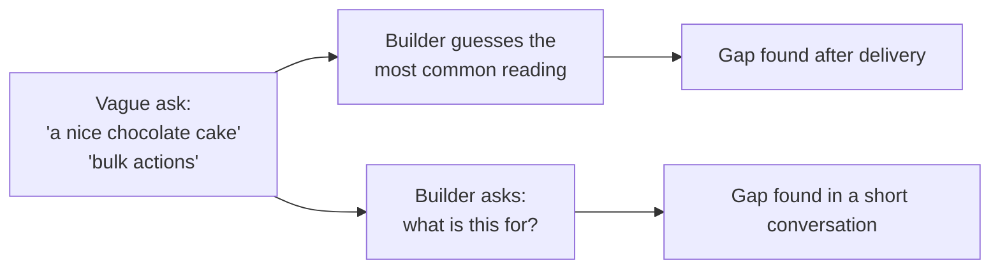

import Scenario from "../../../components/Scenario.astro";
import LevelIntro from "../../../components/LevelIntro.astro";
import PracticeCheck from "../../../components/PracticeCheck.astro";

export const unit = {
  track: "product-domain",
  unitSlug: "requirements-gathering",
};

<Scenario label="The problem">
  <Fragment slot="facts">
    

      

        12 of 24
        servings delivered against servings needed
      

      

        

      

    

    
What the order said vs. what Mira needed

    

      
💬 Order: "a nice chocolate cake for the party"

      
👥 Needed: 24 servings (baker assumed 12)

      
🥜 Needed: nut-free (the baker's usual filling has hazelnuts)

      
🦕 Needed: a dinosaur design (the baker made it plain)

      
🕑 Needed: pickup by 2pm Saturday

    

  </Fragment>

Mira orders a cake by phone for her daughter's birthday: "a nice chocolate cake
for the party, this weekend." The baker has made hundreds of chocolate cakes
and knows exactly what that means. She makes her usual 8-inch chocolate cake
with hazelnut filling, plain on top, and it comes out beautifully.

Mira picks it up and her face falls. The party has 24 guests and an 8-inch cake
serves about 12 (an assumed figure for this example). One guest is allergic to
nuts. Her daughter wanted dinosaurs. Nothing the baker did was careless, and
nothing she did was wrong in the sense of baking badly.

**If the cake was baked perfectly, where exactly did the order go wrong?**

</Scenario>

The mistake happened before any flour came out. "A nice chocolate cake" fits
many different cakes, and the baker silently picked one. Nobody noticed the
gap until the cake was finished, which is the most expensive moment to find it.

<LevelIntro
  items={[
    "What makes a requirement checkable",
    "A need versus a proposed solution",
    "User stories and acceptance criteria",
  ]}
/>

## What turns "a nice cake" into something you can build?

**Could someone who was not on the phone call look at the finished cake and say
for certain whether the order was met?** Not for "nice". Yes for "serves 24".

- A **requirement** is a statement of what must be true when the work is done.
- A requirement is **falsifiable** when there is a concrete check that gives a
  yes or no. Here the word does not mean "false"; it means "testable by
  someone else without asking the author what they meant".
- "Nice" and "for the party" fail that test. "Serves 24, nut-free, dinosaur
  design, ready by 2pm Saturday" passes it, because each part can be checked
  by looking at the cake.

| Vague phrase          | Question that exposes the gap | Checkable version                   |
| --------------------- | ----------------------------- | ----------------------------------- |
| "a nice cake"         | Nice in what way, for whom?   | "Dinosaur design, chocolate sponge" |
| "for the party"       | How many people are coming?   | "Serves 24"                         |
| "chocolate, as usual" | Does anyone have an allergy?  | "Contains no nuts"                  |
| "this weekend"        | By what time exactly?         | "Picked up by 2pm on Saturday"      |

<PracticeCheck
  track={unit.track}
  unitSlug={unit.unitSlug}
  topicId="falsifiable-requirement"
/>

## What is the difference between a need and a proposed solution?

**Mira said "chocolate cake". Is that what she needs?** What she needs is a
birthday dessert that 24 people, including one with a nut allergy, can eat at a
dinosaur party. "Chocolate cake" is the first solution that came to mind.

- A **need** is the goal or constraint underneath: who it is for, what it must
  do, what it must avoid.
- A **proposed solution** is one way to meet it. People usually speak in
  solutions because they are easier to name than needs.
- Building the first-offered solution without checking the need is how a
  "perfect" result misses. The fix is one question: what is this for, and
  what happens if it is wrong?

The same shape appears at work. A ticket reading "We need bulk actions on the
admin panel" names a solution. Sam, the engineer who gets it, builds
multi-select plus a delete button. The need, which Elena the ops lead never
wrote down, was to mark 30 to 50 accounts "verified" each week and leave the
audit log entry that single changes already leave. Sam's code worked and still
missed, for the same reason the cake missed.

<PracticeCheck
  track={unit.track}
  unitSlug={unit.unitSlug}
  topicId="need-vs-solution"
/>

## What do user stories and acceptance criteria add?

**Once the questions are answered, where do the answers live so the next person
sees them?** In two small written artifacts.

- A **user story** records who needs it, what they need, and why, in one
  sentence: "As a [role], I want [capability], so that [benefit]." The "so
  that" part is the most useful, because it lets a builder decide details the
  story never mentioned.
- **Acceptance criteria** are the checklist attached to the story. Each line is
  falsifiable, so "done" becomes a fact anyone can verify rather than two
  private opinions.
- Both can also say what is **out of scope**: related things that are
  deliberately not promised in this version.

> **Cake version.** As a parent hosting a dinosaur party, I want a cake that
> 24 guests can eat, so that no child is left out. Criteria: serves 24, no
> nuts, dinosaur design, pickup by 2pm Saturday. Out of scope: a second cake
> for the adults.

<PracticeCheck
  track={unit.track}
  unitSlug={unit.unitSlug}
  topicId="story-and-criteria"
/>

The skill this unit trains is not writing clever documents. It is noticing
that an ask is still a guess waiting to be built, and spending a few minutes
turning it into checkable statements before anything is built on it.
