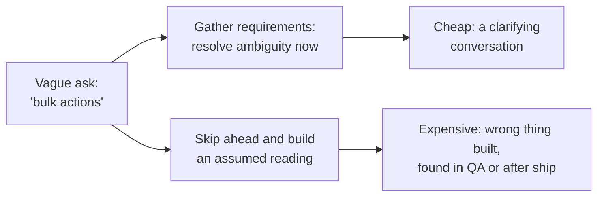
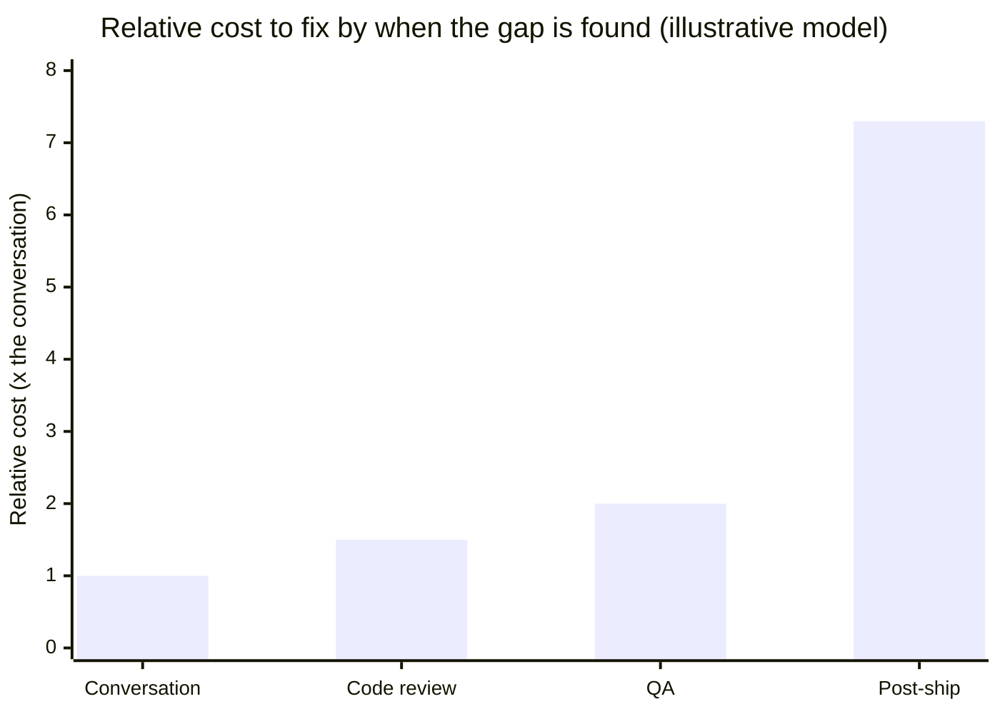

import LevelIntro from "../../../components/LevelIntro.astro";
import Checkpoint from "../../../components/Checkpoint.astro";
import PracticeCheck from "../../../components/PracticeCheck.astro";

export const unit = {
  track: "product-domain",
  unitSlug: "requirements-gathering",
};

L1 used a cake order to show the shape of the mistake: a builder filled a gap
with a guess. This level moves to the workplace version, Sam and Elena's
"bulk actions" ticket, and looks at why the gap is so much cheaper to close
early, then at the written tools that close it.

<LevelIntro
  items={[
    "Why late discovery costs more",
    "How a user story's reason helps",
    "Acceptance criteria and out-of-scope",
  ]}
/>

## Why did the same gap cost so much more the second time?

Sam's first attempt at "bulk actions" took about three days to build and ship.
Fixing it after Elena flagged it took another four days: removing the delete
flow, building status-change logic, and adding the audit log entry nobody had
mentioned. **The same information (bulk status changes, not deletion, plus an
audit log) would have taken about ten minutes of conversation before any code
existed.** What made one gap cost ten minutes in one telling and four days in
the other?

The ambiguity does not disappear if nobody resolves it. It moves downstream,
to wherever someone first has to decide what "bulk actions" actually means.
And the later it is found, the more finished work sits on top of the wrong
assumption.

The interactive demo on this page uses the model
`cost = 1 + (days / 5) ^ 1.5`, where "days" is how long after the ticket is
picked up the gap is found. That
formula is an **illustrative model, not a measurement from any real team**.
Reading four assumed discovery points off it:

| Gap found at...      | Assumed day | Relative cost (x the conversation) |
| -------------------- | ----------- | ---------------------------------- |
| The conversation     | 0           | 1.0                                |
| Code review          | 3           | 1.5                                |
| QA                   | 5           | 2.0                                |
| Two weeks after ship | 17          | 7.3                                |

Notice what the shape says: the first few days are cheap and the curve then
bends upward. The exact numbers are assumptions; the claim is only that
unclear requirements get costlier as work piles up on them.

<Checkpoint question="In the model, a gap found at QA (day 5) costs 2.0x and one found post-ship (day 17) costs 7.3x. Does that mean QA is a safe place to catch ambiguity?">

No. QA is cheaper than post-ship, but it is still twice the cost of the
conversation, and by then implementation and test work are already built on
the wrong reading. The point of the curve is not to find the cheapest of the
late options but to see that the earliest one is cheapest by a wide margin.
The numbers themselves are made up for illustration.

</Checkpoint>

<PracticeCheck
  track={unit.track}
  unitSlug={unit.unitSlug}
  topicId="late-discovery-cost"
/>

## How does a user story's reason help the builder?

**If Sam's requirement only said "bulk status changes for accounts", would he
have known to write an audit log entry?** Almost certainly not. Nothing in
those words implies logging. This is the gap the "so that" clause exists to
close.

A user story puts three things in one sentence: who needs the change, what
capability they need, and why it matters.

| Part | Template      | Example for Elena's ticket                                |
| ---- | ------------- | --------------------------------------------------------- |
| Who  | As a [role]   | As an account reviewer                                    |
| What | I want [what] | I want to select several accounts and change their status |
| Why  | so that [why] | so that I can process the weekly batch of verifications   |

The "so that" clause does real work. When a question comes up mid-build, such
as "should this log the same way single changes do?", the answer is not
guessable from "change status in one action" but it is inferable from the
reason: the story replaces an already-logged workflow, so dropping the log
would undermine the point.

<Checkpoint question="Two engineers get the same story. Only one reads the 'so that' clause. An edge case appears that the criteria do not cover. Who is better placed to decide, and why?">

The one who read the "so that" clause. A capability description says what to
build; a reason generalizes to cases nobody listed. The engineer who knows the
story exists to replace the one-at-a-time weekly verification can reason that
whatever that workflow already guarantees, such as an audit entry, should still
hold in the bulk version, even though nobody wrote it as its own line item.

</Checkpoint>

<PracticeCheck
  track={unit.track}
  unitSlug={unit.unitSlug}
  topicId="so-that-clause"
/>

## What do acceptance criteria and "out of scope" add?

**A story says who and why. Who decides when it is done?** Without a checklist,
"done" is a private judgment made twice, once by the builder and once by the
requester, and the two agreeing is luck rather than design.

**Acceptance criteria** are that checklist: specific conditions, each
falsifiable, that must hold for the story to count as done. For Elena's story:

1. Multi-select checkboxes appear on the account list.
2. A status-change control appears when one or more accounts are selected.
3. Applying a change updates every selected account and writes one audit log
   entry per account, consistent with single-item changes.
4. Bulk delete is explicitly out of scope for this story.

**Out of scope** means "not promised in this version", even if it sounds
related. Writing it down stops the team silently assuming delete is included
just because "bulk actions" was a broad phrase.

| Without acceptance criteria                       | With acceptance criteria                                   |
| ------------------------------------------------- | ---------------------------------------------------------- |
| "Done" is whatever the builder judged enough      | "Done" is a checklist anyone can verify                    |
| Disagreements surface after delivery, expensively | Disagreements surface while writing the list, cheaply      |
| Scope such as delete stays implicit               | Scope is explicit, including what is deliberately excluded |

<PracticeCheck
  track={unit.track}
  unitSlug={unit.unitSlug}
  topicId="acceptance-criteria-scope"
/>

The vague-to-checkable translation itself, the table L1 showed for the cake,
looks like this for the three asks Sam and Elena might hear on any week:

| Vague ask                        | Clarifying questions                                                 | Falsifiable requirement                                                                                                    |
| -------------------------------- | -------------------------------------------------------------------- | -------------------------------------------------------------------------------------------------------------------------- |
| "We need bulk actions"           | What workflow does this replace? Which operation? What scale?        | "Reviewers can select several accounts and change their status in one action; tested up to 50 selections; delete excluded" |
| "Make the dashboard faster"      | Faster at what? How much is enough? For which users?                 | "Initial load completes in under 2 seconds on a typical broadband connection, for 95% of users"                            |
| "Add a way to filter the report" | By which fields? One value or several? Does the filter need to stay? | "Users filter by date range and status, with several statuses at once; the filter persists across reloads in a session"    |

The 2-second and 95% figures are example targets someone would agree on, not
benchmarks. "Persists" means the filter stays applied after the page reloads.

<Checkpoint question="A stakeholder says 'the search should feel more responsive.' Is that falsifiable yet? What one question gets it there?">

Not yet: "feel more responsive" has no check, so two people could disagree about
whether it is done after looking at the same feature. The question that closes
the gap is "how fast is fast enough, and measured how?" Once the answer is a
number with a measurable condition attached, such as a target time for a
stated share of searches, anyone can check the shipped feature independently
and reach the same yes or no.

</Checkpoint>
