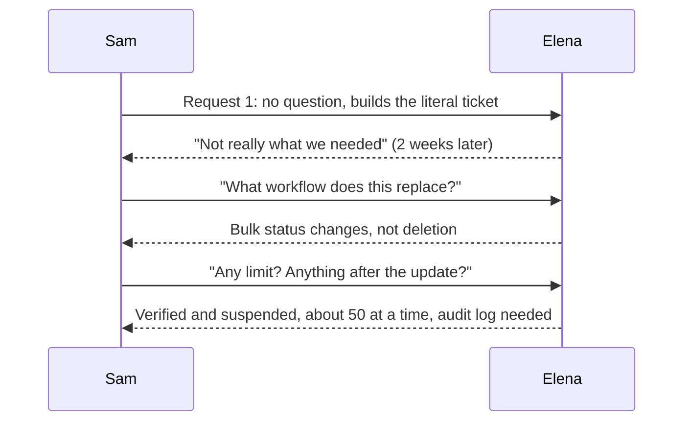
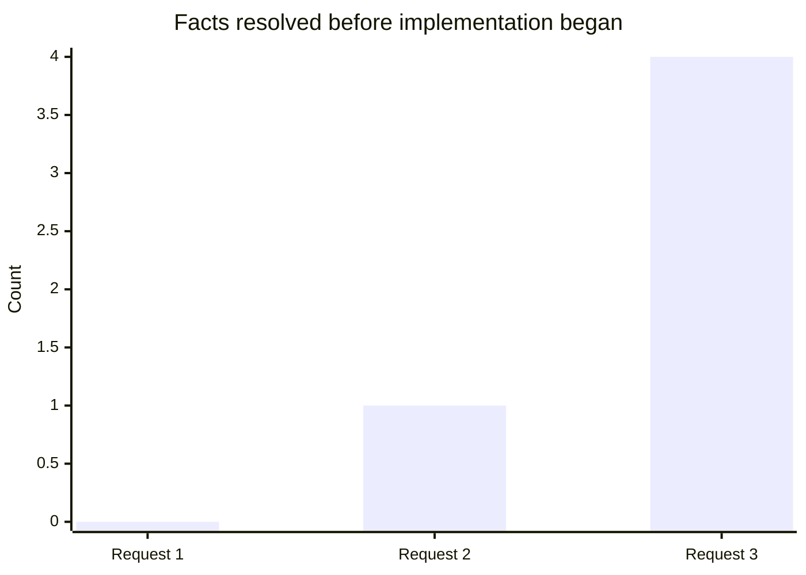

import Scenario from "../../../components/Scenario.astro";
import LevelIntro from "../../../components/LevelIntro.astro";
import Checkpoint from "../../../components/Checkpoint.astro";
import PracticeCheck from "../../../components/PracticeCheck.astro";

export const unit = {
  track: "product-domain",
  unitSlug: "requirements-gathering",
};

<Scenario label="The scenario">
  <Fragment slot="facts">
    

      
🎫 Ticket: "We need bulk actions on the admin panel."

      
👩‍💼 Elena, ops lead, files the ticket

      
🧑‍💻 Sam, engineer, picks it up

      
🔁 Same ticket, same facts one conversation away, three ways to handle it

    

    
Elena's actual workflow

    

      
📥 30 to 50 new accounts a week to verify

      
🖱️ Today: opens each one, sets the status, saves

      
🧾 Compliance requires an audit log entry per change, today

    

  </Fragment>

A stakeholder, meaning someone affected by the result or responsible for asking
for it, submits one line: "We need bulk actions on the admin panel." Elena is
the stakeholder here because her team lives with the outcome. That is the whole
ask. What follows are three ways Sam could pick it up, and what each one
produces.

An **audit log** is a record of who changed what and when. **Compliance** means
rules the team must follow; here, every status change must leave an audit log
entry, one account at a time or in bulk.

**Before reading on: which of the three approaches do you expect to ship the
right thing, and what would you want it to have asked that the others missed?**

</Scenario>

<LevelIntro
  items={[
    "Three ways to handle the same ticket",
    "Counting what each conversation resolved",
    "Failure modes that look like clear requirements",
  ]}
/>

## Request 1: build the literal ticket

**Sam does:** reads "bulk actions on the admin panel", takes the most common
meaning he has seen elsewhere, multi-select plus a delete button, and builds it.
No questions. **Result, two weeks later:** Elena says it is "not really what we
needed". She wanted bulk **status updates**, such as marking many accounts
"verified". Deletion is not in her workflow, and the confirmation dialog adds
friction to an action she never takes. Sam built a real, working feature that
was not the needed one, because "bulk actions" was never specified beyond two
words.

## Request 2: one clarifying question, then stop

**Sam asks:** "What workflow would this replace?" **Elena answers:** about 30
to 50 new accounts a week, each opened, set to "verified" and saved one by one.
**Sam builds** multi-select and a "Verified" button. Closer: this is the real
operation. But Sam stopped after the first answer. He never learned that
"suspended" is occasionally needed, nor that every single-item status change
writes a compliance audit log entry. Elena did not restate that rule because to
her it is simply how status changes work. The bulk version ships without the
log, and a compliance review finds the gap.

<Checkpoint question="Request 2 found the right operation. Why did it still ship with a gap that a compliance review had to catch?">

Because Sam treated the first answer as the end of the conversation rather than
a foothold for more of it. Elena answered exactly what she was asked, which
workflow the ticket replaces, and had no reason to volunteer the audit rule,
since from her side it is not a new fact. The gap was not in her answer but in
the conversation stopping a round early. Getting the core operation right does
not confirm nothing else is riding along with it, such as an existing norm
nobody thought to say out loud.

</Checkpoint>

## Request 3: scoped, and probed for what was not said

**Sam asks a second round:** "Is deletion or any other bulk operation part of
this, or just status change? Is there a limit on how many you select at once,
and does anything have to happen after the update for compliance reasons?"
**Elena answers:** just status changes for now; "verified" mostly, "suspended"
occasionally; usually under 50 at a time; and yes, an audit log entry showing
who made the bulk change and when, same as single changes today.

The resulting story: As an account reviewer, I want to select several accounts
and change their status in one action, so that I can process a weekly batch of
verifications without updating each account individually. Its acceptance
criteria:

1. Multi-select checkboxes appear on the account list.
2. A status-change control appears when one or more accounts are selected,
   offering "Verified" and "Suspended" (matching the existing single-item
   options).
3. Applying a change updates all selected accounts and creates one audit log
   entry per account, consistent with single-item changes.
4. No upper limit is enforced in v1, but the UI is tested up to 50 selections,
   the stated typical batch.
5. Bulk delete is explicitly out of scope for this story.

**v1** means the first version being promised. It may improve later, but these
criteria define what this first delivery must and must not do.

The difference between the requests can be counted. Counting concrete,
checkable facts resolved before any code was written (the operation, the
allowed statuses, the scale, the compliance requirement), not word count:

Request 1 resolved none: every detail was Sam's guess. Request 2 resolved one,
the operation. Request 3 resolved all four, which is everything the criteria
above needed.

| &nbsp;                 | Request 1: no question          | Request 2: one question, then stop      | Request 3: probed for what was unsaid       |
| ---------------------- | ------------------------------- | --------------------------------------- | ------------------------------------------- |
| **What Sam learns**    | Nothing checkable               | The core operation                      | Operation, statuses, scale, audit-log rule  |
| **What gets built**    | The wrong feature (bulk delete) | The right operation, missing compliance | A requirement ready for acceptance criteria |
| **When the gap shows** | Two weeks after ship            | In a compliance review, after ship      | Before a line of code is written            |

<PracticeCheck
  track={unit.track}
  unitSlug={unit.unitSlug}
  topicId="probing-for-unsaid"
/>

## Which failure modes look like clear requirements?

**If a requirement reads confidently and has been written down, can it still
hide a missing fact?** Yes, in at least four ways.

| Failure                                           | What it looks like                                                                               | The fix                                                                     |
| ------------------------------------------------- | ------------------------------------------------------------------------------------------------ | --------------------------------------------------------------------------- |
| First-mentioned solution treated as the need      | "Bulk actions" smuggled in a deletion-style assumption                                           | Ask what workflow is being replaced before deciding what operation is meant |
| Requirements treated as frozen once gathered      | Mid-build, Sam finds the list holds over 10,000 rows, so unpaginated multi-select is impractical | Go back to Elena with the new fact; do not silently pick a reading and hope |
| Criteria that describe the implementation         | "Use a Set to track selected IDs"                                                                | Write the observable behavior; whoever builds it chooses how                |
| Skipping the step because the request feels small | "Bulk actions" was two words                                                                     | Size the conversation to the ambiguity, not to the length of the request    |

<Checkpoint question="A team writes the criterion 'use a Set to track selected account IDs so duplicates cannot be added.' Is it a good acceptance criterion, and what test decides?">

No. It fails the falsifiability test from L2 in a different disguise. A good
criterion must be checkable by someone who never reads the code, only the
built behavior: can a reviewer select the same account twice, and what happens?
"Use a Set" describes one way to get that guarantee, not the guarantee, and it
locks the team into a choice the requirement does not need. Write the behavior
instead, "selecting an already-selected account has no effect", and leave the
how to the implementer.

</Checkpoint>

<PracticeCheck
  track={unit.track}
  unitSlug={unit.unitSlug}
  topicId="requirement-pitfalls"
/>

## Beyond this example

Sam and Elena's ticket is one case, not the whole territory. A few questions to
test whether the model transferred:

- What changes if the stakeholder is unavailable for a second round, say Elena
  is on leave and Sam gets one async message before a deadline? Does Request
  2's "one question, then stop" become the realistic ceiling, and which single
  question recovers the most value?
- What if Elena's answer to the scale question had been "thousands, not
  dozens"? Would the criteria change beyond the number, and does "no upper limit
  enforced in v1" still hold?
- What if the unsaid norm were not a compliance rule but a habit, like every
  list in the product being sorted by newest first? Who would you ask, and how
  would you know to?
- Where in your own queue is there a ticket that reads like "bulk actions":
  short, plausible, and quietly hiding a norm nobody will restate unless asked?
