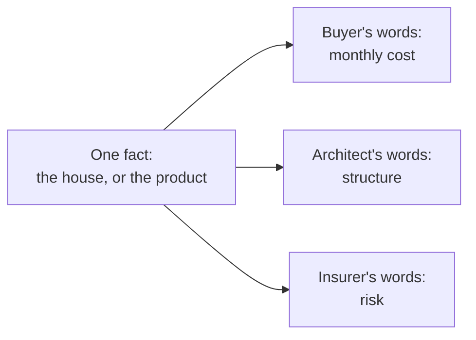

import Scenario from "../../../components/Scenario.astro";
import LevelIntro from "../../../components/LevelIntro.astro";
import PracticeCheck from "../../../components/PracticeCheck.astro";

export const unit = {
  track: "product-domain",
  unitSlug: "translating-capability-into-their-vocabulary-cfo",
};

<Scenario label="One house, three listeners">
  <Fragment slot="facts">
    

      
🏠 <strong>The house (made-up)</strong> — 3 bedrooms, built 1994, roof replaced 2016, one wall between kitchen and living room

      
🛒 <strong>Buyer listens for</strong> — monthly payment, bedrooms, the commute

      
📐 <strong>Architect listens for</strong> — which walls hold up the roof

      
🛡️ <strong>Insurer listens for</strong> — roof age, wiring age, flood risk

    

    
Same house, 3 listeners, 3 different questions. Only the words change.

  </Fragment>

A seller describes the same house three times in one week. To a buyer, she
says "three bedrooms, and the monthly payment is close to what you pay in rent."
To an architect, she says "one wall between the kitchen and the living room,
and I do not know if it holds up the roof." To an insurer, she says "the roof
was replaced in 2016 and the wiring is original." None of these sentences is a
lie, and the house never changed. Yet read the buyer's sentence aloud to the
insurer and it answers nothing the insurer is paid to worry about.

**If the house is identical every time, why does a perfectly good description
for one listener sound like noise to the next?**

</Scenario>

The answer is that a description only works when it answers the question the
listener is already carrying. The house is the _fact_. What the buyer, the
architect and the insurer each ask about it is their _vocabulary_.

<LevelIntro
  items={[
    "One fact, many vocabularies",
    "Cost, reliability and speed at work",
    "Why one pitch fits no one",
  ]}
/>

## What stays the same, and what changes with the listener?

**When you describe one thing to three people, which part is allowed to
change?** Only the framing. The fact stays exactly as true as before.

- **Capability:** what the product or house actually is or does, whoever is
  listening.
- **Vocabulary:** the terms a listener already uses to judge whether
  something is worth doing.
- **Translation:** restating one capability in the listener's vocabulary so
  they do not have to convert it themselves.

One box in, three framings out. The fact on the left never grows or shrinks.

<PracticeCheck
  track={unit.track}
  unitSlug={unit.unitSlug}
  topicId="same-fact-different-vocab"
/>

## What does the same move look like at work?

**Now put three decision-makers in one sales meeting. What does each one hear
as "the point"?** A vendor sells software that catches order errors before
they ship, and the room holds a CFO, an operations lead and the founder.

| Person in the room | Accountable for                 | Hears as "the point"           |
| ------------------ | ------------------------------- | ------------------------------ |
| CFO                | The budget                      | Cost, payback, budget risk     |
| Operations lead    | Things staying up               | Reliability, effort, upkeep    |
| Founder            | Winning the market, fast enough | Speed and competitive position |

A generic line such as "our platform catches order errors before they ship" is
true for all three and addressed to none of them. Everyone nods, nobody says
yes, and the deal goes quiet. The same capability, translated three ways, gives
each person their own reason to say yes.

This is a within-one-deal skill. It builds on leading with value instead of a
bare feature (a separate unit): value is not one thing when several people
have to agree, because each of them counts a different result as value.

## What this unit covers

- **L2:** a map from stakeholder to accountability to vocabulary, a
  three-step translation method, and how to find out who is in the room.
- **L3:** the order-error capability worked end to end, with an assumed
  cost calculation for the CFO, a wrong-vocabulary contrast, and what changes
  in a messier room.
