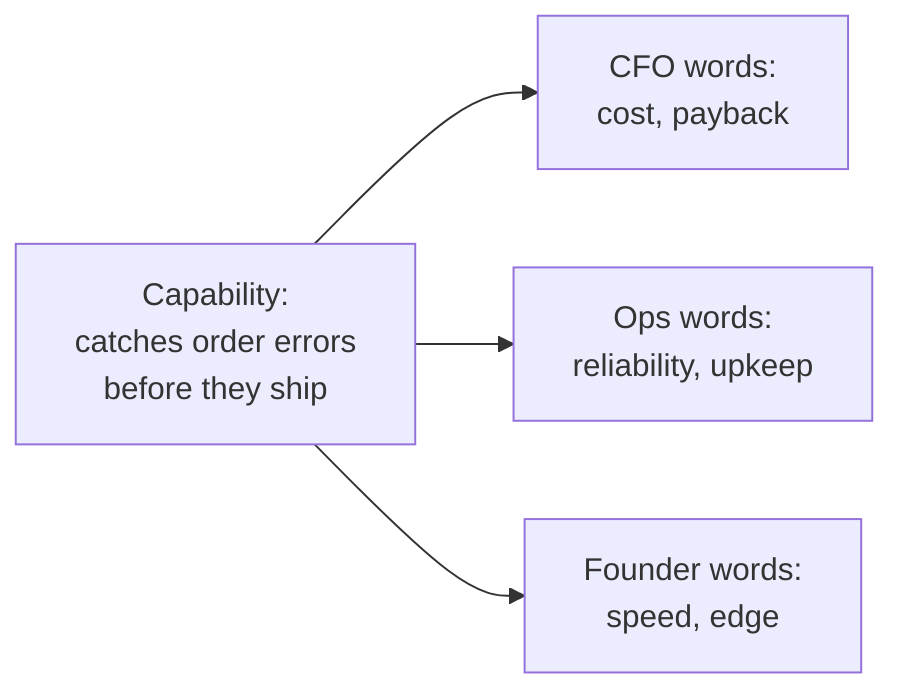

import LevelIntro from "../../../components/LevelIntro.astro";
import Checkpoint from "../../../components/Checkpoint.astro";
import PracticeCheck from "../../../components/PracticeCheck.astro";

export const unit = {
  track: "product-domain",
  unitSlug: "translating-capability-into-their-vocabulary-cfo",
};

L1 showed one fact, the house or the order-error tool, needing a different
framing for each listener. L2 turns that into a method: a map of who cares
about what, a three-step way to produce each framing, and a way to find out who
is in the room before you speak.

<LevelIntro
  items={[
    "The stakeholder map",
    "The three-step translation",
    "Finding out who is in the room",
  ]}
/>

## Why is "know your audience" not specific enough?

**If everyone agrees you should know your audience, why do pitches still go
generic?** Because the research is usually done on the company, not on the
three people at the table. A vendor can correctly learn that the client is a
mid-size retailer and still bring one script, since nobody asked what each
person in the room is personally on the hook for.

| Stakeholder         | Accountable for          | Listens for                        | The same capability, translated                                  |
| ------------------- | ------------------------ | ---------------------------------- | ---------------------------------------------------------------- |
| **CFO**             | The budget               | Cost, ROI, payback, budget risk    | "It pays for itself in under two months by cutting error costs." |
| **Operations lead** | Day-to-day reliability   | Uptime, integration effort, upkeep | "One extra check in the existing pipeline, no new on-call load." |
| **Founder**         | Speed relative to rivals | Time to market, competitive edge   | "It removes a manual review step that slows every release."      |

Read it by row. Each row is the same capability, "catches order errors before
they ship," restated using only the terms that person already uses to judge a
decision. No cell invents a new claim.

**What does it cost to translate for only part of the room?** The chart below
is an assumed teaching model, not measured data: a generic pitch lands about
15% of the time, and each stakeholder whose vocabulary is correctly matched
adds 22 points, so 15 + 22 × matched (the same numbers as this unit's
interactive demo).

The point of the shape is that every unmatched person in the room is a gap, not
a rounding error.

<Checkpoint question="A vendor tells an operations lead: 'this saves the company $40,000 a year.' Is that the operations lead's vocabulary?">

No, it is the CFO's. A savings figure answers "is this worth the budget,"
while the operations lead is asking "does this add work or failure points for
me?" The figure may be true, but it makes the operations lead convert it back
into their own question. A translated version would say how the tool plugs
into the existing pipeline and whether it adds on-call load.

</Checkpoint>

<PracticeCheck
  track={unit.track}
  unitSlug={unit.unitSlug}
  topicId="stakeholder-map"
/>

## How do you produce three honest framings of one fact?

**Given one true statement about a product, what is the move that gives you
the right sentence for each person?** The same three steps every time:

1. State the capability plainly, with no framing yet: what the product does as
   a neutral fact.
2. Ask what this stakeholder is accountable for, using the map or direct
   knowledge of their role rather than a guess.
3. Restate the same fact as the answer to the question that accountability
   implies, so the link to their job is immediate.

This differs from climbing from feature to value for one listener. Here the
value-level fact still has to be re-aimed once per person, because in a
multi-stakeholder deal "value" is not singular.

## How do you find out who is in the room before you pitch?

**If the whole method depends on knowing each person's accountability, where
do you learn it?** A few low-friction ways, in rough order of effort:

| Way to find out                        | What it gives you                        | Caution                                      |
| -------------------------------------- | ---------------------------------------- | -------------------------------------------- |
| Ask beforehand who joins and owns what | A direct answer, usually given plainly   | Only works if you can ask before the meeting |
| Read titles, then verify               | A strong hint about the role             | A title can differ from what someone owns    |
| Watch each person's first question     | A live clue to their real accountability | Needs you to listen before you pitch         |
| State the capability plainly first     | Time to see which follow-up comes back   | Delays the tailored framing by a minute      |

<Checkpoint question="You are told only that you are meeting 'someone from the client side.' What is the best first move once the meeting starts?">

Ask a short, direct question about what that person is focused on, or listen
to how they open. Either gives a real signal. Guessing a role from vague
context risks translating into the wrong vocabulary before the conversation
has begun, which is exactly how the generic first pitch in L1 failed. A thirty
second check costs almost nothing and removes that risk.

</Checkpoint>

<PracticeCheck
  track={unit.track}
  unitSlug={unit.unitSlug}
  topicId="translate-and-discover"
/>

## Failure modes at this level

- **Wrong stakeholder's vocabulary:** a cost figure for the operations lead
  still leaves them to translate.
- **One voice for the room:** a founder saying yes does not convince the CFO.
- **Unconfirmed titles:** a title is a hint, not a certainty.
