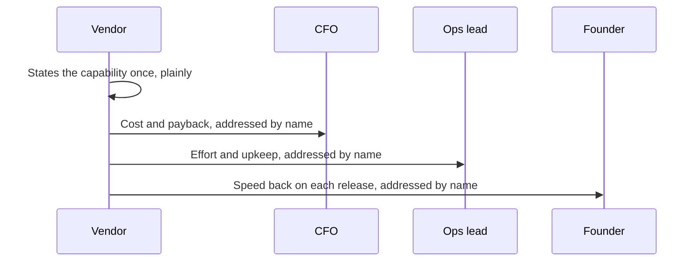

import Scenario from "../../../components/Scenario.astro";
import LevelIntro from "../../../components/LevelIntro.astro";
import Checkpoint from "../../../components/Checkpoint.astro";
import PracticeCheck from "../../../components/PracticeCheck.astro";

export const unit = {
  track: "product-domain",
  unitSlug: "translating-capability-into-their-vocabulary-cfo",
};

<Scenario label="The CFO's question">
  <Fragment slot="facts">
    

      
📦 Assumed: 400 flawed orders a month

      
💸 Assumed: $60 to fix each one, so $24,000 a month

      
🎯 Assumed: the tool catches 3 in 4, so $18,000 a month saved

      
🏷️ Assumed: price $30,000 up front

    

    

      

        $18,000 of $24,000
        monthly error cost the tool removes
      

      

        

      

      
18,000 / 24,000 = 75% (all figures are invented teaching numbers)

    

  </Fragment>

A vendor sells software that checks outgoing orders against the retailer's own
inventory and shipping records and flags likely errors, such as a wrong
address, item or quantity, before the order leaves the warehouse. The CFO
listens to the pitch for ten minutes, then asks one question: "So what do we
actually get back, and when?" The vendor has a good product and no number.

**If the capability is true and strong, why can the CFO still not say yes, and
what would the same capability sound like if it answered the question the CFO
actually asked?**

</Scenario>

The rest of this level runs the L2 method against this one capability, for
each person in turn. All numbers here are assumptions made for teaching, not
data about any real company.

<LevelIntro
  items={[
    "The CFO case with the arithmetic shown",
    "Right and wrong vocabulary for each person",
    "Messier rooms where the map bends",
  ]}
/>

## What is the capability, stated plainly?

**What is the one fact every pitch below is built on?** The software flags
likely order errors before the order ships, instead of after a customer
complains. Every pitch restates this fact. None adds a claim or changes what
the tool does.

## What does the CFO pitch look like with the numbers shown?

**A CFO's question is "what does it cost and what comes back." What does the
capability sound like once it answers that?**

> "Today a flawed order costs about $60 to fix, counting the return, the
> replacement and the support time. You ship roughly 400 a month, which is
> $24,000 a month. This catches about three in four, so $18,000 a month stops
> leaking. At $30,000 up front, it pays for itself in under two months."

Every claim is checkable arithmetic. The table shows the month-by-month
position, assuming the three-in-four catch rate holds:

| Month | Savings that month | Cumulative position (savings minus the $30,000 price) |
| ----- | ------------------ | ----------------------------------------------------- |
| 0     | $0                 | -$30,000                                              |
| 1     | $18,000            | -$12,000                                              |
| 2     | $18,000            | +$6,000                                               |
| 3     | $18,000            | +$24,000                                              |

The break-even point is 30,000 / 18,000, about 1.7 months, which is why "under
two months" is honest. Over a full year the savings are 12 × 18,000 = $216,000,
so the first-year net is $186,000.

**What would the same fact have sounded like in the wrong vocabulary?**
"Our platform proactively catches order errors, reducing failure points in
your pipeline." True, and it hands the CFO nothing to weigh against a budget
line.

<Checkpoint question="The vendor says 'this saves $216,000 a year.' The CFO asks whether the 75% catch rate is real. Which part of the pitch just carried the weight?">

The assumption under the number, not the number itself. A translated figure is
only as strong as the fact it was built from, so the catch rate has to hold up
under a follow-up question. Translation changes the framing, never the
underlying facts, which is why a pitch should be built from numbers the vendor
can defend rather than the most impressive-sounding ones.

</Checkpoint>

<PracticeCheck
  track={unit.track}
  unitSlug={unit.unitSlug}
  topicId="cfo-cost-case"
/>

## What do the other two pitches look like, and what breaks if you swap them?

**An operations lead asks "what does this do to my systems and my team." A
founder asks "does this make us faster or slower than rivals." What does each
need to hear?**

| Listener        | Right vocabulary (assumed details)                                                                                         | Wrong vocabulary: the CFO pitch reused                                 |
| --------------- | -------------------------------------------------------------------------------------------------------------------------- | ---------------------------------------------------------------------- |
| Operations lead | One extra check in the existing pipeline, no new alerts, one config change, a false flag stops one order, not the pipeline | "Saves $216,000 a year" says nothing about workload, risk or paging    |
| Founder         | Replaces a manual review step that adds about two days to each release                                                     | "One config change, no on-call load" is true and does not answer speed |

A bigger number does not rescue a mismatched pitch. A true $216,000 reads as
noise to someone who owns reliability, while a modest sentence aimed at their
accountability moves them further.

In a shared room the order matters less than the fact that all three
translations are actually said, each aimed at its own person, instead of one
blended sentence that answers none of the three.

## What if the room is messier than the example?

**The example has three separate people with one clean accountability each.
Real rooms rarely do. What changes in each case below?** Work these through
yourself before reading on; they are the same method on harder inputs.

- **The operations lead reports to the CFO, and the CFO decides.** Does the
  operations lead's worry go away because they are not the final decision?
  A CFO who senses unease about upkeep will often defer, so the operations
  translation is still needed, perhaps as reassurance the CFO can pass along.
- **The founder is also the technical lead.** One person holds both speed and
  reliability, so a single blended translation is more accurate than choosing
  one row of the map.
- **The news is worse.** Say fewer errors are caught, about 36 a month, so the
  savings are 36 × $60 = $2,160 a month and payback is 30,000 / 2,160, about
  14 months. Do you still lead with the number? Yes. A vaguer pitch that dodges
  it reads as evasive and costs more trust than a long payback would.
- **Your turn:** what changes if the audience were a procurement officer, or
  if the CFO had already said the budget is frozen this year?

The worked example above is one case, not the whole territory. What should
transfer is the method: state the capability plainly, find out who is
accountable for what, and translate honestly.

<Checkpoint question="With a 14-month payback, a salesperson wants to skip the payback figure and talk only about reliability to the CFO. Why is that the worse move?">

Because the CFO's question is still cost and return, and avoiding the number
signals that the answer is bad without letting the CFO weigh it. A long but
honest payback can still be accepted if other benefits matter, such as the
operations and speed gains. Hiding it removes the CFO's ability to make that
trade and damages trust.

</Checkpoint>

<PracticeCheck
  track={unit.track}
  unitSlug={unit.unitSlug}
  topicId="messy-rooms"
/>

## Failure modes at this level

- **One stakeholder's translation reused for all:** a strong CFO pitch repeated
  to the operations lead undoes the translation.
- **A translation that is no longer true:** the payback, the catch rate and the
  two-day figure must survive a follow-up question.
- **Skipping the plain statement:** without a shared fact at the top, three
  framings can feel like three different products.
