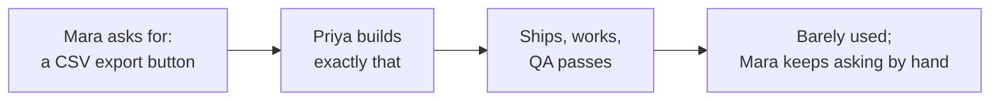

import Scenario from "../../../components/Scenario.astro";
import LevelIntro from "../../../components/LevelIntro.astro";
import PracticeCheck from "../../../components/PracticeCheck.astro";

export const unit = {
  track: "product-domain",
  unitSlug: "understanding-user-s-problem-solution",
};

<Scenario label="The problem">
  <Fragment slot="facts">
    

      

        
Ben said

        "I wish I had a bigger water bottle"
      

      

        
Ben needed

        To not run out of water on long hikes
      

    

    
What happened to the gift

    

      
✅ Well made, leak-proof, exactly "bigger"

      
🏋️ Too heavy to carry up a trail when full

      
🏠 Lives on a shelf at home

    

  </Fragment>

Ben tells his friend Kim, "I wish I had a bigger water bottle." For his
birthday, Kim buys him a large, sturdy, leak-proof steel bottle. It is exactly
what he asked for: bigger. Ben thanks her warmly, and then never takes it
anywhere. Full, it is too heavy to carry up a hiking trail, and hiking is where
he kept running out of water.

**Kim did everything right, so why did the gift fail?** Nothing about the
bottle is wrong. Something about the way "bigger" was heard is.

</Scenario>

Kim built to the words "a bigger water bottle". The words were Ben's first
guess at how to fix a problem he never said out loud: running dry on a long
walk. A lighter bottle plus a refill stop would have fixed it. A bigger bottle
could not.

Software teams make the same mistake at work. Mara, a support-ops lead, files a
ticket: "Add a CSV export button to the ticket dashboard." (A **ticket** is a
written request for work; a **CSV** is a table-like file you can open in a
spreadsheet.) Priya, the engineer, builds exactly that, and it works. Weeks
later almost nobody has clicked it, and Mara is still asking an engineer in
chat most Fridays whether the backlog is getting worse.

<LevelIntro
  items={[
    "Built right versus the right thing",
    "A request is a clue, not a spec",
    "The one-sentence problem test",
  ]}
/>

## Why can a well-made thing still go unused?

**If the bottle and the export button were both flawless, what exactly was
missing?** Not quality. Quality measures how well a thing was built; it cannot
measure whether the thing answers a real need.

- A request phrased as a solution ("a bigger bottle", "a CSV export") carries a
  hidden guess about the problem. Taking it literally inherits that guess
  without ever checking it.
- A **solution** here means the thing someone asks you to build. A **problem**
  means the real difficulty that thing is meant to relieve. Mara's problem was
  noticing early that a number was getting worse.
- The practical rule: treat a request as a **clue** to the problem, then
  confirm the problem before choosing what to build.

Every arrow in that chain is reasonable. The failure never shows at one step,
because no step checks whether the export serves Mara's real need.

<PracticeCheck
  track={unit.track}
  unitSlug={unit.unitSlug}
  topicId="built-right-vs-right-thing"
/>

## How do you know you have found the problem and not just restated the solution?

**Kim could have asked one question: "What happens when you run out?"** That
question is the habit this unit teaches. Before building, try to say the
problem in one sentence that does not mention any solution.

| Statement                                                              | Passes? | Why                                          |
| ---------------------------------------------------------------------- | :-----: | -------------------------------------------- |
| "Ben needs a bigger bottle."                                           |   No    | Names the solution (bigger bottle)           |
| "Ben runs out of water on long hikes."                                 |   Yes   | Describes only the difficulty                |
| "Mara needs a CSV export."                                             |   No    | Names the solution (CSV export)              |
| "Mara needs to notice when a metric is getting worse, in time to act." |   Yes   | Leaves room for a chart, an alert, or a file |

Two quick tools help you get there, and L2 covers both properly. The **five
whys** keeps asking "what is this for?" until an answer names a need instead of
another tool. **Jobs to be done** frames the need as progress someone is trying
to make in a particular situation ("job" means that progress, not an
employment title).

<PracticeCheck
  track={unit.track}
  unitSlug={unit.unitSlug}
  topicId="problem-statement-test"
/>

If you cannot state the problem without naming the solution, you do not yet
know enough to tell whether the solution is a good one.
