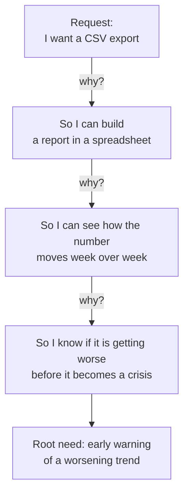
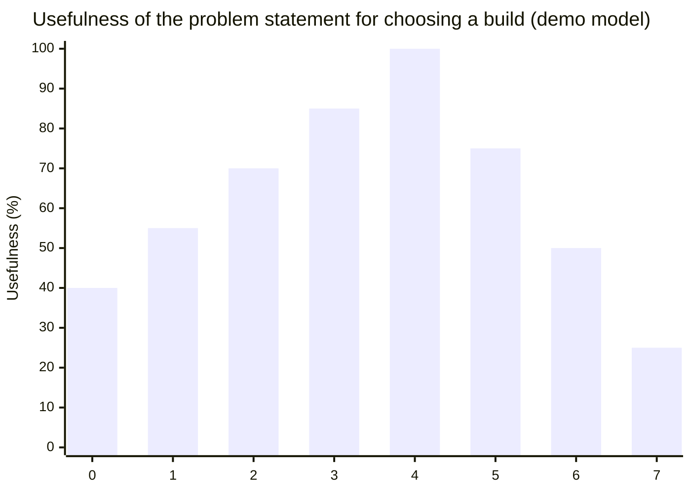
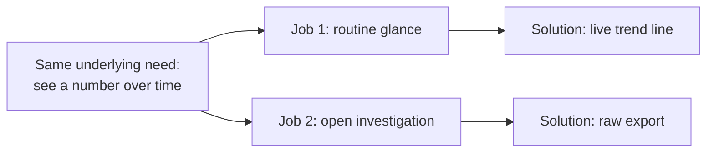

import LevelIntro from "../../../components/LevelIntro.astro";
import Checkpoint from "../../../components/Checkpoint.astro";
import PracticeCheck from "../../../components/PracticeCheck.astro";

export const unit = {
  track: "product-domain",
  unitSlug: "understanding-user-s-problem-solution",
};

L1 showed that a gift and an export button can both be built perfectly and
still miss, because each answered a guess instead of a problem. L2 gives the
two working tools for closing that gap: a way to dig from a request down to the
need, and a way to see why the same need can call for different solutions. The
numbers in the chart below come from this unit's demo model and are
illustrative, not measured.

<LevelIntro
  items={[
    "The five whys chain",
    "How deep is deep enough",
    "Jobs to be done and why context matters",
  ]}
/>

## How do you get from a stated request to the need underneath it?

**Mara says "add a CSV export". If you build it as written, you are betting
that export is the right fix. How do you test that bet before spending a
sprint?** You ask what the export is for, and keep asking.

The **five whys** asks "why do you need that?" after each answer and checks
whether the new answer names a **need** or just another tool. "Validate" here
does not mean a technical test; it means confirming with the person that you
understood the real difficulty.

The first answer ("a report") is still a tool. Only the last one names a need,
and the export turns out to be one of several ways to meet it. A live trend
line on the dashboard might serve Mara better than a file she must open
weekly, but she never asked for that because the spreadsheet was the only
workaround she knew.

**Is more whys always better?** No. The statement gets more useful as you dig,
then less useful once it turns vague. This chart uses the unit's demo model
(illustrative values, not data):

| Whys asked | What the statement sounds like     | What it lets you compare                     |
| ---------- | ---------------------------------- | -------------------------------------------- |
| 0          | "Build a CSV export"               | Only the export itself                       |
| 3          | "Notice a worsening trend in time" | A chart, an alert, or a weekly summary email |
| 6 to 7     | "Feel in control of my work"       | Everything, which in practice means nothing  |

Stop when an answer names a need that is specific enough to compare several
solutions against. Five is a rule of thumb, not a quota.

<Checkpoint question="A teammate keeps asking why until the answer is 'so I can feel in control.' Why is that a worse place to stop than 'notice a worsening trend in time to act'?">

"Feel in control" is true, but almost any feature could be defended with it, so
it cannot rank a chart against an alert against an export. The trend sentence is
specific enough to judge each option by whether it gets Mara the warning in time,
while still leaving room for several solutions. Digging stops paying off at the
point where the statement stops separating good options from bad ones.

</Checkpoint>

<PracticeCheck
  track={unit.track}
  unitSlug={unit.unitSlug}
  topicId="five-whys-depth"
/>

## Why does the same need call for different solutions in different situations?

**Suppose Mara's need and an analyst's need both involve "seeing this number
over time." Would one CSV export serve both?** Not well. This is where jobs to
be done helps: people "hire" a product to make progress on a specific job in a
specific situation. "Job" means the progress someone wants, not their job title.

| Part                | Mara: the weekly glance                       | An analyst: the one-off deep dive             |
| ------------------- | --------------------------------------------- | --------------------------------------------- |
| The job             | Notice a worsening trend before it hurts      | Understand exactly why last month dropped     |
| The situation       | Routine, a few seconds of attention           | Rare, worth an hour of real analysis          |
| Best-fit solution   | A trend line already visible on the dashboard | Raw data to slice and filter freely           |
| Why the other fails | A raw file adds friction to a routine glance  | A pre-drawn chart cannot answer an open "why" |

A generic CSV export fits the second column reasonably and the first badly, and
the first column was Mara's. Naming the job, not just the data, is what picks
the solution.

<Checkpoint question="Both jobs touch the same raw numbers. Why does naming the job still change what you build?">

Because the two jobs put opposite demands on the solution. The weekly glance
needs the answer to be there with zero extra steps; a file adds friction. The deep
dive needs freedom to ask a question nobody anticipated; a pre-drawn chart
blocks that. Same data, different situation, so a solution tuned for one
works against the other.

</Checkpoint>

<PracticeCheck
  track={unit.track}
  unitSlug={unit.unitSlug}
  topicId="jobs-to-be-done"
/>

L3 applies both tools to two other requests, bulk delete and dark mode, and
looks at how the technique itself can go wrong.
