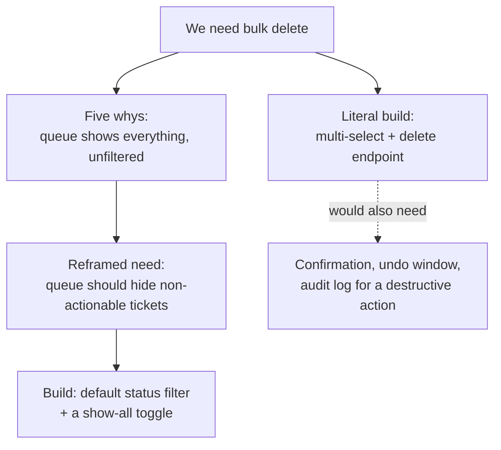

import Scenario from "../../../components/Scenario.astro";
import LevelIntro from "../../../components/LevelIntro.astro";
import Checkpoint from "../../../components/Checkpoint.astro";
import PracticeCheck from "../../../components/PracticeCheck.astro";

export const unit = {
  track: "product-domain",
  unitSlug: "understanding-user-s-problem-solution",
};

<Scenario label="The scenario">
  <Fragment slot="facts">
    

      
🎫 Ticket: "We need bulk delete for tickets"

      
🧑‍💼 Support agents: closing tickets one at a time is slow

    

    
The whys chain

    

      
1️⃣ Why bulk delete? Closed and spam tickets clutter the queue

      
2️⃣ Why does that matter? The queue shows everything, unfiltered

      
3️⃣ Why no filter? Open and closed look identical today

      
🎯 Root need: the queue does not separate actionable from not

    

  </Fragment>

Support agents ask for a "bulk delete" button because clearing old tickets one
at a time is slow. That is the whole ask as written. **If you built exactly what
the ticket says, what would you ship, and what is the most likely way that
turns out to be the wrong tool?**

</Scenario>

<LevelIntro
  items={[
    "A destructive request, reframed",
    "One request, several different needs",
    "How the technique itself can go wrong",
  ]}
/>

## Case 1: why might "bulk delete" be the wrong thing to build?

A **destructive action** can erase information or cause damage if used wrongly.
That is why "delete many things at once" deserves more care than "hide closed
items from the default view."

Taken literally, the ticket produces a multi-select screen and a delete-many
endpoint. Applying the whys gives a different picture:

The reframe moves the question from "how do we destroy records faster" to "how
do we keep the queue showing only what is actionable." A status filter solves
that with no data loss and no new destructive surface to protect. A safe bulk
delete needs extra care because one mistake touches many records: a clear
confirmation, an undo window if possible, and a record of who deleted what.

In this story the team ships the filter and the show-all toggle, and the
clutter complaints stop. The story is a teaching case; no real figures are
claimed.

<Checkpoint question="The team never built bulk delete and the agents stopped asking. Did the whys talk the agents out of something they wanted?">

No. The agents never wanted deletion for its own sake; they wanted a queue that
stopped showing tickets they did not need to act on. The filter met that need
without the risk of a destructive action, so nothing was left for bulk delete to
solve. Had the whys ended in "nobody needs this", that would be a misuse of the
technique: the aim is the solution that fits the need, not arguing the request
away.

</Checkpoint>

<PracticeCheck
  track={unit.track}
  unitSlug={unit.unitSlug}
  topicId="bulk-delete-reframe"
/>

## Case 2: does "several users asked for dark mode" mean one need?

**Several people in a feedback thread ask for dark mode. Are they all asking
for the same reason, and would the answer change what gets built or when?**
Trace the whys per requester instead of assuming one shared reason.

| Requester | Stated reason                                   | Root need                             | Weight behind it                               |
| --------- | ----------------------------------------------- | ------------------------------------- | ---------------------------------------------- |
| User A    | "I use it at night and the bright screen hurts" | Less eye strain in low light          | Real usability pain; matches a support pattern |
| User B    | "Every other tool has it; this looks dated"     | Match expectations set by other tools | An expectation gap, not a functional blocker   |
| User C    | "I just prefer how it looks"                    | Aesthetic preference                  | Lowest urgency; no cost to going without       |

One request, three different needs. A **support-ticket pattern** means several
help requests point at the same repeated pain, and **prioritization** means
deciding what to build first when you cannot build everything. Here, A's need
lines up with a repeated "hard to use at night" complaint, so dark mode gets
sequenced earlier on the **roadmap** (the ordered list of planned work) than
it otherwise would. The whys did not kill the request; they showed which
version of it carried real pain.

<Checkpoint question="Users A, B and C asked for the same feature but the team treated them differently. What made that fair rather than favoritism?">

The whys showed that one feature name hid three needs of different weight. A's
was a usability problem backed by an existing support pattern, while B's and C's
were about expectation and taste, with no functional cost to waiting. Weighing
the real cost of not building for each need is not preferring one person's
opinion; the literal request could not show the difference because all three
asked for the identical thing.

</Checkpoint>

<PracticeCheck
  track={unit.track}
  unitSlug={unit.unitSlug}
  topicId="one-request-several-needs"
/>

## When does the technique itself go wrong?

**If the five whys is so useful, what stops a team from using it badly?** Four
failure modes recur.

| Failure                                       | What it looks like                                         | The fix                                                           |
| --------------------------------------------- | ---------------------------------------------------------- | ----------------------------------------------------------------- |
| Guessing the whys in a meeting                | Plausible reasons invented by the team, no requester asked | Trace the whys with the person who filed the request              |
| Using it to talk users out of what they asked | Concluding "nobody really needs this" as the goal          | Case 2 did not kill dark mode; it ranked which need mattered most |
| Stopping at the first why                     | "So I can build a report": a report is still a solution    | Keep going until the answer names a need                          |
| Same rigor for every request                  | A tiny, reversible tweak gets a full interrogation         | Scale the digging to the cost and risk of the build               |

<PracticeCheck
  track={unit.track}
  unitSlug={unit.unitSlug}
  topicId="five-whys-failure-modes"
/>

## Extend it: what changes in a different case?

**These two cases are examples, not the whole territory.** Try changing the
facts and see whether the reasoning still holds.

- What if the bulk-delete request came from one power user instead of several
  agents hitting the same clutter? Does one voice carry the same weight?
- What if, in Case 2, User C's taste turned out to be most of the requesters and
  User A's eye strain was rare? Does "most common" outrank "most severe"?
- Where in your own backlog is a request that is really several needs sharing
  one feature name, and what would tracing the whys per requester change?

None of these has a single clean answer. The method is a way to ask better
questions, not a script that reproduces these two stories.
