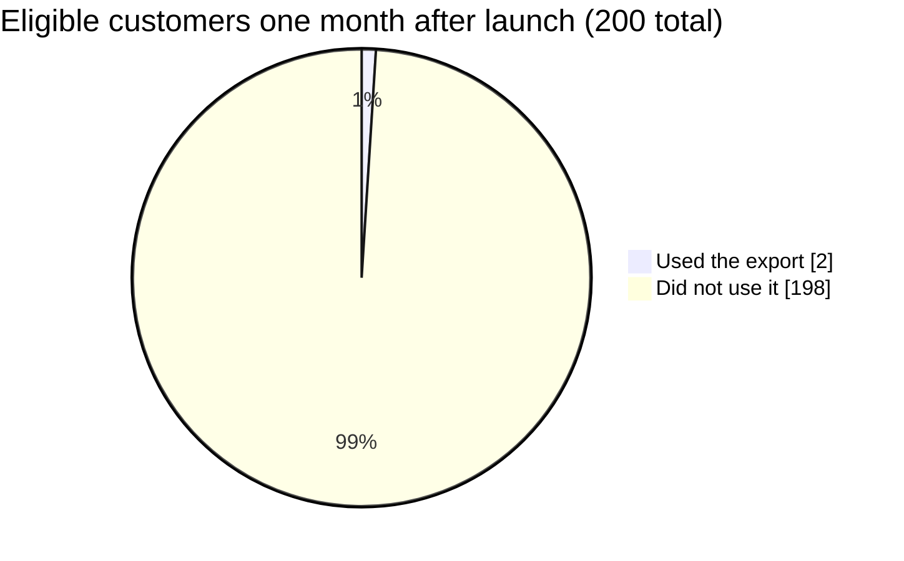

import Scenario from "../../../components/Scenario.astro";
import LevelIntro from "../../../components/LevelIntro.astro";
import PracticeCheck from "../../../components/PracticeCheck.astro";

export const unit = {
  track: "product-domain",
  unitSlug: "validation",
};

<Scenario label="A new dish for a hundred guests">
  <Fragment slot="facts">
    

      

        

          🍲 Cook the whole batch first
          100 portions at risk
        

        

          

        

      

      

        

          🥄 Serve one portion to one guest first
          1 portion at risk
        

        

          

        

      

      
All numbers in this unit are made-up round numbers for teaching.

    

  </Fragment>

A home cook agrees to feed 100 guests at a wedding. She wants to serve a dish
she has never made before, so she buys the ingredients and cooks 100 portions
on Friday. On Saturday the guests take one bite each, and most of the food goes
back to the kitchen on the plates. Nothing was cooked badly. The dish was made
exactly as the recipe said.

She could have cooked one portion on Wednesday and watched one person eat it.
**Why did she spend the effort of 100 portions to learn what 1 portion could
have told her?**

</Scenario>

The cook skipped a cheap check on one belief: that guests would like the dish.
Product teams do the same thing with weeks of engineering instead of portions
of food, and this unit is about the cheap check they skip.

<LevelIntro
  items={[
    "A request versus the real problem",
    "Validation, prototype and MVP",
    "Assumption versus evidence",
  ]}
/>

## Why isn't a customer request the same as the problem?

**Sales tells a product team that customers want to "export their data." Is
that the problem, or something else?** It is something else: a solution that
someone has already picked.

A product team spends six weeks building a full bulk export, with CSV and PDF
files, every field and configurable columns. It ships, and one month later only
2 of the 200 eligible customers have used it. The export works exactly as
designed. In plain terms, "sales" is the group that hears customer requests,
"engineering" builds, and "adoption" is how many people actually used the thing
once it existed.

| Question                | Stated request                        | Evidence                                      |
| ----------------------- | ------------------------------------- | --------------------------------------------- |
| What it is              | Something a person says they want     | Something a person actually did               |
| Export story example    | "Customers want to export their data" | Customers clicked, answered, or came back     |
| Cook story example      | "Guests will love a new dish"         | A guest eating one portion and finishing it   |
| What it lets you decide | Whether to look into the idea         | Whether to commit weeks of effort to the idea |

The request names a mechanism (export) but not the job behind it. It is like
hearing "I need a hammer" and building a fine hammer before asking whether the
real job was hanging a picture, where a hook or tape might do better. Until
behavior confirms the request, it stays an **assumption**.

<PracticeCheck
  track={unit.track}
  unitSlug={unit.unitSlug}
  topicId="assumption-vs-evidence"
/>

## What do validation, prototype and MVP mean?

**If the answer is "check cheaply first," what is the thing being built for the
check, and what is it called?** Three terms cover it, and each one is about
learning something before committing.

| Term           | What it is                                                    | The cook's version                   | The export team's version                  |
| -------------- | ------------------------------------------------------------- | ------------------------------------ | ------------------------------------------ |
| **Validation** | Cheaply testing whether an assumption is true before building | Asking whether guests like the dish  | Asking whether customers want a raw export |
| **Prototype**  | A fast stand-in built to test a question, not to be shipped   | One portion cooked in a home kitchen | A button that leads to a question          |
| **MVP**        | The smallest version that tests the riskiest assumption       | The one-portion tasting              | The smallest test of what customers need   |

An MVP (minimum viable product) is not simply a cheaper copy of the final
feature. L2 shows why that difference decides whether you learn anything.

<PracticeCheck
  track={unit.track}
  unitSlug={unit.unitSlug}
  topicId="validation-terms"
/>

## What this unit covers

L2 works through the validate-before-build loop and why "the smallest version
of the final feature" is a different thing from "the smallest test of the
riskiest assumption." L3 walks through what happened when a second team tested
the same export assumption before building anything, and what it built instead.
