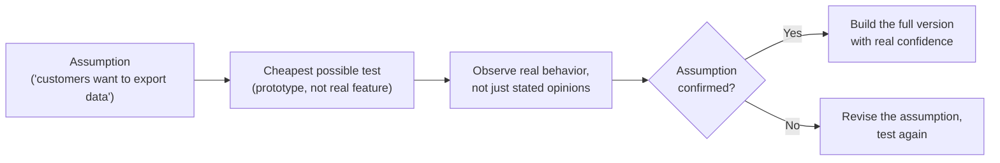
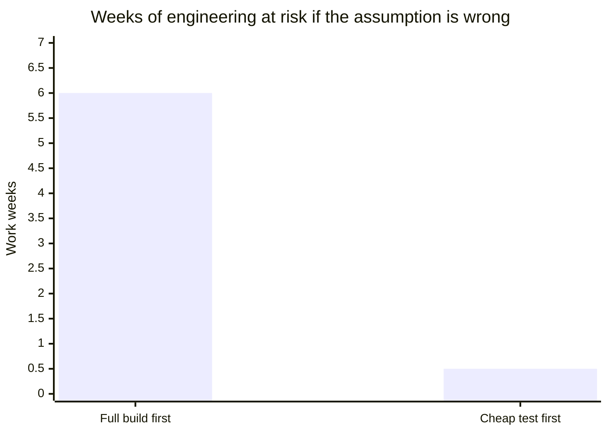

import LevelIntro from "../../../components/LevelIntro.astro";
import Checkpoint from "../../../components/Checkpoint.astro";
import PracticeCheck from "../../../components/PracticeCheck.astro";

export const unit = {
  track: "product-domain",
  unitSlug: "validation",
};

L1 showed that a stated request like "export my data" is already a solution, and
that the cook and the export team both skipped a cheap check. L2 works through
the loop that makes the check, and why "a smaller feature" and "a test of the
riskiest assumption" are different things. Numbers are made up for teaching.

<LevelIntro
  items={[
    "The validate-before-build loop",
    "Smaller feature versus riskiest-assumption test",
    "Behavior versus stated opinions",
  ]}
/>

## What does the validate-before-build loop look like?

**If a team cannot be sure customers want a feature until it exists, is
validation impossible before shipping?** No. Validation does not need the real
feature. It needs a cheap way to watch how people respond to the idea.

The loop never reaches "build the full version" until a cheap test has produced
real evidence. Skipping straight from assumption to build is what happened in
L1: six weeks of engineering stood in for a step that should have taken days.

The size of that gap is the whole argument. Assume the cheap test costs about
half a work week (an assumed figure, covering two days of building plus time to
review answers).

<Checkpoint question="In L1's story, the team went straight from 'sales says customers want export' to a 6-week full build. Which step in the loop did they skip, and what would it have cost them to run it first?">

They skipped the cheapest possible test, so there was no point where they
watched real behavior before committing the six weeks. Running it first would
have cost days instead of weeks, and it would have surfaced the same signal,
that customers wanted something other than a raw export, before any of the six
weeks was spent rather than after.

</Checkpoint>

**If sales already told the team that customers want to export, isn't that
evidence?** It is an assumption reported secondhand. What someone says they
would use and what they do when given a real chance can differ sharply. A cheap
prototype that records real clicks, real answers or real willingness to wait is
a much stronger signal than a stated preference relayed through another team.
Sales did nothing wrong here: "customers said this" is a useful clue, while
"customers clicked, answered or paid" is evidence.

<PracticeCheck
  track={unit.track}
  unitSlug={unit.unitSlug}
  topicId="validate-before-build-loop"
/>

## Is an MVP just a smaller version of the feature?

**A team cuts the export to CSV only and three columns and calls it an MVP. Is
it?** That is a common reading of the term, and it is not the one that makes an
MVP useful.

|                                 | Smaller version of the final feature               | Test of the riskiest assumption                                  |
| ------------------------------- | -------------------------------------------------- | ---------------------------------------------------------------- |
| What gets built                 | A real, working but limited version of the feature | Whatever is cheapest that still produces a real signal           |
| Engineering effort              | Still substantial, because it is shippable code    | Minimal, often no real backend at all                            |
| What it tests                   | Whether the limited version works technically      | Whether the underlying assumption about what people want is true |
| Risk if the assumption is wrong | Weeks of effort spent on the wrong thing           | Days spent, assumption revised, no real feature effort wasted    |

A smaller export (fewer formats, fewer columns) still commits engineering time
to the same unconfirmed guess, just a little less of it. A true MVP might export
nothing at all: it could be a button that says "coming soon" and asks what the
customer wanted the file for.

The everyday version: someone says "I need an app to print my recipes." The
riskiest assumption is that printing is the real need. A cheap test asks whether
they want paper copies or want to send recipes to a family chat group. The MVP
is the smallest test that answers that question, not automatically the smallest
printing app.

<Checkpoint question="A team builds an MVP export that supports only CSV and only three columns. Using the table above, is this a test of the riskiest assumption, or something else?">

It is still a smaller version of the final feature. It is real, shippable code
that exports actual data, just less of it, so it still commits real engineering
time to the unconfirmed guess that customers want a raw export at all. A true
test of the riskiest assumption would not need to export anything. It would only
need to find out, as cheaply as possible, what customers wanted to do once the
data was out. Cutting scope is not the same move as testing whether the feature
should exist in that form.

</Checkpoint>

**Does this only apply to exports?** No. It applies to any feature whose value
depends on an unconfirmed belief about what people want. The pattern to watch
for is always the same: effort about to be committed to a guess when a cheaper
test of that guess exists and has not been tried.

<PracticeCheck
  track={unit.track}
  unitSlug={unit.unitSlug}
  topicId="mvp-vs-smaller-feature"
/>
