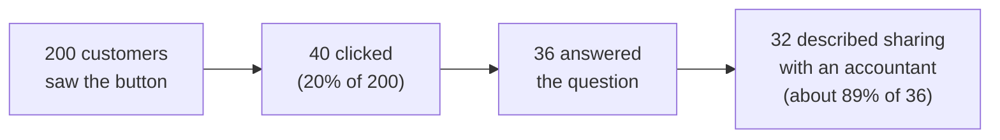

import Scenario from "../../../components/Scenario.astro";
import LevelIntro from "../../../components/LevelIntro.astro";
import Checkpoint from "../../../components/Checkpoint.astro";
import PracticeCheck from "../../../components/PracticeCheck.astro";

export const unit = {
  track: "product-domain",
  unitSlug: "validation",
};

<Scenario label="A 2-day test instead of a 6-week build">
  <Fragment slot="facts">
    

      
🚪 <strong>The test</strong> — a button labeled "Export &amp; Share" that opens a short question, not a real export

      
👥 <strong>Audience</strong> — the same 200 eligible customers as in L1

      
❓ <strong>Question asked</strong> — "what would you do with this once you had it?"

      
⏱️ <strong>Build time</strong> — 2 days, against 6 weeks for the real export

    

  </Fragment>

A second team hears the same request from sales, but does not build the export.
It adds one button to the same 200 customers' accounts. Clicking it exports
nothing: it says the feature is coming soon and asks what the customer would do
with it.

**Before reading the results: if most customers who click are really after
something other than a raw data export, what is the most likely thing they are
trying to accomplish?**

</Scenario>

L2 gave the loop and the MVP distinction. L3 follows one team through it with
numbers, then looks at how the loop fails.

<LevelIntro
  items={[
    "Reading the fake-door numbers",
    "What was built and how it performed",
    "Failure modes that undo validation",
  ]}
/>

## What did the fake-door test measure?

**How do you read a funnel where 200 customers saw a button and only some of
them said anything?** One step at a time, with each rate measured against the
right starting group.

A **fake-door test** shows a visible door before the real room exists. The
ethical part matters: the team does not pretend the feature is available. It
says "coming soon," asks a question and uses the answer to decide what to build.
The button and prompt took two days to build, not six weeks.

| Step                                                      | Count | Rate and its base                                        |
| --------------------------------------------------------- | ----- | -------------------------------------------------------- |
| Customers who saw the button                              | 200   | Starting group                                           |
| Clicked it                                                | 40    | 20% of 200                                               |
| Answered the follow-up prompt                             | 36    | 90% of the 40 clickers                                   |
| Described sharing with an accountant, not downloading raw | 32    | about 89% of 36 answers, 80% of clickers, 16% of all 200 |

The prediction question has an answer: most clickers did not want to download and
manipulate raw files. They wanted to hand their numbers to someone else, such as
an accountant or bookkeeper, without giving that person full account access
(which would let them act as the customer). "Export my data" was standing in for
"let me share this with someone outside my team," a materially different
feature.

<Checkpoint question="Only 40 of 200 customers clicked, and only 36 of those answered. Does the fact that most customers never clicked undermine what the test found about the 32 who described sharing?">

No, because the two facts answer different questions. The 20% click rate says
how many customers cared enough about this to act, which was fewer than sales
assumed. Among the people who did click and answer, the pattern was strong:
about 80% of clickers described sharing. A low overall click rate does not dilute
that. It is a second, independent finding sitting next to the first. One caution
runs the other way: 32 of 36 is 89% of the answers but only 16% of all 200
customers, so the right base matters when quoting the number.

</Checkpoint>

## What got built instead, and how did it perform?

**If validation takes time too, why is it worth it?** Compare what each path
bought.

Based on the signal, the team built a **shareable, read-only link**: no file
export at all, just a link an accountant could open directly. "Read-only" means
the outside person can look but cannot change settings, move money or delete
data. It took one week.

| Path                                | Engineering time        | Adoption after 1 month | Weeks per adopting customer |
| ----------------------------------- | ----------------------- | ---------------------- | --------------------------- |
| Original bulk export (L1)           | 6 weeks                 | 2 of 200 (1%)          | 6 / 2 = 3                   |
| Test, then shareable read-only link | 0.5 (assumed) + 1 = 1.5 | 150 of 200 (75%)       | 1.5 / 150 = 0.01            |

The gap is not about the second build being better engineered. It is that the
second build was the thing customers were asking for, confirmed before any
full-feature work. The unit's interactive demo lets you drag the weeks spent
before validating: at 6 weeks it reproduces the first team's loss, and at 0 it
reproduces the second team's.

<Checkpoint question="Six weeks for 1% adoption versus one week for 75%. What does the gap tell you about whether validation itself takes time, and what does it not tell you?">

The gap shows the second team spent less time building the wrong thing, not that
validation was free. The test still had to happen before the one-week build
could start, a cost the first team never paid. What it does not show is that
skipping validation saves time in general. The first team's six weeks produced
almost no return, so its cost per adopting customer was about 3 weeks against
about 0.01 weeks for the second team, even counting the test. The comparison is
between committing fully to an unconfirmed guess and paying a small upfront cost
to build the right thing.

</Checkpoint>

<PracticeCheck
  track={unit.track}
  unitSlug={unit.unitSlug}
  topicId="reading-fake-door-results"
/>

## How does the loop fail?

**A team can run every step above and still learn nothing. Where does that
happen?** In five recurring places.

| Failure mode                                                                  | What it gets wrong                                                                      |
| ----------------------------------------------------------------------------- | --------------------------------------------------------------------------------------- |
| Treating a secondhand request as evidence                                     | What people say and what they do when given the chance can differ sharply               |
| Building a smaller version of the feature instead of a test of the assumption | Still commits real effort to an unconfirmed guess, just a little less of it             |
| Counting clicks without asking a follow-up question                           | A click does not reveal what the customer was trying to do; the "why" redirects a build |
| Treating a confirmed assumption as proof no more testing is needed            | Confirming one assumption does not cover the next decision; new guesses need new tests  |
| Running the test but building the original plan anyway                        | Evidence nobody acts on wastes the test                                                 |

**Suppose 32 of the 36 answers had said "yes, I want to download a CSV of my raw
data." Would the 2-day test have been wasted?** No. The team would then hold
real evidence, a 20% click rate and real intent behind the clicks, which the
first team only found out a month late. A confirming result is a cheap
purchase of confidence. It is not wasted just because it changed nothing.

<PracticeCheck
  track={unit.track}
  unitSlug={unit.unitSlug}
  topicId="validation-failure-modes"
/>

## Extend it: what changes in a different case?

**This is one worked case, not the whole territory.** It had a cheap test that
was easy to build, a clear follow-up question and a result that pointed
somewhere new. Try changing the facts.

- **What if the audience were different?** Suppose only 12 customers existed.
  Would a 20% click rate still mean anything, and what would you do instead of
  counting clicks?
- **What if the news were worse?** Suppose only 3 of 200 had clicked and
  nobody answered. What would you conclude about the assumption, and what would
  you test next?
- **What if the cheap test were not cheap?** If the button needed two weeks to
  build safely, how would that change the comparison with the six-week build?

None of these has one clean answer. The loop is a shape for deciding what to
learn before building, not a script that reproduces the second team's week.
