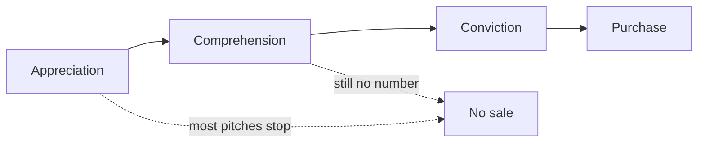

import Scenario from "../../../components/Scenario.astro";
import LevelIntro from "../../../components/LevelIntro.astro";
import PracticeCheck from "../../../components/PracticeCheck.astro";

export const unit = {
  track: "product-domain",
  unitSlug: "value-based-selling",
};

<Scenario label="Same robot, same friend, two pitches">
  <Fragment slot="facts">
    

      

        Assumed round numbers, for teaching only
      

      

        $480 vs. $1,440
        robot price (once) vs. cleaner cost per year
      

      

        

      

    

    

      
🎬 Pitch 1: “it maps your rooms with a laser”

      
😮 Reaction: “wow, clever.” No purchase

      
🧾 Pitch 2: “you pay $120 a month for a cleaner; this pays for itself in 4 months”

      
✅ Reaction: orders it that evening

    

  </Fragment>

A friend, Sam, watches a demo of a robot floor cleaner at a store. The
salesperson explains that it maps each room with a laser and never bumps into
furniture. Sam says, "That's really clever," and walks out without it.

A week later a different seller meets Sam and says only this: "You pay a
cleaner $60 a visit, twice a month. That is $120 a month, $1,440 a year. This
robot costs $480 once, so it pays for itself in four months." Sam orders it
that evening. (Every figure here is an assumed round number for teaching.)

**The robot never changed. What did the second seller add that the first one
left out?**

</Scenario>

The first pitch gave Sam something to admire. The second gave Sam something to
compare against a bill Sam already pays. Admiring a product and paying for it
are two different mental states, and this unit is about the gap between them.

<LevelIntro
  items={[
    "Appreciation, comprehension and conviction",
    "Value-based selling in one sentence",
    "Why the buyer's own number closes the gap",
  ]}
/>

## Can a buyer love a product and still not buy it?

**Sam understood the robot perfectly after the first pitch. Why did that not
lead to a purchase?** Because understanding how something works answers a
question about the product. Buying answers a different question: is this
specific cost worth this specific outcome, for me, now?

| Reaction          | What the buyer thinks                             | Does it produce a sale?                    |
| ----------------- | ------------------------------------------------- | ------------------------------------------ |
| **Appreciation**  | "That is clever, well built, impressive."         | No. Admiration is not a budget decision.   |
| **Comprehension** | "I see what problem this solves, in general."     | Rarely. Knowing is not the same as urgent. |
| **Conviction**    | "This number, against my money, is worth it now." | Yes. A purchase needs this state.          |

Most pitches are built to produce appreciation and hope the rest follows. It
does not. Each step needs something the previous step cannot supply.

<PracticeCheck
  track={unit.track}
  unitSlug={unit.unitSlug}
  topicId="appreciation-conviction"
/>

## What did the second pitch actually add?

**Both pitches described the same robot. So what is different about the
second?** It added two things: a number tied to something Sam already pays
(the cleaner), and a timeframe (four months to break even). That pairing is
what **value-based selling** means: anchoring the pitch, and ultimately the
price, to the concrete outcome the buyer gets (money saved, time recovered,
risk avoided) instead of to what the product contains.

- **A number the buyer already owns.** The $120 a month was Sam's own
  existing spend. Nothing had to be taken on faith.
- **A timeframe.** "Four months" is concrete in a way "great savings" never is.
- **No new feature.** The capability stayed the same. Only its connection to
  the buyer's budget changed.

This unit assumes you already know to lead with value rather than features
(`product-domain/value-framing-over-feature-framing`) and to speak in a given
stakeholder's vocabulary
(`product-domain/translating-capability-into-their-vocabulary-cfo`). What is
new here is turning a value claim into a number precise enough, and credible
enough, that a buyer will commit money against it.

<PracticeCheck
  track={unit.track}
  unitSlug={unit.unitSlug}
  topicId="buyer-owned-number"
/>

L2 builds the model behind the number: cost of inaction, cost of adoption and
payback period. L3 works a full workplace case (an invoice tool pitched to a
finance director) and shows what happens when the number is inflated.
