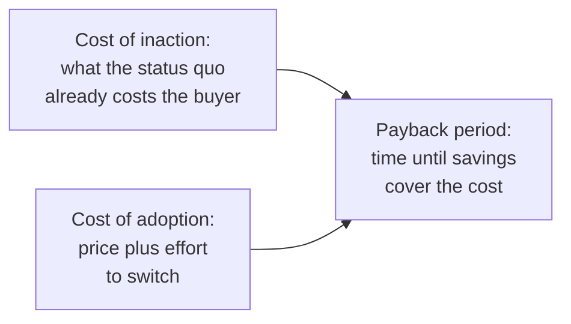

import LevelIntro from "../../../components/LevelIntro.astro";
import Checkpoint from "../../../components/Checkpoint.astro";
import PracticeCheck from "../../../components/PracticeCheck.astro";

export const unit = {
  track: "product-domain",
  unitSlug: "value-based-selling",
};

L1 showed Sam admiring a robot and only buying when the seller connected it to
the cleaner's bill. L2 builds the model that makes that connection repeatable:
which numbers to assemble, how they combine, and why a precise claim moves a
buyer where a vague one does not.

<LevelIntro
  items={[
    "Cost of inaction and cost of adoption",
    "Payback period as the number buyers remember",
    "Why a specific claim beats a vague one",
  ]}
/>

## Where does the number come from?

**Sam's second pitch had a monthly figure and a break-even time. Where did each
come from?** From two sides of one decision, plus a third figure derived from
how they relate.

| Figure               | Question it answers                                    | Sam's robot (assumed numbers)                   |
| -------------------- | ------------------------------------------------------ | ----------------------------------------------- |
| **Cost of inaction** | What does leaving things as they are cost every month? | $60 a visit, twice a month: $120 a month        |
| **Cost of adoption** | What does switching cost in total, not only the price? | $480 once, plus about half an hour to set it up |
| **Payback period**   | How long until the savings cover the cost?             | $480 divided by $120 a month: 4 months          |

- **Cost of inaction** is often written down nowhere. The buyer absorbs it as
  "just how things are", so naming it out loud is persuasive before any
  product is mentioned.
- **Cost of adoption** includes effort, training and temporary disruption, not
  only the sticker price. Quoting only the price makes a case look better than
  it will feel to live through.
- **Payback period** is usually the one figure a buyer remembers. "Four
  months" sticks; "significant savings" does not.

<Checkpoint question="A seller says the robot will pay for itself in four months, but the buyer will also spend a weekend moving furniture and fixing the wifi to set it up. Which of the three figures did the seller leave incomplete?">

The cost of adoption. The seller counted only the price and ignored the real
effort of switching. The payback arithmetic may still look right, but the buyer
will discover the weekend of setup afterward, and that gap between the pitch
and the lived experience makes every other number in the pitch look less
trustworthy. An honest cost of adoption names the effort up front.

</Checkpoint>

<PracticeCheck
  track={unit.track}
  unitSlug={unit.unitSlug}
  topicId="cost-of-inaction-adoption"
/>

## Why does a specific claim beat a vague one?

**"This will save you a lot" and "this will save you $1,440 a year" both sound
like good news. Why does only the second move a buyer?** Because a buyer can
test the second against something they already know, and cannot test the first
against anything.

|                             | Vague claim                          | Quantified claim                                             |
| --------------------------- | ------------------------------------ | ------------------------------------------------------------ |
| Example                     | "It will save you a lot of money."   | "It replaces $120 a month of cleaning, about $1,440 a year." |
| What the buyer must do next | Guess what "a lot" means.            | Compare a stated figure with a bill they already know.       |
| Effect on urgency           | None. "A lot" competes with nothing. | It competes directly with other uses of the same money.      |
| What it invites             | Polite agreement, no next step.      | A specific question: "do I really spend $120 a month?"       |

**Why is a specific objection progress rather than a setback?** A vague claim
is too soft to disagree with, so the conversation has nowhere to go but "sounds
good". A specific number gives the buyer something to test, and testing is how
trust gets built. A claim that is never questioned was probably never taken
seriously enough to be evaluated.

<Checkpoint question="One seller says 'this significantly reduces mistakes'. Another says 'this cuts mistakes from 4 in 100 to under 1 in 100'. Why is the second more persuasive, beyond just containing digits?">

Because the buyer can check it against something they already track. The
second claim gives a starting point the buyer can verify against their own
mistake rate, an outcome they can weigh against their own situation, and a
precise statement they can push back on if their case looks different. The
first leaves the buyer to invent their own meaning for "significantly", and
most buyers will not do that work unprompted.

</Checkpoint>

<PracticeCheck
  track={unit.track}
  unitSlug={unit.unitSlug}
  topicId="quantified-claims"
/>

L3 takes one workplace case all the way through: a real ledger, a payback
period that accounts for a slow start, and a contrast between a number that
backfires and one that holds up.
