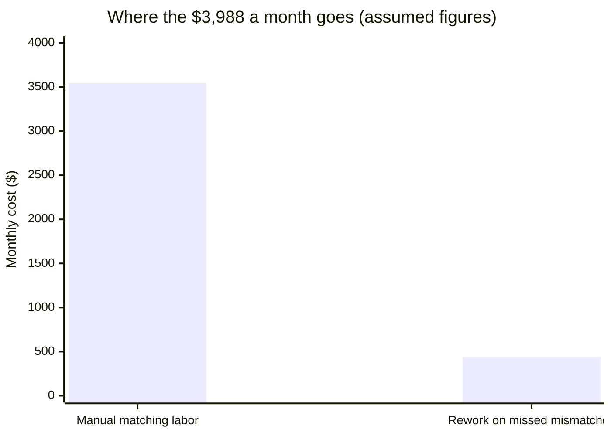
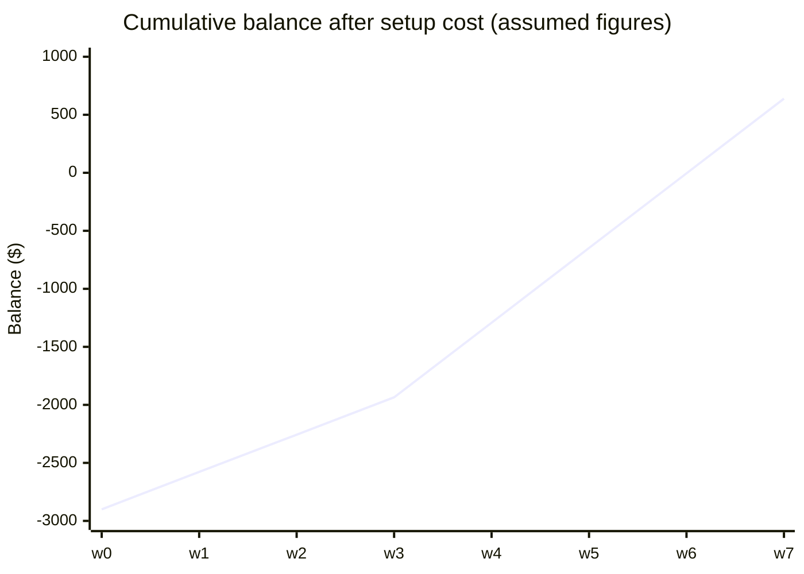

import Scenario from "../../../components/Scenario.astro";
import LevelIntro from "../../../components/LevelIntro.astro";
import Checkpoint from "../../../components/Checkpoint.astro";
import PracticeCheck from "../../../components/PracticeCheck.astro";

export const unit = {
  track: "product-domain",
  unitSlug: "value-based-selling",
};

<Scenario label="The second call with the finance director">
  <Fragment slot="facts">
    

      
👥 3 people, about 5 hours a week each, matching invoices by hand

      
⚠️ About 2 mismatches a month slip through, 4 hours each to unwind

      
💵 $55 an hour fully loaded, her own figure

      
🧾 Tool: $1,200 a month plus about $2,900 once to set up

    

    
All figures are assumed round numbers for teaching.

  </Fragment>

A rep sold nothing at the first demo: a finance director called an
invoice-reconciliation tool "genuinely impressive" and never replied. Now she
has agreed to a second call. The rep does not plan another demo. The goal is to
build the case from the director's own numbers, so that the figure she hears at
the end is one she could defend to her own boss.

**What should the rep ask first, before quoting a single figure?**

</Scenario>

L2 gave the parts: cost of inaction, cost of adoption, payback period. This
level assembles them with real arithmetic, shows where a naive payback
calculation misleads, and then asks what happens when the headline number is
inflated.

<LevelIntro
  items={[
    "A ledger built from the buyer's own figures",
    "Payback that accounts for a slow start",
    "An inflated claim versus a conservative one",
  ]}
/>

## Whose numbers go in the ledger?

**Not "would this save you money?" That asks the director to estimate a benefit
she has not experienced.** The better first question asks for a fact she
already has: "How many people touch invoice matching, and roughly how much of
their week does it take?" Every line in the ledger should trace back to
something the buyer said, not to an assumption the seller dropped in.

| Line item                     | Basis                                   | Monthly cost      |
| ----------------------------- | --------------------------------------- | ----------------- |
| Manual matching labor         | 15 hrs a week × 4.3 weeks × $55 an hour | about $3,548      |
| Rework on missed mismatches   | 2 incidents × 4 hours × $55 an hour     | $440              |
| **Cost of inaction, monthly** |                                         | **about $3,988**  |
| **Cost of inaction, annual**  | × 12                                    | **about $47,850** |

The rework line was nearly left out because the director mentioned it in
passing. Cost of inaction often hides in exactly that kind of aside, not in the
thing the buyer names first when asked about their biggest problem.

<PracticeCheck
  track={unit.track}
  unitSlug={unit.unitSlug}
  topicId="own-numbers-ledger"
/>

## Why not simply divide the setup cost by the weekly saving?

**The tool costs $1,200 a month and about $2,900 once. If the rep divides $2,900
by the full weekly saving, what does the pitch promise, and what really
happens?** Net monthly saving once fully running is $3,988 minus $1,200, which
is $2,788, or about $643 a week. Dividing $2,900 by $643 gives roughly 4.5
weeks.

That figure assumes full-speed savings from day one. In practice the team
learns the tool for about three weeks and realizes only half the saving
(roughly $322 a week). Running the real week-by-week balance:

| End of week | 0      | 1      | 2      | 3      | 4      | 5    | 6   | 7    |
| ----------- | ------ | ------ | ------ | ------ | ------ | ---- | --- | ---- |
| Balance ($) | -2,900 | -2,578 | -2,257 | -1,935 | -1,292 | -648 | -5  | +639 |

The balance is still $5 short at the end of week six and crosses zero during
week seven, so the honest pitch says **about seven weeks**. The ramp-up dip is
not a separate cost line, because the slow start is already inside the
week-by-week balance; adding it again would double count it.

<Checkpoint question="The 4.5-week figure sounds better than seven weeks. Why is seven weeks the better number to say out loud?">

Because the buyer will live through the slow first weeks whether or not they
are mentioned. If the pitch promised 4.5 weeks and the lived experience takes
seven, the gap becomes evidence in the buyer's mind that the other numbers
were optimistic too, even the accurate ones. A less dramatic number that
matches what actually happens stays defensible after the sale, not just
persuasive before it.

</Checkpoint>

The pitch the director hears compresses all of this into a few sentences she
can repeat to her own boss: roughly $3,988 a month today, $1,200 a month plus
about $2,900 to start, roughly $2,800 a month net once running, paid back in
about seven weeks. No feature is named. The capability is assumed; the number
is what is being sold.

<PracticeCheck
  track={unit.track}
  unitSlug={unit.unitSlug}
  topicId="ramp-up-payback"
/>

## What happens when the number is wrong?

**A second rep skips the "ask for her numbers" step and uses an assumed generic
benchmark to promise $92,000 a year, nearly double the honest $48,000.** The
buyer's team later tracks the real hours and finds the saving is about $30,000.
That is still a good outcome, so the tool stays. But the director now discounts
that vendor's claims by default, brings a colleague to the renewal to check the
math, and mentions the gap when a peer asks for a reference.

|                                      | Inflated claim ($92k)                              | Conservative claim ($48k)                    |
| ------------------------------------ | -------------------------------------------------- | -------------------------------------------- |
| Where the number came from           | A generic benchmark, never checked with this buyer | The buyer's own stated hours and rates       |
| First reaction                       | Impressive; may close faster                       | Credible; the buyer can defend it internally |
| What happens once reality is checked | Real saving lands far below promise; trust breaks  | Real saving lands near promise; trust builds |
| Effect on the next conversation      | Every later number is discounted                   | Later numbers are taken closer to face value |

<Checkpoint question="The buyer stayed a customer even though the real saving was $30,000, not $92,000. Was the inflated pitch still a mistake?">

Yes. Staying a customer does not mean the pitch worked as intended. The cost
did not show up as a lost sale; it showed up as lost trust that taxes every
later interaction: the renewal, any expansion, any reference. A pitch should
close the first deal and also build a relationship that survives being
checked. The honest $30,000 result was sellable on its own, and only the extra
$62,000 of padding cost the vendor anything.

</Checkpoint>

<PracticeCheck
  track={unit.track}
  unitSlug={unit.unitSlug}
  topicId="honest-numbers"
/>

## This is one case, not the whole territory

The invoice example is a worked case, and the same logic applies wherever a
buyer weighs a cost against a benefit. Try extending it yourself before reading
on.

**What if the director pushes back: "I don't think we spend that much time on
this"?** The honest response is to make the number smaller and more
verifiable, not to defend it harder. Offer a two-week time log her own team
fills in, or a deliberately conservative case. Even if the true saving were
half, the net saving would be about $794 a month and the payback about 18
weeks (a little over four months), which is still a clear case.

**What if the honest ledger shows a payback of 14 months?** Do not pad the
cost-of-inaction side. State the modest financial case plainly, and name any
real secondary benefit (a compliance risk removed, one less manual task for a
small team) as exactly that, alongside the number rather than disguised as a
bigger one.

**And what if the audience changes?** Consider a buyer who owns the budget but
does not feel the pain personally, or a buyer whose team will pay the ramp-up
cost while a different team collects the saving. Which ledger line would you
need to rebuild first, and whose numbers would you ask for?

| Failure mode                                         | What it gets wrong                                                 |
| ---------------------------------------------------- | ------------------------------------------------------------------ |
| Using a benchmark instead of the buyer's own figures | Looks impressive, then collapses when the buyer's team checks it   |
| Quoting only the subscription as cost of adoption    | Hides setup and ramp-up, so real payback runs longer than promised |
| Using a vague claim as if it were a quantified one   | Gives the buyer nothing to compare against their own budget        |
| Padding a modest honest case                         | Trades a small defensible win for a larger unstable one            |
| Treating "I understand" as a decision                | Confuses comprehension with conviction                             |
