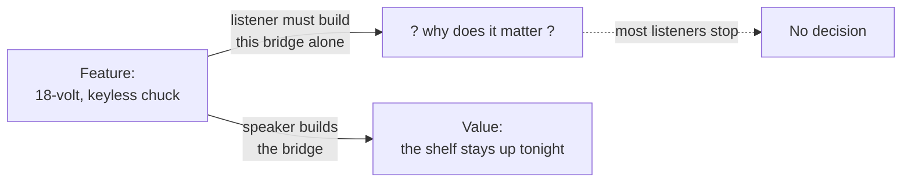

import Scenario from "../../../components/Scenario.astro";
import LevelIntro from "../../../components/LevelIntro.astro";
import PracticeCheck from "../../../components/PracticeCheck.astro";

export const unit = {
  track: "product-domain",
  unitSlug: "value-framing-over-feature-framing",
};

<Scenario label="The drill and the hole">
  <Fragment slot="facts">
    

      
🔧 <strong>Says what it is</strong> — "an 18-volt drill with a keyless chuck"

      
🕳️ <strong>Says what it does for you</strong> — "a hole in the wall, so the shelf holds your books by tonight"

      
🙋 <strong>Listener's reaction</strong> — a blank look for the first, a nod for the second

    

  </Fragment>

Someone wants to hang a shelf and walks into a hardware store. One clerk
says: "This is an 18-volt drill with a keyless chuck." Another says:
"This makes the hole in the wall so your shelf stays up with all your
books on it." Both are describing the same tool. **Why does only the
second answer help the person decide?**

The first answer says what the tool _is_. The second says what the tool
_does for this person_ — in words they already understood before they
walked in. Nobody needs to know what a "keyless chuck" is to want a
shelf that stays up.

</Scenario>

<LevelIntro
  items={[
    "Feature versus value, defined",
    "The translation gap a listener has to cross",
    "What L2 and L3 work through next",
  ]}
/>

## What is the difference between a feature and value?

**If both answers are true, what exactly separates them?** One states a
fact about the product. The other states what that fact changes for the
listener.

| Kind        | What it is                                                         | Drill example                | True for everyone? |
| ----------- | ------------------------------------------------------------------ | ---------------------------- | ------------------ |
| **Feature** | A fact about the product: what it has, how it works, its size      | "18-volt, keyless chuck"     | Yes                |
| **Value**   | What that fact changes for one listener, in terms they already use | "The shelf stays up tonight" | Only for this need |

- A feature stays the same whoever is listening. Value depends on who is
  listening and what they are trying to get done.
- A short test: if the sentence is still just as true when nobody is
  listening, it is probably a feature. If it only makes sense once you
  know the listener's goal, it is value.
- "This backpack has padded straps" is a feature. "Your shoulders hurt
  less on the walk home" is value.

<PracticeCheck
  track={unit.track}
  unitSlug={unit.unitSlug}
  topicId="feature-vs-value"
/>

## Why does stating a feature leave the listener stuck?

**Suppose the listener is smart and willing. Why don't they just work out
why the feature matters?** Because working it out needs background they
do not have yet, and that is usually why they are asking.

- **Translation gap** — the mental work a listener must do to get from a
  product fact to a reason to care. Here "translation" does not mean
  another language; it means turning a technical fact into something
  they can use.
- A wide gap means most listeners stop before crossing it. Value framing
  means the speaker crosses the gap on the listener's behalf.
- The same idea in a workplace pitch: "activated carbon filter" is a
  feature; "tap water that tastes like bottled water" is value. L2 and L3
  use that water-filter pitcher as the running example, with real
  arithmetic.

<PracticeCheck
  track={unit.track}
  unitSlug={unit.unitSlug}
  topicId="translation-gap"
/>

## Key terms

- **Feature** — a factual property of a product.
- **Value** — the outcome a feature produces for a specific listener,
  stated in terms they already care about (money, time, comfort, risk,
  effort).
- **Translation gap** — the work between a feature and a reason to care.
- **Pitch** — a short explanation meant to make someone care enough to
  keep listening or act.

## What this unit covers

L2 gives a repeatable method for finding the value under a feature and
explains why experts skip it. L3 writes the same water-filter pitch twice
with the cost arithmetic worked out, and tests where value framing stops
being the right move.
