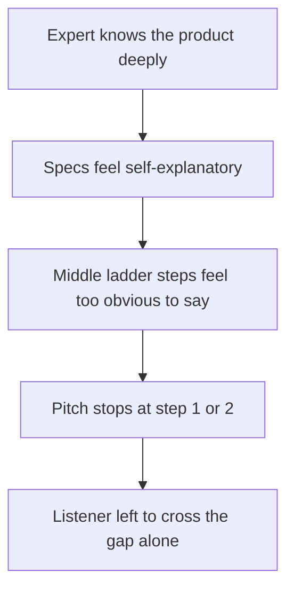

import LevelIntro from "../../../components/LevelIntro.astro";
import Checkpoint from "../../../components/Checkpoint.astro";
import PracticeCheck from "../../../components/PracticeCheck.astro";

export const unit = {
  track: "product-domain",
  unitSlug: "value-framing-over-feature-framing",
};

L1 named the translation gap, the work a listener has to do to get from a
product fact to a reason to care, without showing how to close it. L2
gives the method for closing it, and the bias that makes most speakers
skip it.

<LevelIntro
  items={[
    'The "so what" ladder, step by step',
    "The curse of knowledge behind skipped steps",
    "Why the same ladder fits unrelated products",
  ]}
/>

## How do you find the value underneath a feature?

**A feature is true, but it does not announce its own value. Where does
the value come from?** From asking one question again and again: "so what
does that mean for the listener?" Stop when the answer is no longer a fact
about the product and has become something the listener already cares
about.

| Step         | Statement                                                               | Still a feature?                                   |
| ------------ | ----------------------------------------------------------------------- | -------------------------------------------------- |
| 1            | "It has an activated carbon filter."                                    | Yes, a spec                                        |
| 2 (so what?) | "The filter removes chlorine and sediment from tap water."              | Yes, still about the product                       |
| 3 (so what?) | "The water no longer tastes like chlorine."                             | Closer, a sensory outcome                          |
| 4 (so what?) | "It tastes close to bottled water."                                     | Closer, compared to something familiar             |
| 5 (so what?) | "You can stop buying bottled water, about $1,028.50 saved in year one." | **Value**: money, a term the listener already uses |

Nothing was invented on the way up. Each step is true; what changed is
which fact gets said out loud. A reusable shape is **it has X, that causes
Y, so you get Z**: X is the feature, Y the bridge, Z the value. If Z still
sounds like product vocabulary, ask "so what?" once more.

<Checkpoint question="A bicycle helmet pitch says: 'It has a multi-density foam liner and rotational-impact protection.' On the ladder, is that already value?">

No, it is still step 1. Both phrases describe what the helmet contains, not
what happens to the person wearing it. Climbing means asking what that foam
actually does in a fall, until the answer reads something like "it cushions
your head if you fall off". That is stated in terms of the listener's own
body. Naming two specs instead of one does not move a pitch up the ladder.

</Checkpoint>

<PracticeCheck
  track={unit.track}
  unitSlug={unit.unitSlug}
  topicId="so-what-ladder"
/>

## Why do experts stop at step 1 or 2?

**If the top of the ladder persuades so much better, why does anyone stop
low?** Because the people who know a product best are the worst placed to
notice the gap.

The **curse of knowledge** is the bias where, once you know something, it
is hard to imagine not knowing it, so you underestimate how much
explanation someone else needs. A school version: after you can divide
fractions, you forget that a classmate may still need every step written
out. Specs feel obvious to the people who live with them, so they skip the
middle steps.

The fix is not to know less. It is to climb the ladder on purpose every
time, instead of trusting the listener to climb it alone.

<Checkpoint question="A speaker says: 'Our service has 99.9% uptime.' Is that value, or a well-dressed feature?">

A well-dressed feature. The percentage is a statement about the product,
and the listener must still work out what it means for them. Someone close
to the metric already knows, which is exactly the curse of knowledge. One
more climb: 0.1% of a year's 8,760 hours is about 8.8 hours, so the value
version is "your customers can expect the service to be unavailable for
less than nine hours in a whole year". That is time, which the listener
already understands.

</Checkpoint>

<PracticeCheck
  track={unit.track}
  unitSlug={unit.unitSlug}
  topicId="curse-of-knowledge"
/>

## Does the same ladder work for other products?

**Is this a water-filter trick, or a general method?** General, because
"so what does that mean for the listener?" does not depend on the product.

| Product        | Feature (step 1)                      | Value (top of the ladder)                              |
| -------------- | ------------------------------------- | ------------------------------------------------------ |
| Bicycle helmet | "Multi-density foam liner"            | "Cushions your head if you fall"                       |
| Umbrella       | "Fiberglass ribs, tight-woven fabric" | "Does not flip inside out in a gust"                   |
| Standing desk  | "Dual-motor lift mechanism"           | "Switch between sitting and standing without stopping" |

You do not need to know what the foam or the fabric is for the table to
work. That is the point: the value side saves the listener from needing
that background first.

## Failure modes at this level

- **Assuming the listener will climb alone.** Most will not, because they
  lack the background to know which features matter.
- **Climbing past what is true.** "Saves $1,028.50 in year one" only holds
  if the listener really buys bottled water at the assumed rate. Value
  framing must stay accurate, not only persuasive.
- **Value language that is a feature in disguise.** "Improves hydration
  compliance metrics" sounds like value but needs its own translation.

<PracticeCheck
  track={unit.track}
  unitSlug={unit.unitSlug}
  topicId="value-language-traps"
/>
